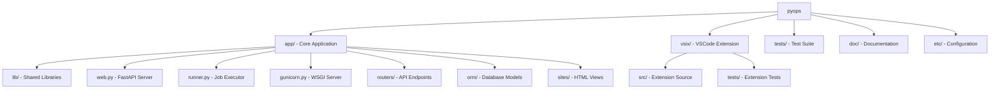
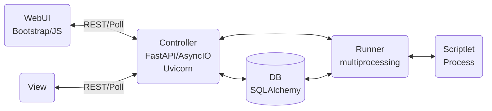
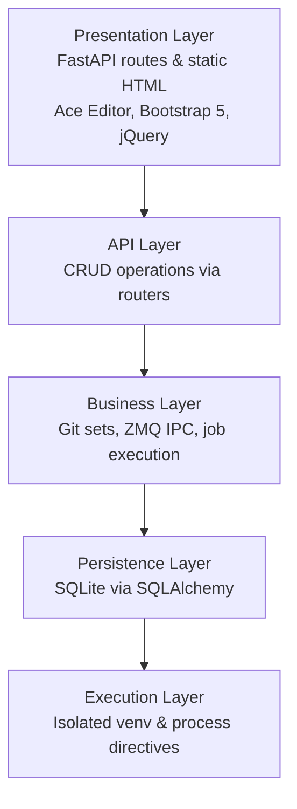
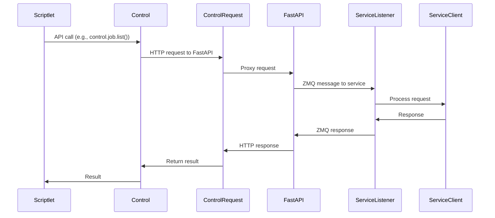
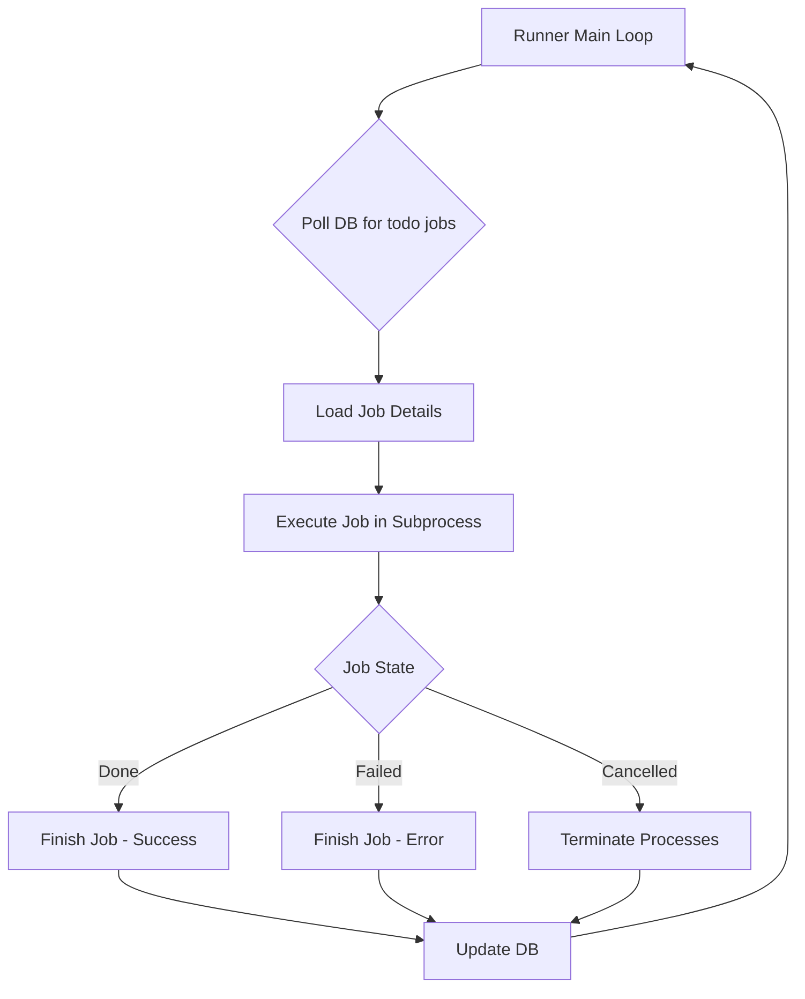
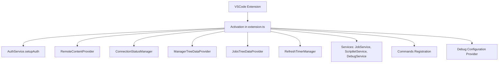

# Python App

## Overview

PyOps is an "Execution Platform" for "Python Operations Scriptlets". It is licensed under GNU AGPLv3 and organized as a monorepo with core functionality in `app/`, a VSCode extension in `vsix/`, tests in `tests/`, and documentation in `doc/`.

### Monorepo Structure

The project is structured as follows:

#### App Directory Structure

- `app/web.py`: Main FastAPI application server
- `app/runner.py`: Background job execution daemon
- `app/gunicorn.py`: WSGI server configuration
- `app/routers/scriptlet/`: REST API endpoints for scriptlet operations
- `app/orm/`: Database models for Job and Schedule
- `app/sites/scriptlet/`: HTML views for the web interface

#### Lib Directory

- `app/lib/git.py`: Git operations for scriptlet management
- `app/lib/pyops.py`: IPC and control classes
- `app/lib/files.py`: Configuration management
- `app/lib/sets.py`: Git repository set management
- `app/lib/sites.py`: Site rendering utilities
- `app/lib/async_utils.py`: Asynchronous utilities
- `app/lib/auth.py`: Authentication utilities
- `app/lib/runner.py`: Runner utilities

## Architecture

### High-Level System Architecture

### Layers

The architecture is layered as follows:

### Layers

- **Presentation Layer**: FastAPI routes and static HTML with Ace Editor, Bootstrap 5, jQuery
- **API Layer**: CRUD operations via scriptlet routers
- **Business Layer**: Git sets, ZMQ IPC, job execution
- **Persistence Layer**: SQLite via SQLAlchemy
- **Execution Layer**: Isolated venv and process directives

### Technology Stack

- **Backend**: Python 3.12, FastAPI, SQLAlchemy 2.x, ZMQ, msgpack
- **Database**: SQLite (thread-safe)
- **Frontend**: Bootstrap 5, jQuery 3.6, Ace Editor, Material Icons

## Core Components

### Runner (`app/runner.py`)
- Daemon that polls DB for todo jobs
- Executes scriptlets in workspaces `data/jobs/{owner}/{set}/{id}/`
- Handles job states: todo, dequeued, running, done, failed, cancelled, remove

### Web (`app/web.py`)
- Serves /controller/{set}/{name}, /menu, and static /files/

### PyOps (`app/lib/pyops.py`)
- Provides `Control` for API calls
- Provides `ServiceListener` for services

## Configuration

`app/lib/files.py` defines the Config class for managing `etc/pyops.json`.

### JSON Structure

- `web`: `{"bind": "127.0.0.1:8000", "worker": 4, "timeout": 300}`
- `data`: `{"jobs": "data/jobs", "git": "data/git", "db": "data/app.db"}`
- `runner`: `{"venv": "data/venv", "pkg": "data/pkg", "git_pull_interval": 60, "drop_done_delay_seconds": 60}`
- `log`: `{"loglevel": "debug"}`
- `users`: `{"anonymous": {"debug_port": 15678}}`

### Access Methods

- `conf_data()`: Returns web, data, log sections
- `conf_runner()`: Returns runner-specific config
- `get(path)`: Serves static files
- `conf_log()`: Provides log config with file handlers
- `conf_users()`: Provides users section

### Features

- Supports dynamic reload on change
- Defaults: web bind "0.0.0.0:80", jobs "data/jobs", no SSL
- No built-in auth; proxy recommended
- Log levels: debug, info, etc.

## Core Functionality

### Git Operations

`app/lib/git.py` manages scriptlet code in Git sets with serialized access via `repo_lock()`.

#### Operations

- `read_content()`: Reads file content (committed or debug)
- `write_content()`: Writes and stages changes
- `perform_git_add_commit_push()`: Commits and pushes changes
- `batch_commit()`: Batch operations
- `delete_file_and_commit()`: Removes and commits
- `get_repo_status()`: Returns git status
- `has_unstaged_changes()`: Checks for drafts
- `rollback_staged/committed()`: Reverts changes

#### Set-Scriptlet Management

- `get_repo_path(set)`: Returns `data/git/{set}/`
- `list_scriptlets()`: Lists `{name}.{type}.py/html` from sets
- `infer_type_from_filename()`: Derives type from filename
- `check_name_unique()`: Prevents duplicates

#### Global Attributes

- Sets are Git repos in `data/git/{set}/`
- Scriptlets: `{name}.task.py`, `{name}.service.py`, etc.
- Pull syncs at interval; skips dirty/tag, soft reset clean
- Unique lock per set prevents concurrent access
- Commit-push checks remotes; skip if no remote

### ZMQ Control

`app/lib/pyops.py` provides IPC via ZMQ for scriptlets with HTTP proxy to FastAPI.

#### IPC Flow

#### Controls

- **JobControl**: `list()`, `create()`, `get()`, `delete()`, `cancel()`, `download()`
- **ScheduleControl**: `list()`, `create()`, `get()`, `delete()`, `activate()`, `deactivate()`

#### Service Components

- **ServiceListener**: Listens for messages, handles TERM signals
- **ServiceClient**: Connects to running services
- **Control Class**: Wraps controls, proxies to `/controller/{set}/{name}/q`

#### Global Attributes

- Available in scriptlet global namespace
- Message format: `{"type": "GET/POST", "path": str, "cmd": query, "data": body, "data_type": "json/text/binary/none"}`
- Uses msgpack for serialization
- Listener poll uses zmq.Poller with timeout=0

### Sets Management

`app/lib/sets.py` handles Git repositories.

#### Operations

- `list_sets()`: Lists available sets
- `clone_set()`: Clones remote to `data/git/{name}/` with .gitignore & README
- `remove_set()`: Deletes directory
- `switch_branch()`: Checks out branch

#### Global Attributes

- Sets group scriptlets in Git repos
- Managed via /scriptlet/sets UI or API
- VSIX supports clone/switch/remove via trees
- Locking prevents conflicts
- Auto-sync via pull_if_needed()

### ORM Models

`app/orm/` uses SQLAlchemy Base.

#### Database

- `database.py`: `get_db_path()`, `init_db()`, `get_db_engine()`, `destroy_db()`
- SQLite file-based DB, thread-safe WAL mode

#### Models

- **Job**: Tracks id, owner, set, name, kind, state, drop_done, max_retries, param, pid, debugpy_pid, detail, overrides, start, end
- **Schedule**: Tracks id, schedule, set, name, owner, active, drop_done, max_retries, param, last

#### Global Attributes

- DB in data/ sqlite
- init_db() creates tables on startup
- Runner polls Jobs todo & Schedules cron
- Job states: todo, dequeued, running, done, failed, cancelled, remove, removed
- Schedule active/drop_done indexed

## Execution

### Runner Daemon

`app/runner.py` implements background job executor with GracefulKiller for signals.

#### Main Loop

#### Job Execution

- `loadJob()`: Fetches from DB, returns owner, set, name, kind, param, code, overrides
- `run()`: Processes param, libs, code in subprocess with venv activation
- Handles directives: pip packages, git repos, libraries
- For debug: uses unstaged code (preview) or overrides (VSIX)
- Compiles with custom filenames for accurate stacktraces
- `finishJob()`: Sets state, end, detail, pid=None

#### Directive Processing

- `process_imports()`: Handles pip, git, library directives
- Installs pip -q, clones git repos to pkg/, pip installs -e, exec libs
- Uses committed code for libs
- `process_install_lines()`: Executes installs

#### Directive Logic

Distinguishes types by argument:
- git: contains '://' or starts with 'git@'
- pip: plain string not starting with '{' and not containing '::'
- library: starts with '{' or contains '::'

#### Post-Termination

- `postTerm()`: Updates state to cancelled if not done/failed, deletes if remove
- `terminate_job_processes()`: Kills full process tree with SIGTERM then SIGKILL

#### Scheduling

- `schedule()`: Enqueues from cron Schedules via croniter

#### Global Attributes

- Spawns isolated processes per job
- Workspaces: `data/jobs/{owner}/{set}/{id}/`
- States: todo, dequeued, running, done, failed, cancelled, remove
- Supports debug mode & drop_done cleanup
- GracefulKiller handles SIGTERM/SIGINT

### Debug Implementation

#### Debug Kind

Runner treats debug kind specially for web preview/VSIX.

- Web: no overrides, unstaged main code, committed libs
- VSIX: overrides for local code
- Injects debugpy.listen(('0.0.0.0', port)) always, +wait_for_client() if '#>AWAIT_DEBUG' in param
- Requires user debug_port
- Kills previous debug job for owner

#### Config Extension

- `files.py` adds `conf_users()` for "users" {}
- `pyops.json` example: `{"users": {"anonymous": {"debug_port": 5678}}}`

#### Enqueue Logic

- `enqueue()` handles debug, kills existing running/dequeued for owner
- Creates new todo

#### Validation

- `validate_debug_prerequisites()` checks port
- Fails job if invalid

#### Execution

- Injects debugpy as first lib, compiles debug_bridge.py with listen and wait_for_client
- Auto-installs debugpy if not present
- Keeps listener/glob/logging

#### Overrides

- VSIX `buildOverrides()` walks local pyops/set/*.py
- Runner `run()` applies overrides to code/libs if matching {set}::{name}
- Enables local code in debug jobs

#### Tests

- Unit tests for enqueue, validate, inject
- Integration tests for full execution

#### Global Attributes

- Debug enables VSCode attach to localhost:{port}
- Allows second job by killing previous
- Overrides enable custom code injection

## Web Interface

### FastAPI App

`app/web.py` creates FastAPI application mounting routers and static files.

#### Root Routes

- `root()`: Serves root.html
- `favicon()`: Serves favicon.ico
- `file(path)`: Serves static /files/{path}

#### Controller Proxy

- `controller(set, name)`: Renders UI via `get_controller_code` & `get_view_content`
- Injects {{SET}} {{NAME}} in views
- `controller_proxy()`: Handles HTTP methods to /controller/{set}/{name}/{rest:path}
- Sends ZMQ msg to service with type, path, query, body, data_type
- `menu()`: Lists controllers from Git

#### View Rendering

- `get_controller_code()`: Reads controller.py
- `get_view_content()`: Reads html views (head, menu, body)
- Dynamic UI with Bootstrap, Ace, jQuery
- Supports light/dark theme

#### Global Attributes

- Async routes
- Controllers proxy to services via ZMQ
- Views use Ace for python/json/html modes

### Scriptlet Routers

`app/routers/scriptlet/` submounts to /scriptlet/.

#### Job Routers

- `job.py`: Manages job lifecycle
  - Enqueues jobs with kind ("task", "service", "debug")
  - For debug, accepts overrides
  - Delete allows todo/cancelled/killed/failed/done states
- `manager.py`: UI for bulk ops

#### Monitor-Scheduler

- `monitor.py`: Lists jobs/schedules by state
- `schedule.py`: CRUD schedules
- `scheduler.py`: Activates cron triggers
- `sets.py`: Manages Git sets

#### Editor

- `editor.py`: Code editing & Jedi completion
- Supports task/md/view/library with Ace & preview

#### Global Attributes

- FastAPI APIRouter
- X-User header for owner (default anonymous)
- Endpoints: /scriptlet/job/item POST, etc.
- Integrates git.py for read/write
- UI: manager.html, monitor.html, scheduler.html, sets.html

### Sites

`app/sites/` serves HTML views:
- `root/`: Main application page (root.html)
- `scriptlet/`: Scriptlet management interfaces

## Testing

`tests/` uses pytest with >90% coverage.

### Structure

- `conftest.py`: Fixtures mock_conf, mock_db, mock_client, mock_git_dir, mock_git_ops, etc.
- unit/lib/: Tests lib_files, lib_git, lib_pyops, lib_runner_utils, lib_sets, lib_sites
- unit/orm/: Tests job, schedule
- integration/: Tests git, orm, routers, runner execution
- api/: Tests api_editor, api_endpoints, api_job, api_schedule, api_sets

### Fixtures-Mocks

- `mock_db`: Temp SQLite
- `mock_git_dir`: Mock sets/scriptlets
- `mock_git_ops`: Overrides list_scriptlets, read/write
- `mock_process`: Subprocess mock
- `mock_croniter`, `mock_jedi`, `mock_datetime`
- Overrides for controller_code, view_content, file_path

### Global Attributes

- Runtime in `.cache/`
- No autouse fixtures
- conftest.py custom_showwarning, pytest_configure
- Integration tests prefix routers/, lib/, runner/

## Key Features

- Scriptlets support types: task, library, controller, view, markdown
- Support directives for pip packages, git repos, libraries
- Scheduling via croniter
- Monitoring and bulk operations
- VSIX trees for manager and jobs

## Deployment

### Development Server

`run.sh` starts development server using Gunicorn and Uvicorn

### Docker Support

Containerized deployment with Nginx reverse proxy

### Global Attributes

- **PyOps**: "IT Infrastructure Python Leveraging Tool"
- **Web**: Mounts routers & static files
- **Jobs**: States tracked with PID & logs
- **Services**: Use listener.listen() or poll()
- **Config**: Loads from etc/pyops.json
- **Tests**: Store runtime in .cache/
- **VSIX Tests**: VSIX tests use Mocha with >80% coverage
- **VSIX**: Provides pyops-manager & pyops-monitor trees

## Additional Features

### Job Max Retries

Job & Schedule models add max_retries Column(Integer, default=0, nullable=False).

#### Runner Retries

- `execute_job_code()` accepts max_retries: int = 0
- For task kind: attempt up to max_retries + 1 times
- On error: if attempt < max_retries, log warning, sleep 60s, retry
- Else: set failed with traceback

#### JobControl.create

Adds max_retries: int = 0 to sig, json adds "max_retries": max_retries.

#### UI Scheduler

- `scheduler.html` createModal adds #createModal-maxRetries input type=number min=0 value=0 after drop_done
- `clearCreateModal` val("0")
- `onCreate` parseInt || 0 sends PUT /scriptlet/schedule/item

### Runner Execution Details

The runner spawns isolated subprocesses per job in `data/jobs/{owner}/{set}/{id}/` workspaces. It executes `job.param` as Python code via `exec(compiled_param, glob)`. For task jobs, it retries up to `max_retries + 1` times on error, sleeping 60s between retries, then sets state to `'failed'` with traceback.

### Debugpy Config

- debugpy.listen binds ('0.0.0.0', port) intentionally for Docker remote debugging (VSCode on host to container port-forward)
- Never change debugpy.listen host/port binding without explicit user instruction

### Debug Port Endpoint

- app/web.py GET /debug/port uses sanitize_owner(X-User default "anonymous") & files.conf_users()[owner]["debug_port"]
- Returns {"port": int(port)}
- 400 "No debug_port configured for user '{owner}'" if missing.

### Tests Debug Port

tests/api/test_api_endpoints.py::test_debug_port mocks conf_users anonymous/testuser/missing -> 200/400.

## VSIX Extension

### Overview

The `vsix/` directory contains the VSCode extension for PyOps, providing a graphical interface for managing scriptlets and jobs.

### Architecture

### Core Components

- **`src/extension.ts`**: Main activation file that sets up the extension context and registers all providers and services.
- **`src/jobsTreeProvider.ts`**: Provides the `JobsTreeDataProvider` for displaying job states in the tree view.
- **`src/managerTreeProvider.ts`**: Provides the `ManagerTreeDataProvider` for managing scriptlets.
- **`src/utils.ts`**: Contains shared utility functions like `inferExt` and `hasValidConfig`.
- **`src/commands/CreateScriptletCommand.ts`**: Handles the logic for creating new scriptlets.

### Configuration

VSCode workspace settings set serverUrl, username, password (state), localPyopsDir, and autoRefreshInterval. Auth is optional (Basic if username/password set).

### Functionality

#### Auth Service

`src/services/AuthService.ts` handles authentication setup for Basic Auth:

- Prompts for password if username is configured but no password is stored.
- Stores password securely in workspace state.
- Unit tests in `tests/services/AuthService.test.ts`.

#### Refresh Timer Manager

`src/services/RefreshTimerManager.ts` manages auto-refresh timers for manager/jobs tree providers:

- Starts/stops timers based on config validity.
- Prevents duplicate timers.
- Unit tests in `tests/services/RefreshTimerManager.test.ts`.

#### Tree Providers

- **ManagerTreeDataProvider** fetches scriptlets via API, downloads to local `.pyops/{set}/`, supports create/upload/save/diff/reset/delete/debug, has unit tests in `tests/managerTreeProvider.test.ts`.
- **JobsTreeDataProvider** lists jobs by state, supports bulk cancel/delete & refresh.

#### Content Provider

RemoteContentProvider serves remote files; onDidChange events.

#### Services

- JobService, ScriptletService, DebugService, etc.

#### Commands

- Registration and execution.

### Testing

#### VSIX Tests

- **Unit tests** in `tests/` use Jest with mocked vscode APIs & API client.
- **Integration tests** in `tests/integration/` use @vscode/test-electron for real VS Code environment with simple assert-based testing.
- Integration tests run against separately started localhost PyOps development server without authentication.
- PyOps server must be started externally before running integration tests (not managed by test framework).
- Run unit tests with `npm run test` or `npm run test:coverage`.
- Run integration tests with `npm run test:integration` (requires running local development PyOps server on localhost:8000).
- Integration tests excluded from CI/CD since VS Code not available.
- Infrastructure set up with simple console-based test runner that works in VS Code extension host.
- Tests verify extension activation, configuration (server URL only), views, and command registration.
- No authentication testing in integration tests (development server runs without auth).

#### Service Tests

- **JobService.test.ts**: Tests CRUD operations, bulk cancel/delete, viewJob polling with stdout/stderr updates and state transitions (done/failed/cancelled/remove/404), error handling for all async methods, handling of undefined provider, and timer cleanup.
- **ScriptletService.test.ts**: Tests local/remote sync operations, network error handling, filesystem branch tests (existsSync conditions), and multi-step error scenarios.
- **DebugService.test.ts**: Tests buildOverrides and enqueueDebugJob functionality.
- **DebugOutputMonitor.test.ts**: Tests start/stop monitoring and polling, including incremental stdout/stderr append, channel display, stopping on job completion states (done/failed/cancelled/remove/404), and fetching error logs.
- **RefreshTimerManager.test.ts**: Tests ensureRunning and stopIfRunning methods.
- **AuthService.test.ts**: Tests setupAuth for prompts and storage.
- **PyOpsPythonDebugConfigProvider.test.ts**: Tests configuration provision.

#### Provider Tests

- **managerTreeProvider.test.ts**: Tests getTreeItem/Children API fetch/download, error handling for fetchScriptlets/downloadScriptlets, and refresh graceful failure.
- **jobsTreeProvider.test.ts**: Tests job states and bulk operations.
- **RemoteContentProvider.test.ts**: Tests provideTextDocumentContent, registerRemoteLanguageModeSetter conditional logic, missing language mappings, and event emitter access.

#### Utility Tests

- **utils.test.ts**: Tests `inferExt` for all switch cases including unknown types, and `hasValidConfig` for false paths (empty/undefined/null serverUrl).

#### Other Tests

- **apiClient.test.ts**: Tests API calls with authentication.
- **ConnectionStatusManager.test.ts**: Tests status bar updates.
- **CreateScriptletCommand.test.ts**: Tests command execution.

#### Test Mocking

- Uses hoisted `jest.mock('../src/services/*')` with mockImplementation for instances/methods.
- Dynamic require for overrides.
- VSCode mocks: `window.createOutputChannel`, `workspace.getConfiguration`, etc.
- `global.fetch` for API calls, `fs`/`path` mocks for filesystem operations.

#### Integration Tests

- VSIX Integration Monitor
- VSIX Integration Manager
- VSIX-Integration-Commands

### Key Features

- Trees: pyops-manager (sets/scriptlets), pyops-monitor (jobs).
- Actions: enqueue debug download view.
- Checks hasValidConfig() for serverUrl only.
- Status bar shows connection.
- Integrates Cline for code gen.

### Global Attributes

- Tests use `beforeAll` for shared activate/setup; `beforeEach(jest.clearAllMocks())`.
- No autouse fixtures; isolation via mocks/clear.
- Run tests with: `npm run test --prefix vsix/`.
- Focus on error paths, edge cases, and complex conditional logic for branch coverage.

### Additional Features

#### Debug Features

- DebugService: `src/services/DebugService.ts` provides buildOverrides (recursive FS walk local pyops/set/*.py) & enqueueDebugJob (API POST /job/item kind=debug)
- getDebugHost() parses hostname from pyops.serverUrl ; fallback localhost on invalid URL
- used by PyOpsPythonDebugConfigProvider & pyops.startDebugJob & pyops.attachDebugJob
- unit tests `tests/services/debugService.test.ts` >90% coverage.

#### Local-Only Support

- ManagerTreeProvider defines interface ScriptletInfo {set: string; name: string; type: string; isLocalOnly?: boolean}
- _scriptlets: ScriptletInfo[]; fetchScriptlets(): Promise<ScriptletInfo[]> /scriptlet/inventory/list
- scanLocalScriptlets(): Promise<ScriptletInfo[]> discovers pyops/{set}/{type}/*.{inferExt(type)} isLocalOnly:true
- refresh merges remote & localOnly; filters excludedSets; downloads remoteOnly sets _syncStatus.
- Local-only display: diff-added icon & contextValue pyopsItem-{type}-local & tooltip 'Local only - Set: {set}, Name: {name}, Type: {type}' & description .ext (local)
- Remote: check/warning syncStatus icon & contextValue pyopsItem-{type} & tooltip sync status.
- Local-only task scriptlets support pyops.startDebugJob & pyops.stopDebugJob context menus via package.json when /^pyopsItem-task(-local)?$/; sync commands resetLocalFromRemote/saveRemoteDraft/diffLocalRemote restricted excluding -local; writeLocalToRemoteDraft & deleteScriptlet available via /^pyopsItem-(task|service|library|controller|view|markdown)(-local)?$/; writeLocalToRemoteDraft auto-creates remote via PUT /inventory/item if 404 then POST /draft & handles network errors on check/create with specific try-catch showErrorMessages; integration test9 tests write on local-only -> auto-create + draft success.

#### Debug Integration

- Debug-Job-Enqueue-SkipCheck: `app/routers/scriptlet/job.py` PUT /scriptlet/job/item skips `git.read_content` existence check for `kind=="debug"` if `overrides[f"{ru.set}::{ru.name}"]` exists - Enables VSIX local-only debug jobs without requiring remote scriptlet file.
- Runner-LoadJob-SkipCheck: `app/runner.py` loadJob skips `os.listdir/files_list` existence check for `kind=="debug"` if `job.overrides` valid JSON & `f"{job.set}::{job.name}" in parsed dict - Sets `code = override_dict[main_key]` - Fallback git.read_content if no main override or invalid JSON (logs warning) - `committed=False` for debug fallback - Enables full local-only debug lifecycle (enqueue->dequeue->load->run).
- Debug-Await-Directive: Runner.run_debug_job checks '#>AWAIT_DEBUG' in job.param - Injects debugpy bridge with listen(('0.0.0.0', port)) always - Appends wait_for_client() if directive present. - VSIX.DebugService.enqueuDebugJob sets param='#>AWAIT_DEBUG'. - Enables waiting for VSIX debugger attach; non-VSIX enqueues non-blocking by default. - Tests: tests/integration/runner/test_execution.py test_run_debug_inject (with directive); vsix/tests/services/debugService.test.ts.
- Debug-Port-Endpoint: app/web.py GET /debug/port uses sanitize_owner(X-User default "anonymous") & files.conf_users()[owner]["debug_port"] - Returns {"port": int(port)} - 400 "No debug_port configured for user '{owner}'" if missing.
- VSIX-Debug-Port-Fetch: DebugService.enqueueDebugJob fetches /debug/port first with auth headers if set - Logs [DEBUG getDebugPort] Success: {port} / Failed: {error} - Validates number & range(1,65536) throws "Invalid port" else - Returns port with jobId for vscode debug attach localhost:{port}.
- Tests-Debug-Port: tests/api/test_api_endpoints.py::test_debug_port mocks conf_users anonymous/testuser/missing -> 200/400. vsix/tests/services/debugService.test.ts mocks fetch /debug/port success/auth-noauth/job-fail/network/invalid-port/throw.
- VSIX-AttachDebug: VSIX adds "Attach Debug" title bar button in pyops-manager panel executes pyops.attachDebugJob command - Lists jobs via JobService.listJobs() filters kind="debug" state="running"|"dequeued" - Requires exactly one running debug job - Fetches port DebugService.getDebugPort() - Launches vscode.debug.startDebugging folder config=debugpy attach localhost:port justMyCode=false - Name=`Attach to PyOps Debug (${set||'unknown'}::${name||'unknown'})` - Logs "Attaching to job {id} ({set||?}::{name||?}) at port {port}" - Handles no/missing/multiple/port fail gracefully.
- JobService-listJobs: JobService adds public async listJobs(): Promise<Job[]> { return this.fetchJobs(); } - Enables pyops.attachDebugJob access.
- DebugService-getDebugPort: DebugService adds public async getDebugPort(): Promise<number> extracts `/debug/port` fetch/auth/logic - Refactors enqueueDebugJob to call it - Unit tests in debugService.test.ts success/throw-fetch-fail/invalid-port/no-auth.
- Global-AttachDebug: pyops.attachDebugJob enables reattach to detached VSIX PyOps debugpy sessions on running jobs without reenqueue or restart.

#### Build and Development

- Build Process Insights: TypeScript compilation requires strict output directory discipline. Compiled JavaScript files must only exist in `out/` directories. Any JS files in source directories indicate misconfiguration.
- Integration Test Compilation: Integration tests require a separate TypeScript configuration from the main extension. They cannot share the same `tsconfig.json` due to different include patterns and output requirements. The `rootDir` must exactly match the directory containing all source files being compiled. Include patterns must explicitly list both test suite files and utility files.
- Output Directory Management: Incorrect `rootDir` in `tsconfig.json` leads to nested or misplaced output directories. The `outDir` path must be calculated relative to `rootDir`, not the `tsconfig.json` location. Verify compilation output matches the expected structure before running tests.
- Test Architecture Access: Integration tests in the VS Code environment access extension services through global objects. Use `(global as any).serviceName` for service access, not direct TypeScript imports. Static methods are accessed via `serviceInstance.constructor.methodName` or the class name. Do not assume instance methods exist where only static methods are defined.
