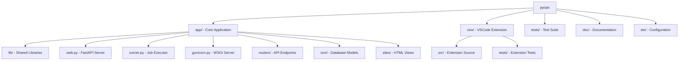
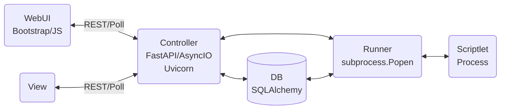
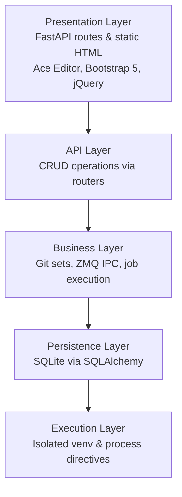
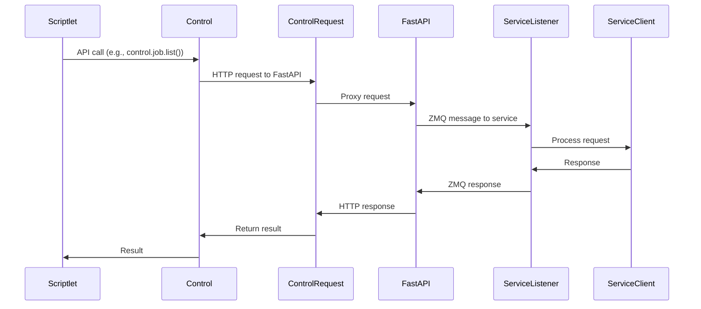
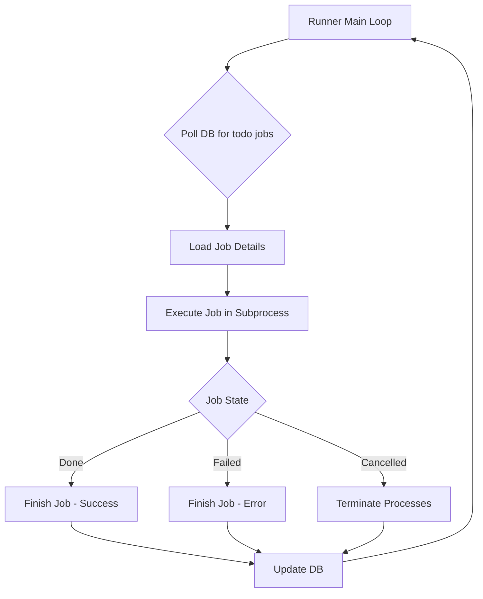
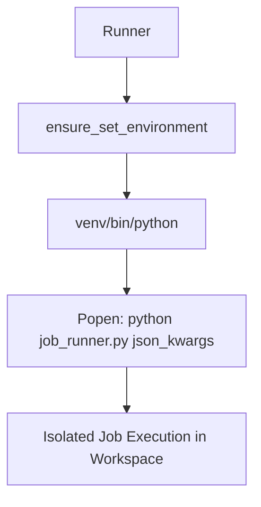
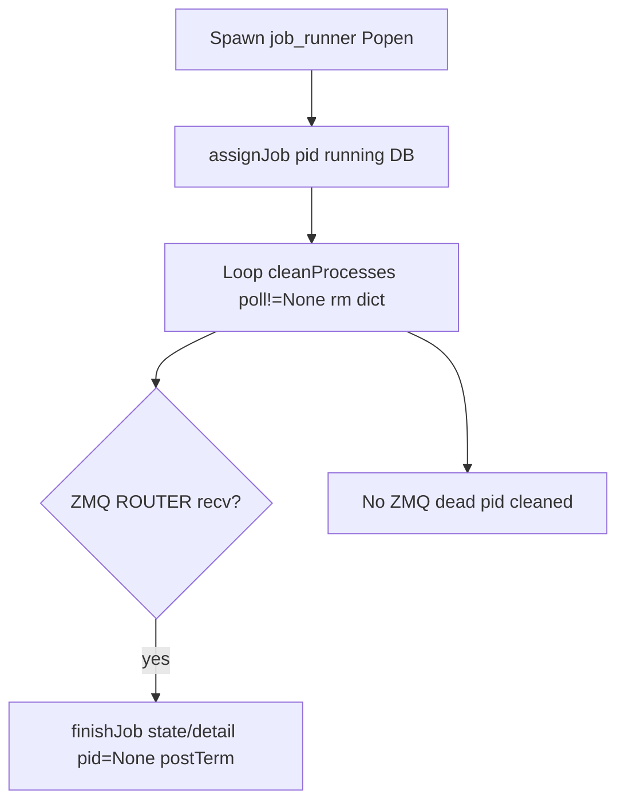
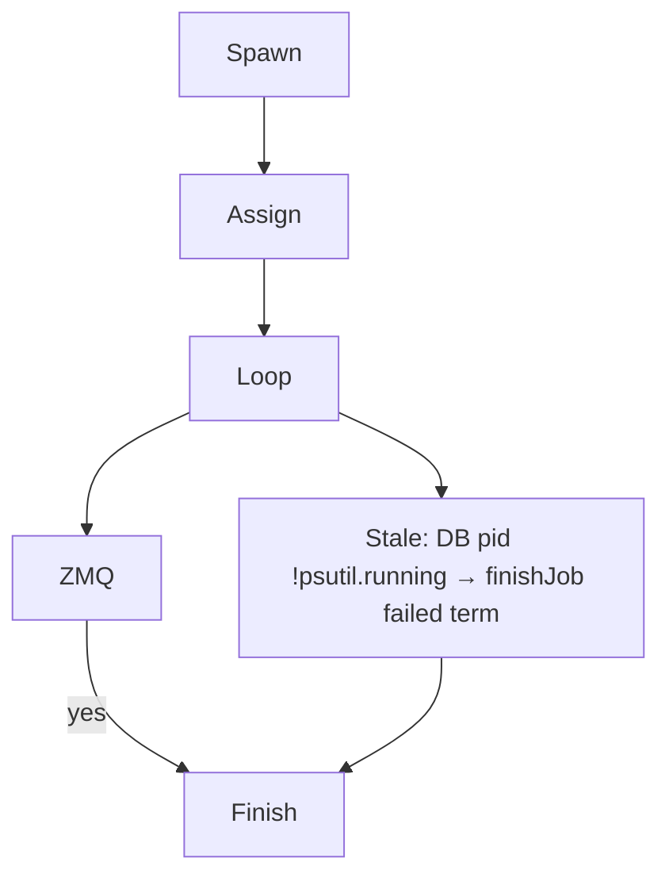

## PyOps

### Overview
PyOps is an "Execution Platform" for "Python Operations Scriptlets". It is licensed under GNU AGPLv3 and organized as a monorepo with core functionality in `app/`, a VSCode extension in `vsix/`, tests in `tests/`, and documentation in `doc/`.

### Monorepo Structure

The project is structured as follows:



#### App Directory Structure

- `app/web.py`: Main FastAPI application server
- `app/runner.py`: Background job execution daemon
- `app/gunicorn.py`: WSGI server configuration
- `app/routers/scriptlet/`: REST API endpoints for scriptlet operations
- `app/orm/`: Database models for Job and Schedule
- `app/sites/scriptlet/`: HTML views for the web interface

#### Lib Directory

- `app/lib/git.py`: Git operations for scriptlet management
- `app/lib/pyops.py`: IPC and control classes
- `app/lib/files.py`: Configuration management
- `app/lib/sets.py`: Git repository set management
- `app/lib/sites.py`: Site rendering utilities
- `app/lib/async_utils.py`: Asynchronous utilities
- `app/lib/auth.py`: Authentication utilities
- `app/lib/runner.py`: Runner utilities

## Architecture

### High-Level System Architecture



### Layers

The architecture is layered as follows:



### Layers

- **Presentation Layer**: FastAPI routes and static HTML with Ace Editor, Bootstrap 5, jQuery
- **API Layer**: CRUD operations via scriptlet routers
- **Business Layer**: Git sets, ZMQ IPC, job execution
- **Persistence Layer**: SQLite via SQLAlchemy
- **Execution Layer**: Isolated venv and process directives

### Technology Stack

- **Backend**: Python 3.12, FastAPI, SQLAlchemy 2.x, ZMQ, msgpack
- **Database**: SQLite (thread-safe)
- **Frontend**: Bootstrap 5, jQuery 3.6, Ace Editor, Material Icons

## Core Components

### Runner (`app/runner.py`)
- Daemon that polls DB for todo jobs
- Executes scriptlets in workspaces `data/jobs/{owner}/{set}/{id}/`
- Handles job states: todo, dequeued, running, done, failed, cancelled, remove

### Web (`app/web.py`)
- Serves /controller/{set}/{name}, /menu, and static /files/

### PyOps (`app/lib/pyops.py`)
- Provides `Control` for API calls
- Provides `ServiceListener` for services

## Configuration

`app/lib/files.py` defines the Config class for managing `etc/pyops.json`.

### JSON Structure

- `web`: `{"bind": "127.0.0.1:8000", "worker": 4, "timeout": 300}`
- `data`: `{"jobs": "data/jobs", "git": "data/git", "db": "data/app.db"}`
- `runner`: `{"venv": "data/venv", "pkg": "data/pkg", "git_pull_interval": 60, "drop_done_delay_seconds": 60}`
- `log`: `{"loglevel": "debug"}`
- `users`: `{"anonymous": {"debug_port": 15678}}`

### Access Methods

- `conf_data()`: Returns web, data, log sections
- `conf_runner()`: Returns runner-specific config
- `get(path)`: Serves static files
- `conf_log()`: Provides log config with file handlers
- `conf_users()`: Provides users section

### Features

- Supports dynamic reload on change
- Defaults: web bind "0.0.0.0:80", jobs "data/jobs", no SSL
- No built-in auth; proxy recommended
- Log levels: debug, info, etc.

## Core Functionality

### Git Operations

`app/lib/git.py` manages scriptlet code in Git sets with serialized access via `repo_lock()`.

#### Operations

- `read_content()`: Reads file content (committed or debug)
- `write_content()`: Writes and stages changes
- `perform_git_add_commit_push()`: Commits and pushes changes
- `batch_commit()`: Batch operations
- `delete_file_and_commit()`: Removes and commits
- `get_repo_status()`: Returns git status
- `has_unstaged_changes()`: Checks for drafts
- `rollback_staged/committed()`: Reverts changes

#### Set-Scriptlet Management

- `get_repo_path(set)`: Returns `data/git/{set}/`
- `list_scriptlets()`: Lists `{name}.{type}.py/html` from sets
- `infer_type_from_filename()`: Derives type from filename
- `check_name_unique()`: Prevents duplicates

#### Global Attributes

- Sets are Git repos in `data/git/{set}/`
- Scriptlets: `{name}.task.py`, `{name}.service.py`, etc.
- Pull syncs at interval; skips dirty/tag, soft reset clean
- Unique lock per set prevents concurrent access
- Commit-push checks remotes; skip if no remote

#### Status Caching
```mermaid
flowchart TD
    A[Refresh] --> B[/list: FS only]
    B --> C[Loop /status per scriptlet]
    C --> D[has_unstaged_changes]
    D --> E{Set cache hit?}
    E -->|Yes| F[Return cached]
    E -->|No| G[repo_lock]
    G --> H[git status --porcelain]
    H --> I[Parse unstaged]
    I --> J[Cache & return]
```

Global attributes: Cache serializes via lock; TTL refreshes on writes; matches existing logic.

### ZMQ Control

`app/lib/pyops.py` provides IPC via ZMQ for scriptlets with HTTP proxy to FastAPI.

#### IPC Flow



#### Controls

- **JobControl**: `list()`, `create()`, `get()`, `delete()`, `cancel()`, `download()`
- **ScheduleControl**: `list()`, `create()`, `get()`, `delete()`, `activate()`, `deactivate()`

#### Service Components

- **ServiceListener**: Listens for messages, handles TERM signals, supports both synchronous and asynchronous messaging
- **ServiceClient**: Connects to running services
- **Control Class**: Wraps controls, proxies to `/controller/{set}/{name}/q`

#### Global Attributes

- Available in scriptlet global namespace
- Message format: `{"type": "GET/POST", "path": str, "cmd": query, "data": body, "data_type": "json/text/binary/none"}`
- Uses msgpack for serialization
- Listener poll uses zmq.Poller with timeout=0
- Supports both synchronous (`listen()`, `poll()`, `response()`) and asynchronous (`async_poll()`, `async_response()`) messaging
- Asynchronous methods enable concurrent request handling

### Sets Management

`app/lib/sets.py` handles Git repositories.

#### Operations

- `list_sets()`: Lists available sets
- `clone_set()`: Clones remote to `data/git/{name}/` with .gitignore & README
- `remove_set()`: Deletes directory
- `switch_branch()`: Checks out branch

#### Global Attributes

- Sets group scriptlets in Git repos
- Managed via /scriptlet/sets UI or API
- VSIX supports clone/switch/remove via trees
- Locking prevents conflicts
- Auto-sync via pull_if_needed()

### ORM Models

`app/orm/` uses SQLAlchemy Base.

#### Database

- `database.py`: `get_db_path()`, `init_db()`, `get_db_engine()`, `destroy_db()`
- SQLite file-based DB, thread-safe WAL mode

#### Models

- **Job**: Tracks id, owner, set, name, kind, state, drop_done, max_retries, param, pid, debugpy_pid, detail, overrides, start, end
- **Schedule**: Tracks id, schedule, set, name, owner, active, drop_done, max_retries, param, last

#### Global Attributes

- DB in data/ sqlite
- init_db() creates tables on startup
- Runner polls Jobs todo & Schedules cron
- Job states: todo, dequeued, running, done, failed, cancelled, remove, removed
- Schedule active/drop_done indexed

## Execution

### Runner Daemon

`app/runner.py` implements background job executor with GracefulKiller for signals.

#### Main Loop



#### Job Execution

- `loadJob()`: Fetches from DB, returns owner, set, name, kind, param, code, overrides
- `run()`: Processes param, libs, code in subprocess with venv activation
- Handles directives: pip packages, git repos, libraries
- For debug: uses unstaged code (preview) or overrides (VSIX)
- Compiles with custom filenames for accurate stacktraces
- `finishJob()`: Sets state, end, detail, pid=None

#### Directive Processing

- `process_imports()`: Handles pip, git, library directives
- Installs pip -q, clones git repos to pkg/, pip installs -e, exec libs
- Uses committed code for libs
- `process_install_lines()`: Executes installs

#### Directive Logic

Distinguishes types by argument:
- git: contains '://' or starts with 'git@'
- pip: plain string not starting with '{' and not containing '::'
- library: starts with '{' or contains '::'

#### Post-Termination

- `postTerm()`: Updates state to cancelled if not done/failed, deletes if remove
- `terminate_job_processes()`: Kills full process tree with SIGTERM then SIGKILL

#### Scheduling

- `schedule()`: Enqueues from cron Schedules via croniter

#### Global Attributes

- Spawns isolated processes per job
- Workspaces: `data/jobs/{owner}/{set}/{id}/`
- States: todo, dequeued, running, done, failed, cancelled, remove
- Supports debug mode & drop_done cleanup
- GracefulKiller handles SIGTERM/SIGINT

## Subprocess Execution Isolation

- **Current Implementation**: Jobs executed via multiprocessing.Process in shared environment.
- **Updated**: subprocess.Popen with set-specific venv Python interpreter for per-set isolation.
- **Benefits**: Prevents package conflicts, ensures clean execution context.
- **CLI Invocation**: job_runner.py accepts JSON-serialized kwargs via command-line for complex arg passing.
- **Process Management**: Polling uses p.poll() is None (alive), termination via Popen.terminate() with psutil tree-kill.
- **ZMQ IPC**: Unchanged; works across subprocess boundaries.
- **Debug Handling**: Adapter checks and debugpy injection functional in venv context.
- **Testing**: Mocks updated to subprocess.Popen; maintains >90% coverage.

### Config Isolation via Kwargs
- Subprocesses consume JSON-serialized config dicts passed from runner, no file reads or module patching.
- Relative paths (e.g., "data/git") resolved with locally computed project_root.
- Functions refactored to accept conf dicts: run_*_job, setup_job_globals, terminate_debugpy_adapter.

### Call Flow
```mermaid
graph TD
    A[main] --> B[run_task_job(project_root, conf_data, conf_runner, conf_users)]
    B --> C[setup_job_globals(..., project_root, conf_data, conf_runner)]
    A --> D[run_debug_job(..., project_root, conf_data, conf_runner, conf_users)]
    D --> C
    D --> E[terminate_debugpy_adapter(conf_users, owner)]
```



## Runner IPC Mechanism

The runner uses ZMQ ROUTER/REQ over IPC sockets for reliable job completion signaling from child processes, replacing multiprocessing.Queue.

### IPC Pattern

- **Socket**: Runner binds ROUTER to `/tmp/pyops/runner.sock`; children connect REQ.
- **Message Format**: `{"id": str, "state": str, "detail": str|None}` (msgpack-packed).
- **Protocol**: Child sends REQ (single frame), runner receives multipart (identity + empty + packed), processes `finishJob`, replies empty REP (identity + empty + b'ack').
- **Guarantees**: REQ/REP ensures delivery; no message loss like Queue.
- **Polling**: Integrated in main loop with `zmq.Poller` timeout=0 for non-blocking.
- **Cleanup**: `setsockopt(zmq.LINGER, 0)`; close on shutdown.

### Runner Main Loop with ZMQ Polling

```mermaid
flowchart TD
    A[Main Loop Start] --> B{Poll DB for todo jobs?}
    B -->|Yes| C[Dequeue & Spawn Process<br/>(pass sock_path)]
    C --> D[Poll ZMQ Socket<br/>(timeout=0)]
    D --> E{Event?}
    E -->|Yes| F[Recv Multipart Msg<br/>(identity + empty + packed)]
    F --> G[Unpack msgpack<br/>Call finishJob]
    G --> H[Send REP<br/>(identity + empty + b'ack')]
    H --> I[Clean DB/Processes]
    E -->|No| I
    B -->|No| J[Schedule/Pull Git]
    J --> I
    I --> A
```

### Child Completion Signaling

```mermaid
sequenceDiagram
    participant Child as Job Process
    participant ZMQ as REQ Socket
    participant Parent as Runner ROUTER
    Child->>ZMQ: Context(); socket = REQ(); connect(ipc://runner.sock)
    Note over Child,ZMQ: Execute job code
    alt Success
        Child->>ZMQ: packb(msg); send(single frame)
        ZMQ->>Parent: Multipart: identity + empty + packed
        Parent->>ZMQ: Process finishJob; send REP: identity + empty + b'ack'
        ZMQ->>Child: Recv ACK
        Child->>Child: Close socket; exit
    else Failure
        Child->>ZMQ: packb(failed msg); send/recv (retry 3x)
        Note over Child: Log if no ACK
    end
```

## Runner Process Lifecycle

### Current
- `app/runner.py` main: spawn `job_runner.py` → `assignJob(pid, "running")` → loop `cleanProcesses` (poll!=None → remove `Popen` dict).
- Completion: ZMQ `ROUTER/REQ` → `receive_and_process` → `finishJob(state/detail, pid=None)` → `postTerm` (remove/cancelled).
- Startup: `handleOddJobs` dequeued/running → todo/failed.
- Debug: Post-spawn adapter poll (5s timeout → fail if no).



### Enhanced Stale PID Monitoring
- Post-`cleanProcesses`: Query DB `Job.pid` in former dict → `!psutil.Process(pid).is_running()` → `finishJob("failed", "process termination pid={pid}")`.
- Ensures DB sync for silent deaths (e.g., segv).

**Updated Diagram**:


### Debug Implementation

#### Debug Kind

Runner treats debug kind specially for web preview/VSIX.

- Web: no overrides, unstaged main code, committed libs
- VSIX: overrides for local code
- Injects debugpy.listen(('0.0.0.0', port)) always, +wait_for_client() if '#>AWAIT_DEBUG' in param
- Requires user debug_port
- Kills previous debug job for owner

#### Config Extension

- `files.py` adds `conf_users()` for "users" {}
- `pyops.json` example: `{"users": {"anonymous": {"debug_port": 5678}}}`

#### Enqueue Logic

- `enqueue()` handles debug, kills existing running/dequeued for owner
- Creates new todo

#### Validation

- `validate_debug_prerequisites()` checks port
- Fails job if invalid

#### Execution

- Injects debugpy as first lib, compiles debug_bridge.py with listen and wait_for_client
- Auto-installs debugpy if not present
- Keeps listener/glob/logging

#### Overrides

- VSIX `buildOverrides()` walks local pyops/set/*.py
- Runner `run()` applies overrides to code/libs if matching {set}::{name}
- Enables local code in debug jobs

#### Tests

- Unit tests for enqueue, validate, inject
- Integration tests for full execution

#### Global Attributes

- Debug enables VSCode attach to localhost:{port}
- Allows second job by killing previous
- Overrides enable custom code injection

## Web Interface

### FastAPI App

`app/web.py` creates FastAPI application mounting routers and static files.

#### Root Routes

- `root()`: Serves root.html
- `favicon()`: Serves favicon.ico
- `file(path)`: Serves static /files/{path}

#### Controller Proxy

- `controller(set, name)`: Renders UI via `get_controller_code` & `get_view_content`
- Injects {{SET}} {{NAME}} in views
- `controller_proxy()`: Handles HTTP methods to /controller/{set}/{name}/{rest:path}
- Sends ZMQ msg to service with type, path, query, body, data_type
- `menu()`: Lists controllers from Git

#### View Rendering

- `get_controller_code()`: Reads controller.py
- `get_view_content()`: Reads html views (head, menu, body)
- Dynamic UI with Bootstrap, Ace, jQuery
- Supports light/dark theme

#### Global Attributes

- Async routes
- Controllers proxy to services via ZMQ
- Views use Ace for python/json/html modes

### Scriptlet Routers

`app/routers/scriptlet/` submounts to /scriptlet/.

#### Job Routers

- `job.py`: Manages job lifecycle
  - Enqueues jobs with kind ("task", "service", "debug")
  - For debug, accepts overrides
  - Delete allows todo/cancelled/killed/failed/done states
- `manager.py`: UI for bulk ops

#### Monitor-Scheduler

- `monitor.py`: Lists jobs/schedules by state
- `schedule.py`: CRUD schedules
- `scheduler.py`: Activates cron triggers
- `sets.py`: Manages Git sets

#### Editor

- `editor.py`: Code editing & Jedi completion
- Supports task/md/view/library with Ace & preview

#### Global Attributes

- FastAPI APIRouter
- X-User header for owner (default anonymous)
- Endpoints: /scriptlet/job/item POST, etc.
- Integrates git.py for read/write
- UI: manager.html, monitor.html, scheduler.html, sets.html

### Sites

`app/sites/` serves HTML views:
- `root/`: Main application page (root.html)
- `scriptlet/`: Scriptlet management interfaces

## Testing

`tests/` uses pytest with >90% coverage.

### Structure

- `conftest.py`: Fixtures mock_conf, mock_db, mock_client, mock_git_dir, mock_git_ops, etc.
- unit/lib/: Tests lib_files, lib_git, lib_pyops, lib_runner_utils, lib_sets, lib_sites
- unit/orm/: Tests job, schedule
- integration/: Tests git, orm, routers, runner execution, zmq_integration
- api/: Tests api_editor, api_endpoints, api_job, api_schedule, api_sets

### Fixtures-Mocks

- `mock_db`: Temp SQLite
- `mock_git_dir`: Mock sets/scriptlets
- `mock_git_ops(mock_git_dir)`: Temp FS ops via `mock_git_dir.tmp_path / repo` (repo="data/git/{set}" → `tmp_path/data/git/{set}/{name}.{ext}`).
  - Covers `write_content`, `read_content`, `get_controller_code`, `get_view_content`, `delete_file_and_commit`.
  - **Pitfall**: `Path(repo)` creates **real** `./data/git/{set}/` files (e.g., "test_set" tests → pollution; conflicts `testset/test_task.py` pytest collection despite `norecursedirs=data`).
- `mock_popen`: Subprocess.Popen mock with pid, poll(), terminate(), wait()
- `mock_zmq`: ZMQ Context/Socket mock for REQ/REP simulation (msgpack-packed messages, 3 retries on ZMQError)
- `mock_croniter`, `mock_jedi`, `mock_datetime`
- Overrides for controller_code, view_content, file_path

### Global Attributes

- Runtime in `.cache/`
- No autouse fixtures
- conftest.py custom_showwarning, pytest_configure
- Integration tests prefix routers/, lib/, runner/

## Key Features

- Scriptlets support types: task, library, controller, view, markdown
- Support directives for pip packages, git repos, libraries
- Scheduling via croniter
- Monitoring and bulk operations
- VSIX trees for manager and jobs

## Deployment

### Development Server

`run.sh` starts development server using Gunicorn and Uvicorn

### Docker Support

Containerized deployment with Nginx reverse proxy

### Global Attributes

- **PyOps**: "IT Infrastructure Python Leveraging Tool"
- **Web**: Mounts routers & static files
- **Jobs**: States tracked with PID & logs
- **Services**: Use listener.listen() or poll()
- **Config**: Loads from etc/pyops.json
- **Tests**: Store runtime in .cache/
- **VSIX Tests**: VSIX tests use Mocha with >80% coverage
- **VSIX**: Provides pyops-manager & pyops-monitor trees

## Additional Features

### Job Max Retries

Job & Schedule models add max_retries Column(Integer, default=0, nullable=False).

#### Runner Retries

- `execute_job_code()` accepts max_retries: int = 0
- For task kind: attempt up to max_retries + 1 times
- On error: if attempt < max_retries, log warning, sleep 60s, retry
- Else: set failed with traceback

#### JobControl.create

Adds max_retries: int = 0 to sig, json adds "max_retries": max_retries.

#### UI Scheduler

- `scheduler.html` createModal adds #createModal-maxRetries input type=number min=0 value=0 after drop_done
- `clearCreateModal` val("0")
- `onCreate` parseInt || 0 sends PUT /scriptlet/schedule/item

### Runner Execution Details

The runner spawns isolated subprocesses per job in `data/jobs/{owner}/{set}/{id}/` workspaces. It executes `job.param` as Python code via `exec(compiled_param, glob)`. For task jobs, it retries up to `max_retries + 1` times on error, sleeping 60s between retries, then sets state to `'failed'` with traceback.

### Debugpy Config

- debugpy.listen binds ('0.0.0.0', port) intentionally for Docker remote debugging (VSCode on host to container port-forward)
- Never change debugpy.listen host/port binding without explicit user instruction

### Debug Port Endpoint

- app/web.py GET /debug/port uses sanitize_owner(X-User default "anonymous") & files.conf_users()[owner]["debug_port"]
- Returns {"port": int(port)}
- 400 "No debug_port configured for user '{owner}'" if missing.

### Tests Debug Port

tests/api/test_api_endpoints.py::test_debug_port mocks conf_users anonymous/testuser/missing -> 200/400.