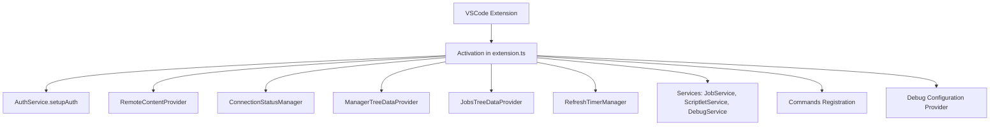

## PyOps VSIX Extension

### Overview

The `vsix/` directory contains the VSCode extension for PyOps, providing a graphical interface for managing scriptlets and jobs.

### Architecture

### Core Components

- **`src/extension.ts`**: Main activation file that sets up the extension context and registers all providers and services.
- **`src/jobsTreeProvider.ts`**: Provides the `JobsTreeDataProvider` for displaying job states in the tree view.
- **`src/managerTreeProvider.ts`**: Provides the `ManagerTreeDataProvider` for managing scriptlets.
- **`src/utils.ts`**: Contains shared utility functions like `inferExt` and `hasValidConfig`.
- **`src/commands/CreateScriptletCommand.ts`**: Handles the logic for creating new scriptlets.

### Configuration

VSCode workspace settings set serverUrl, username, password (state), localPyopsDir, and autoRefreshInterval. Auth is optional (Basic if username/password set).

### Functionality

#### Auth Service

`src/services/AuthService.ts` handles authentication setup for Basic Auth:

- Prompts for password if username is configured but no password is stored.
- Stores password securely in workspace state.
- Unit tests in `tests/services/AuthService.test.ts`.

#### Refresh Timer Manager

`src/services/RefreshTimerManager.ts` manages auto-refresh timers for manager/jobs tree providers:

- Starts/stops timers based on config validity.
- Prevents duplicate timers.
- Unit tests in `tests/services/RefreshTimerManager.test.ts`.

#### Tree Providers

- **ManagerTreeDataProvider** fetches scriptlets via API, downloads to local `.pyops/{set}/`, supports create/upload/save/diff/reset/delete/debug, has unit tests in `tests/managerTreeProvider.test.ts`.
- **JobsTreeDataProvider** lists jobs by state, supports bulk cancel/delete & refresh.

#### Content Provider

RemoteContentProvider serves remote files; onDidChange events.

#### Services

- JobService, ScriptletService, DebugService, etc.

#### Commands

- Registration and execution.

### Testing

#### VSIX Tests

- **Unit tests** in `tests/` use Jest with mocked vscode APIs & API client.
- **Integration tests** in `tests/integration/` use @vscode/test-electron for real VS Code environment with simple assert-based testing.
- Integration tests run against separately started localhost PyOps development server without authentication.
- PyOps server must be started externally before running integration tests (not managed by test framework).
- Run unit tests with `npm run test` or `npm run test:coverage`.
- Run integration tests with `npm run test:integration` (requires running local development PyOps server on localhost:8000).
- Integration tests excluded from CI/CD since VS Code not available.
- Infrastructure set up with simple console-based test runner that works in VS Code extension host.
- Tests verify extension activation, configuration (server URL only), views, and command registration.
- No authentication testing in integration tests (development server runs without auth).

#### Service Tests

- **JobService.test.ts**: Tests CRUD operations, bulk cancel/delete, viewJob polling with stdout/stderr updates and state transitions (done/failed/cancelled/remove/404), error handling for all async methods, handling of undefined provider, and timer cleanup.
- **ScriptletService.test.ts**: Tests local/remote sync operations, network error handling, filesystem branch tests (existsSync conditions), and multi-step error scenarios.
- **DebugService.test.ts**: Tests buildOverrides and enqueueDebugJob functionality.
- **DebugOutputMonitor.test.ts**: Tests start/stop monitoring and polling, including incremental stdout/stderr append, channel display, stopping on job completion states (done/failed/cancelled/remove/404), and fetching error logs.
- **RefreshTimerManager.test.ts**: Tests ensureRunning and stopIfRunning methods.
- **AuthService.test.ts**: Tests setupAuth for prompts and storage.
- **PyOpsPythonDebugConfigProvider.test.ts**: Tests configuration provision.

#### Provider Tests

- **managerTreeProvider.test.ts**: Tests getTreeItem/Children API fetch/download, error handling for fetchScriptlets/downloadScriptlets, and refresh graceful failure.
- **jobsTreeProvider.test.ts**: Tests job states and bulk operations.
- **RemoteContentProvider.test.ts**: Tests provideTextDocumentContent, registerRemoteLanguageModeSetter conditional logic, missing language mappings, and event emitter access.

#### Utility Tests

- **utils.test.ts**: Tests `inferExt` for all switch cases including unknown types, and `hasValidConfig` for false paths (empty/undefined/null serverUrl).

#### Other Tests

- **apiClient.test.ts**: Tests API calls with authentication.
- **ConnectionStatusManager.test.ts**: Tests status bar updates.
- **CreateScriptletCommand.test.ts**: Tests command execution.

#### Test Mocking

- Uses hoisted `jest.mock('../src/services/*')` with mockImplementation for instances/methods.
- Dynamic require for overrides.
- VSCode mocks: `window.createOutputChannel`, `workspace.getConfiguration`, etc.
- `global.fetch` for API calls, `fs`/`path` mocks for filesystem operations.

#### Integration Tests

- VSIX Integration Monitor
- VSIX Integration Manager
- VSIX-Integration-Commands

### Key Features

- Trees: pyops-manager (sets/scriptlets), pyops-monitor (jobs).
- Actions: enqueue debug download view.
- Checks hasValidConfig() for serverUrl only.
- Status bar shows connection.
- Integrates Cline for code gen.

### Global Attributes

- Tests use `beforeAll` for shared activate/setup; `beforeEach(jest.clearAllMocks())`.
- No autouse fixtures; isolation via mocks/clear.
- Run tests with: `npm run test --prefix vsix/`.
- Focus on error paths, edge cases, and complex conditional logic for branch coverage.

### Additional Features

#### Debug Features

- DebugService: `src/services/DebugService.ts` provides buildOverrides (recursive FS walk local pyops/set/*.py) & enqueueDebugJob (API POST /job/item kind=debug)
- getDebugHost() parses hostname from pyops.serverUrl ; fallback localhost on invalid URL
- used by PyOpsPythonDebugConfigProvider & pyops.startDebugJob & pyops.attachDebugJob
- unit tests `tests/services/debugService.test.ts` >90% coverage.

#### Local-Only Support

- ManagerTreeProvider defines interface ScriptletInfo {set: string; name: string; type: string; isLocalOnly?: boolean}
- _scriptlets: ScriptletInfo[]; fetchScriptlets(): Promise<ScriptletInfo[]> /scriptlet/inventory/list
- scanLocalScriptlets(): Promise<ScriptletInfo[]> discovers pyops/{set}/{type}/*.{inferExt(type)} isLocalOnly:true
- refresh merges remote & localOnly; filters excludedSets; downloads remoteOnly sets _syncStatus.
- Local-only display: diff-added icon & contextValue pyopsItem-{type}-local & tooltip 'Local only - Set: {set}, Name: {name}, Type: {type}' & description .ext (local)
- Remote: check/warning syncStatus icon & contextValue pyopsItem-{type} & tooltip sync status.
- Local-only task scriptlets support pyops.startDebugJob & pyops.stopDebugJob context menus via package.json when /^pyopsItem-task(-local)?$/; sync commands resetLocalFromRemote/saveRemoteDraft/diffLocalRemote restricted excluding -local; writeLocalToRemoteDraft & deleteScriptlet available via /^pyopsItem-(task|service|library|controller|view|markdown)(-local)?$/; writeLocalToRemoteDraft auto-creates remote via PUT /inventory/item if 404 then POST /draft & handles network errors on check/create with specific try-catch showErrorMessages; integration test9 tests write on local-only -> auto-create + draft success.

#### Debug Integration

- Debug-Job-Enqueue-SkipCheck: `app/routers/scriptlet/job.py` PUT /scriptlet/job/item skips `git.read_content` existence check for `kind=="debug"` if `overrides[f"{ru.set}::{ru.name}"]` exists - Enables VSIX local-only debug jobs without requiring remote scriptlet file.
- Runner-LoadJob-SkipCheck: `app/runner.py` loadJob skips `os.listdir/files_list` existence check for `kind=="debug"` if `job.overrides` valid JSON & `f"{job.set}::{job.name}" in parsed dict - Sets `code = override_dict[main_key]` - Fallback git.read_content if no main override or invalid JSON (logs warning) - `committed=False` for debug fallback - Enables full local-only debug lifecycle (enqueue->dequeue->load->run).
- Debug-Await-Directive: Runner.run_debug_job checks '#>AWAIT_DEBUG' in job.param - Injects debugpy bridge with listen(('0.0.0.0', port)) always - Appends wait_for_client() if directive present. - VSIX.DebugService.enqueuDebugJob sets param='#>AWAIT_DEBUG'. - Enables waiting for VSIX debugger attach; non-VSIX enqueues non-blocking by default. - Tests: tests/integration/runner/test_execution.py test_run_debug_inject (with directive); vsix/tests/services/debugService.test.ts.
- Debug-Port-Endpoint: app/web.py GET /debug/port uses sanitize_owner(X-User default "anonymous") & files.conf_users()[owner]["debug_port"] - Returns {"port": int(port)} - 400 "No debug_port configured for user '{owner}'" if missing.
- VSIX-Debug-Port-Fetch: DebugService.enqueueDebugJob fetches /debug/port first with auth headers if set - Logs [DEBUG getDebugPort] Success: {port} / Failed: {error} - Validates number & range(1,65536) throws "Invalid port" else - Returns port with jobId for vscode debug attach localhost:{port}.
- Tests-Debug-Port: tests/api/test_api_endpoints.py::test_debug_port mocks conf_users anonymous/testuser/missing -> 200/400. vsix/tests/services/debugService.test.ts mocks fetch /debug/port success/auth-noauth/job-fail/network/invalid-port/throw.
- VSIX-AttachDebug: VSIX adds "Attach Debug" title bar button in pyops-manager panel executes pyops.attachDebugJob command - Lists jobs via JobService.listJobs() filters kind="debug" state="running"|"dequeued" - Requires exactly one running debug job - Fetches port DebugService.getDebugPort() - Launches vscode.debug.startDebugging folder config=debugpy attach localhost:port justMyCode=false - Name=`Attach to PyOps Debug (${set||'unknown'}::${name||'unknown'})` - Logs "Attaching to job {id} ({set||?}::{name||?}) at port {port}" - Handles no/missing/multiple/port fail gracefully.
- JobService-listJobs: JobService adds public async listJobs(): Promise<Job[]> { return this.fetchJobs(); } - Enables pyops.attachDebugJob access.
- DebugService-getDebugPort: DebugService adds public async getDebugPort(): Promise<number> extracts `/debug/port` fetch/auth/logic - Refactors enqueueDebugJob to call it - Unit tests in debugService.test.ts success/throw-fetch-fail/invalid-port/no-auth.
- Global-AttachDebug: pyops.attachDebugJob enables reattach to detached VSIX PyOps debugpy sessions on running jobs without reenqueue or restart.

#### JS Library Support

- `utils.ts inferExt()`: Added case 'jslibrary' → '.js'.
- `RemoteContentProvider.ts getLanguageId()`: Added case 'jslibrary' → 'javascript' for Ace/IntelliSense.
- `CreateScriptletCommand.ts`: Added 'JS Library' quickpick option, maps to 'jslibrary' type.
- `package.json menus`: Extended contextValue regex /^pyopsItem-(task|service|library|controller|view|markdown|jslibrary)(-local)?$/ for sync commands (resetLocalFromRemote, writeLocalToRemoteDraft, saveRemoteDraft, diffLocalRemote, deleteScriptlet).
- Manager tree displays jslibrary with .js ext, sync status icons, local-only support.
- Tests: Added inferExt('jslibrary') → 'js'; getLanguageId('jslibrary') → 'javascript'; >80% coverage maintained.

#### Build and Development

- Build Process Insights: TypeScript compilation requires strict output directory discipline. Compiled JavaScript files must only exist in `out/` directories. Any JS files in source directories indicate misconfiguration.
- Integration Test Compilation: Integration tests require a separate TypeScript configuration from the main extension. They cannot share the same `tsconfig.json` due to different include patterns and output requirements. The `rootDir` must exactly match the directory containing all source files being compiled. Include patterns must explicitly list both test suite files and utility files.
- Output Directory Management: Incorrect `rootDir` in `tsconfig.json` leads to nested or misplaced output directories. The `outDir` path must be calculated relative to `rootDir`, not the `tsconfig.json` location. Verify compilation output matches the expected structure before running tests.
- Test Architecture Access: Integration tests in the VS Code environment access extension services through global objects. Use `(global as any).serviceName` for service access, not direct TypeScript imports. Static methods are accessed via `serviceInstance.constructor.methodName` or the class name. Do not assume instance methods exist where only static methods are defined.
