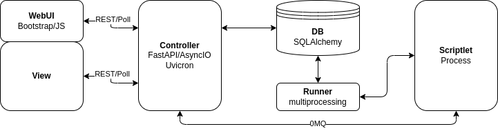

# InfraOps
Execution Platform for Infrastructural Oriented Python Scriptlets

## Architecture


## Configuration
### Settings
Example: [etc/infraops.json](etc/infraops.json)
- Not providing log paths logs to stdout/stderr
- Not providing a jobs data path defaults to "app/../data/jobs"
- InfraOps does not Provide SSL by itself, you should use a reverse proxy.

### Authentication
At the moment InfraOps provides no authentication method.
Implementing an authentication method at reverse proxy level is strongly advised for public systems.

### External Packages
The `pkg` directory could contain Python packages which are available in scriptles via `import`.
Best Practice is to directly clone the package's Git repository.

## Scriptlets
### Types
#### Task
One time executed, usually for debugging.

#### Schedule
Cron like scheduling of tasks.

#### Service
Not timed schedule which is kept running unless there are 3 fails.

A service should consist of a main loop.
This main loop can be a [websocket client](https://github.com/websocket-client/websocket-client) receiving messages from FastAPI controller.

## Setup
### Direct
```
git clone https://git.ralph.or.at/infraops/infraops.git
cd infraops
./run.sh
```

### SystemD
- TODO

### Docker compose
- `docker-compose.yml`
```
version: '3.6'
networks:
  default:
    driver: bridge

services:
  app:
    container_name: infraops_app.SOMEDOMAIN
    image: 'registry.ralph.or.at/infraops/infraops:latest'
    restart: unless-stopped
    networks:
      - default
    volumes:
      - './volumes/app/data:/opt/infraops/data'
      - './volumes/app/etc:/opt/infraops/etc'
      - './volumes/app/pkg:/opt/infraops/pkg'
  nginx:
    container_name: infraops.SOMEDOMAIN
    image: 'nginx:1.25'
    restart: unless-stopped
    ports:
      - '443:443'
    networks:
      - default
    depends_on:
      - app
    volumes:
      - './volumes/nginx/conf.d:/etc/nginx/conf.d:ro'
      - './volumes/nginx/auth:/etc/nginx/auth:ro'
      - '/etc/ssl/private:/etc/nginx/ssl:ro'
      - './volumes/nginx/log:/var/log/nginx:rw'
```
:exclamation: instead of using original nginx container as reverse proxy you could use [jonasal/nginx-certbot](https://hub.docker.com/r/jonasal/nginx-certbot) for using LetsEncrypt certificates.

- `./volumes/app/etc/infraops.json`
```
{
    "web": {
        "bind": "0.0.0.0:80",
        "worker": 4,
        "timeout": 300
    },
    "data": {
        "jobs": "../data/jobs"
    },
    "log": {
        "loglevel": "debug"
    }
}
```
:exclamation: note, that there are no logfiles set, logging shall be done via `docker logs`

- `./volumes/nginx/conf.d/app.conf`
```
server {
	listen 443 ssl;
	server_name infraops.SOMEDOMAIN;

        ssl_certificate /etc/nginx/ssl/SOMECERT.crt;
        ssl_certificate_key /etc/nginx/ssl/SOMEKEY.key;
	    ssl_protocols       TLSv1.2 TLSv1.3;
        ssl_ciphers         HIGH:!aNULL:!MD5;
        add_header Strict-Transport-Security max-age=63072000;

        access_log /var/log/nginx/app_access.log;
	    error_log /var/log/nginx/app_error.log;

        location / {
                auth_basic           "InfraOps";
                auth_basic_user_file /etc/nginx/auth/htpasswd; 

                proxy_pass http://infraops_app.SOMEDOMAIN;
                proxy_set_header X-Real-IP $remote_addr;
                proxy_set_header Host infraops.SOMEDOMAIN;
                proxy_set_header X-Forwarded-For $proxy_add_x_forwarded_for;
                proxy_set_header X-Protocol https;
                proxy_set_header X-Original-Host $host;
                proxy_read_timeout 300;
                proxy_connect_timeout 120;
                proxy_send_timeout 300;
        }
}
```

- create `./volumes/nginx/auth/htpasswd`
```bash
htpasswd -c ./volumes/nginx/auth/htpasswd SOMEUSER
```