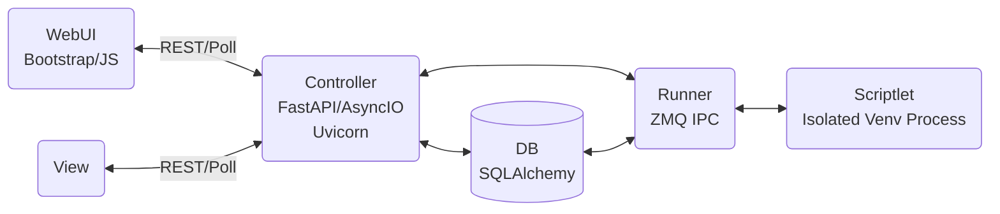

# PyOps
Execution Platform for Python Operations Scriptlets

PyOps is an "Execution Platform" for "Python Operations Scriptlets". It is licensed under GNU AGPLv3 and organized as a monorepo with core functionality in `app/`, a VSCode extension in `vsix/`, tests in `tests/`, and documentation in `docs/`.

## Architecture


## Configuration

Stored in `etc/pyops.json` (override path via `PYOPS_CONFIG` env var):

- `web`: `{"bind": "127.0.0.1:8000", "worker": 8, "timeout": 300, "expanded_sets": []}`
- `brand` *(optional, per-instance branding for the operator UI)*: `{"title": "PyOps", "icon": "miscellaneous_services", "favicon": null}` — `title` lands in the browser tab and the sidebar header; `icon` is either a material-icons-round glyph name (default) or a path to a PNG/SVG/etc. served via `/brand/icon`; `favicon` is an optional path served at `/favicon.ico`. Paths may be absolute or relative to the project root. Defaults reproduce the bundled pyops look.
- `data`: `{"jobs": "data/jobs", "git": "data/git", "db": "data/app.db"}`
- `runner`: `{"venv": "data/venv", "pkg": "data/pkg", "git_pull_interval": 60, "drop_done_delay_seconds": 60, "shutdown_timeout_seconds": 30}`
- `log`: `{"loglevel": "debug"}`

## Features
PyOps supports various scriptlet types: task, service, schedule, controller, view, library, markdown, jslibrary, data.

In addition to WebUI it also includes a VSCode extension for direct use from VSCode and derivatives, plus `pyopsctl` — a terminal-driven operator CLI for remote admin (no venv, no pip, distro packages only). See [`docs/pyops_guide.md`](docs/pyops_guide.md) § pyopsctl.

- **Task**: One-time executed scriptlets for debugging or batch operations. Same file can serve as its own test suite via `kind=test` + `if __name__ == "__test__":` (uses `#!{pyops::pytest}` for programmatic pytest invocation).
- **Service**: Persistent services that run continuously
- **Schedule**: Cron-based scheduling of tasks
- **Controller**: Web controllers for dynamic UI generation
- **View**: HTML views for the web interface
- **Library**: Reusable code libraries
- **Markdown**: Documentation scriptlets — `README.md` at the set root plus any number of free-named `docs/{name}.md` pages
- **JSLibrary**: JavaScript libraries
- **Data**: Set-scoped YAML/JSON files under `data/{name}.{yaml,json}`, accessed by tasks/libraries through the `data` global with shared-RO / exclusive-RW locks for cross-task safety

Job kinds: `task | service | debug | draft | test`.

## Setup
### Direct
```
git clone https://github.com/pyops-project/pyops.git
cd pyops
./run.sh
```

For development with hot reload:
```
./run_dev.sh
```

### Testing
```bash
# Unit/integration tests
pytest tests/ -v --cov=app --cov-report=term-missing

# E2E tests (Playwright, starts real server per test)
pytest tests/e2e/ -v
```

### Docker Compose
- `docker-compose.yml`
```
networks:
  default:
    driver: bridge

services:
  app:
    container_name: pyops_app.SOMEDOMAIN
    image: 'ghcr.io/pyops-project/pyops:latest'
    restart: unless-stopped
    # Clean shutdown chain on `docker compose down`:
    #   docker SIGTERM → gunicorn master → workers drain (graceful_timeout=120s
    #   in app/gunicorn.py) → on_exit() SIGTERMs the runner subprocess →
    #   runner runs _shutdown_job_processes (runner.shutdown_timeout_seconds,
    #   default 30s). Total worst-case ≈ 150s. Docker's default
    #   stop_grace_period of 10s SIGKILLs the
    #   container before that chain finishes, which leaves service rows in
    #   "running" state on disk; the next start then marks them failed
    #   with detail "incomplete execution detected on startup".
    #   180s gives the chain enough room.
    stop_grace_period: 180s
    # Pyops opens file descriptors across multiple workers + the runner
    # subprocess + per-job log streams + ZMQ sockets; the Docker default
    # nofile soft limit (1024 historically) is the first wall pyops hits
    # under load. Bump both limits to the 16-bit max (65535) so the
    # `pyops_max_fds_*` gauges in /metrics stay well below the threshold.
    ulimits:
      nofile:
        soft: 65535
        hard: 65535
    networks:
      - default
    volumes:
      - './volumes/app/data:/opt/pyops/data'
      - './volumes/app/etc:/opt/pyops/etc'
      - './volumes/app/venv:/opt/pyops/venv'
      # Optional: route every pip invocation inside the container
      # (bootstrap pip in ensure_set_environment + every #!pip
      # directive in every per-set venv) through a single host-managed
      # pip.conf. pip reads /etc/pip.conf as its site-wide config
      # automatically — no pyops code involvement; standard Linux
      # subprocess + system-config mechanic. Drop the next line and the
      # file at ./volumes/app/etc/pip.conf to use a private index, set
      # a global timeout, pin trusted-host, etc.
      - './volumes/app/etc/pip.conf:/etc/pip.conf:ro'
  nginx:
    container_name: pyops.SOMEDOMAIN
    image: 'nginx:1.25'
    restart: unless-stopped
    ports:
      - '443:443'
    networks:
      - default
    depends_on:
      - app
    volumes:
      - './volumes/nginx/conf.d:/etc/nginx/conf.d:ro'
      - './volumes/nginx/auth:/etc/nginx/auth:ro'
      - '/etc/ssl/private:/etc/nginx/ssl:ro'
      - './volumes/nginx/log:/var/log/nginx:rw'
```

- `./volumes/app/etc/pyops.json`
```
{
    "web": {
        "bind": "0.0.0.0:80",
        "worker": 8,
        "timeout": 300
    },
    "data": {
        "jobs": "data/jobs",
        "git": "data/git",
        "db": "data/app.db"
    },
    "runner": {
        "venv": "venv",
        "pkg": "pkg",
        "git_pull_interval": 60,
        "drop_done_delay_seconds": 60
    },
    "log": {
        "loglevel": "debug"
    }
}
```

- `./volumes/app/etc/pip.conf` *(optional — only when the compose
  bind above is enabled)*
```ini
[global]
index-url = https://your-private-index.example.com/simple/
trusted-host = your-private-index.example.com
timeout = 60
```

Applies to **every** pip invocation inside the container without any
pyops awareness: the bootstrap pip in `ensure_set_environment`, every
per-set venv's pip, and every user `#!pip <pkg>` directive in a
scriptlet. pip reads `/etc/pip.conf` as its site-wide config, so the
single bind covers the whole container. Authenticated indices: either
embed credentials in the URL or also bind a `~/.netrc` into the
container for the pyops user.

- `./volumes/nginx/conf.d/app.conf`
```
server {
	listen 443 ssl;
	server_name pyops.SOMEDOMAIN;

    ssl_certificate /etc/nginx/ssl/SOMECERT.crt;
    ssl_certificate_key /etc/nginx/ssl/SOMEKEY.key;
    ssl_protocols       TLSv1.2 TLSv1.3;
    ssl_ciphers         HIGH:!aNULL:!MD5;
    add_header Strict-Transport-Security max-age=63072000;

    access_log /var/log/nginx/app_access.log;
    error_log /var/log/nginx/app_error.log;

    location / {
        auth_basic           "PyOps";
        auth_basic_user_file /etc/nginx/auth/htpasswd;

        proxy_pass http://pyops_app.SOMEDOMAIN;
        proxy_set_header X-Real-IP $remote_addr;
        proxy_set_header Host pyops.SOMEDOMAIN;
        proxy_set_header X-Forwarded-For $proxy_add_x_forwarded_for;
        proxy_set_header X-Protocol https;
        proxy_set_header X-Original-Host $host;
        proxy_set_header X-User $remote_user;
        proxy_read_timeout 300;
        proxy_connect_timeout 120;
        proxy_send_timeout 300;
    }
}
```

- Create `./volumes/nginx/auth/htpasswd`
```bash
htpasswd -c ./volumes/nginx/auth/htpasswd SOMEUSER
```

## Monitoring

Three unauthenticated endpoints intended for an external monitoring system (e.g. Zabbix, Prometheus). They are read-only and cheap enough to scrape every few seconds.

| Path | Format | Use |
|------|--------|-----|
| `GET /health` | JSON | Aggregated status (`ok` / `degraded` / `fail`); subsystem checks (database, runner socket, data dirs, ulimits, GPU); job/schedule/set summary. Returns HTTP 503 only when the database is unreachable. |
| `GET /health/failed` | JSON | All failed jobs (no pagination), full detail per row. Filter on `set`, `name`, `owner`, or `detail` substring on the monitoring side. |
| `GET /metrics` | Prometheus exposition (`text/plain; version=0.0.4`) | Per-state job counts, per-(set, name, state) breakdown, ulimit gauges, GPU status (`pyops_gpu_ok{status=…}`) plus a dedicated `pyops_gpu_reboot_required` flag for driver/runtime version mismatch, oldest-todo-age and last-completed-age gauges. |

Behind nginx + Basic Auth, exempt the monitoring source from auth — for example:

```
location ~ ^/(health|metrics) {
    allow 10.0.0.0/8;       # monitoring subnet
    deny  all;
    auth_basic off;
    proxy_pass http://pyops_app.SOMEDOMAIN;
}
```

Or scrape the upstream container directly on the compose-internal port (preferred when the monitoring host is on the same LAN).

See `docs/insights_app.md` § "Monitoring Router" for the full metric list, GPU status taxonomy, and the ulimit threshold semantics.
