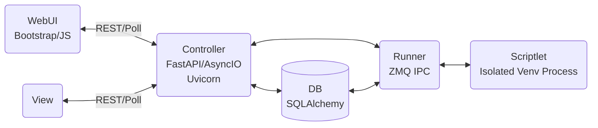

# PyOps
Execution Platform for Python Operations Scriptlets

PyOps is an "Execution Platform" for "Python Operations Scriptlets". It is licensed under GNU AGPLv3 and organized as a monorepo with core functionality in `app/`, a VSCode extension in `vsix/`, tests in `tests/`, and documentation in `doc/`.

## Architecture


## Configuration
- `web`: `{"bind": "127.0.0.1:8000", "worker": 4, "timeout": 300}`
- `data`: `{"jobs": "data/jobs", "git": "data/git", "db": "data/app.db"}`
- `runner`: `{"venv": "data/venv", "pkg": "data/pkg", "git_pull_interval": 60, "drop_done_delay_seconds": 60}`
- `log`: `{"loglevel": "debug"}`
- `users`: `{"anonymous": {"debug_port": 15678}}`

## Features
PyOps supports various scriptlet types: task, service, schedule, controller, view, library, markdown, jslibrary.

In addition to WebUI it also includes a VSCode extension for direct use from VSCode and derivatives.

- **Task**: One-time executed scriptlets for debugging or batch operations
- **Service**: Persistent services that run continuously
- **Schedule**: Cron-based scheduling of tasks
- **Controller**: Web controllers for dynamic UI generation
- **View**: HTML views for the web interface
- **Library**: Reusable code libraries
- **Markdown**: Documentation scriptlets
- **JSLibrary**: JavaScript libraries

## Setup
### Direct
```
git clone https://git.ralph.or.at/pyops/pyops.git
cd pyops
./run.sh
```

For development with hot reload:
```
./run_dev.sh
```

### Docker Compose
- `docker-compose.yml`
```
networks:
  default:
    driver: bridge

services:
  app:
    container_name: pyops_app.SOMEDOMAIN
    image: 'registry.ralph.or.at/pyops/pyops:latest'
    restart: unless-stopped
    networks:
      - default
    volumes:
      - './volumes/app/data:/opt/pyops/data'
      - './volumes/app/etc:/opt/pyops/etc'
      - './volumes/app/venv:/opt/pyops/venv'
  nginx:
    container_name: pyops.SOMEDOMAIN
    image: 'nginx:1.25'
    restart: unless-stopped
    ports:
      - '443:443'
    networks:
      - default
    depends_on:
      - app
    volumes:
      - './volumes/nginx/conf.d:/etc/nginx/conf.d:ro'
      - './volumes/nginx/auth:/etc/nginx/auth:ro'
      - '/etc/ssl/private:/etc/nginx/ssl:ro'
      - './volumes/nginx/log:/var/log/nginx:rw'
```

- `./volumes/app/etc/pyops.json`
```
{
    "web": {
        "bind": "0.0.0.0:80",
        "worker": 4,
        "timeout": 300
    },
    "data": {
        "jobs": "data/jobs",
        "git": "data/git",
        "db": "data/app.db"
    },
    "runner": {
        "venv": "venv",
        "pkg": "pkg",
        "git_pull_interval": 60,
        "drop_done_delay_seconds": 60
    },
    "log": {
        "loglevel": "debug"
    },
    "users": {
        "anonymous": {"debug_port": 15678}
    }
}
```

- `./volumes/nginx/conf.d/app.conf`
```
server {
	listen 443 ssl;
	server_name pyops.SOMEDOMAIN;

    ssl_certificate /etc/nginx/ssl/SOMECERT.crt;
    ssl_certificate_key /etc/nginx/ssl/SOMEKEY.key;
    ssl_protocols       TLSv1.2 TLSv1.3;
    ssl_ciphers         HIGH:!aNULL:!MD5;
    add_header Strict-Transport-Security max-age=63072000;

    access_log /var/log/nginx/app_access.log;
    error_log /var/log/nginx/app_error.log;

    location / {
        auth_basic           "PyOps";
        auth_basic_user_file /etc/nginx/auth/htpasswd;

        proxy_pass http://pyops_app.SOMEDOMAIN;
        proxy_set_header X-Real-IP $remote_addr;
        proxy_set_header Host pyops.SOMEDOMAIN;
        proxy_set_header X-Forwarded-For $proxy_add_x_forwarded_for;
        proxy_set_header X-Protocol https;
        proxy_set_header X-Original-Host $host;
        proxy_set_header X-User $remote_user;
        proxy_read_timeout 300;
        proxy_connect_timeout 120;
        proxy_send_timeout 300;
    }
}
```

- Create `./volumes/nginx/auth/htpasswd`
```bash
htpasswd -c ./volumes/nginx/auth/htpasswd SOMEUSER
```
