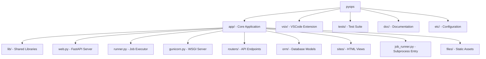
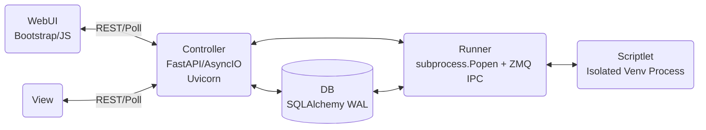
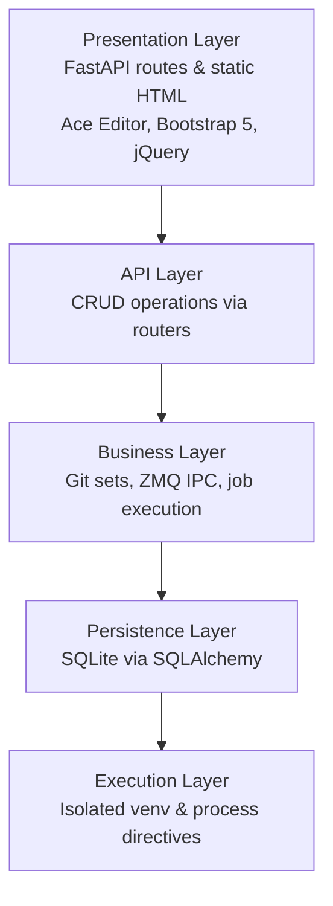
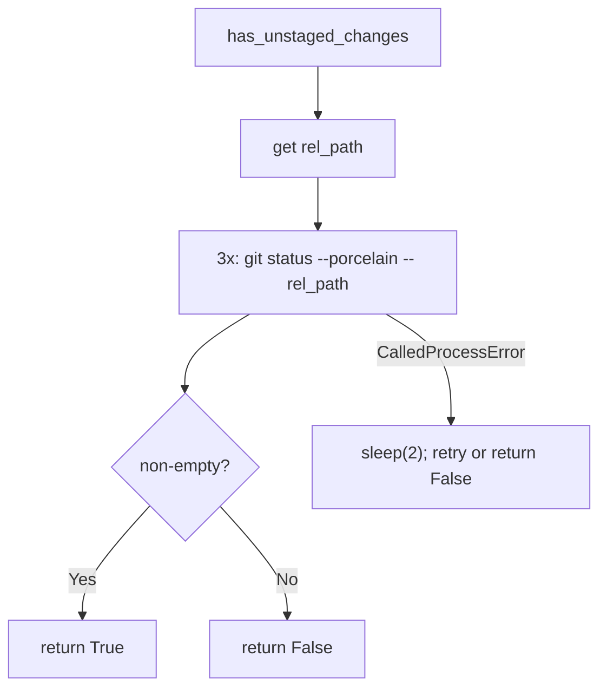
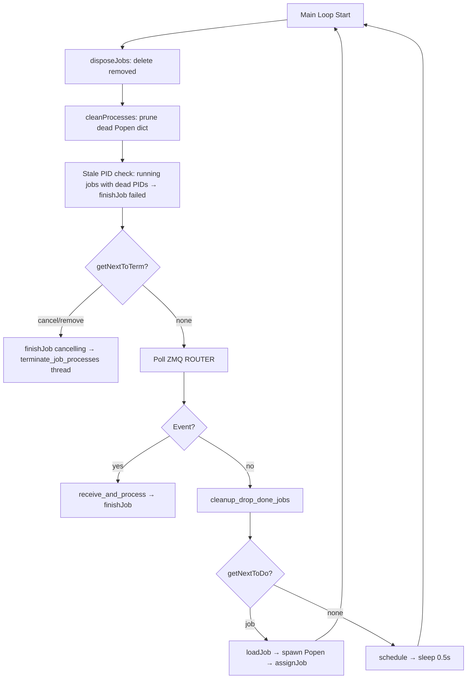
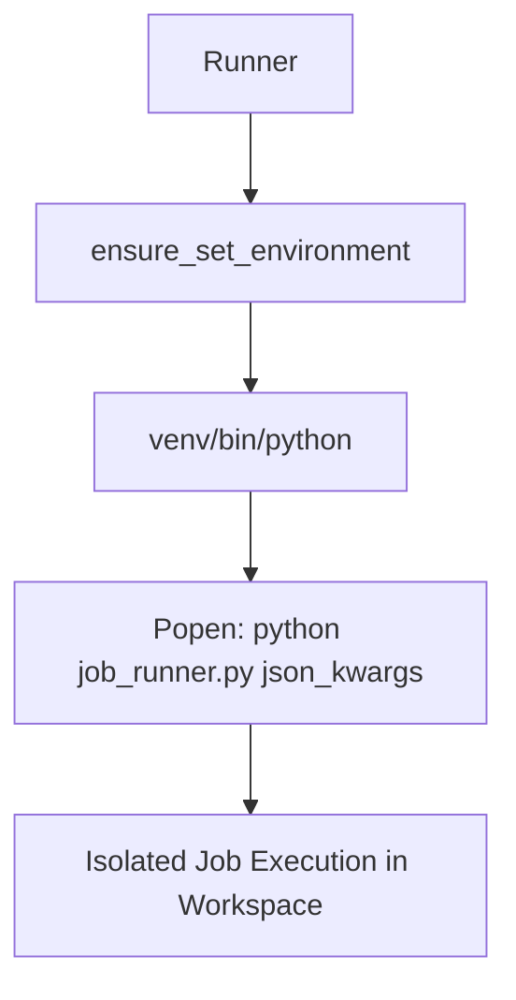
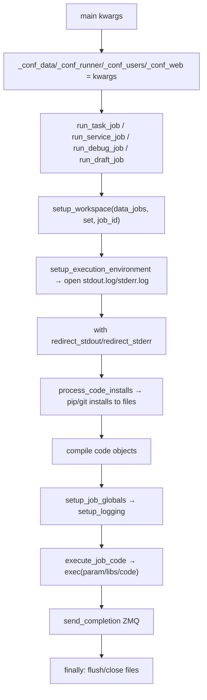
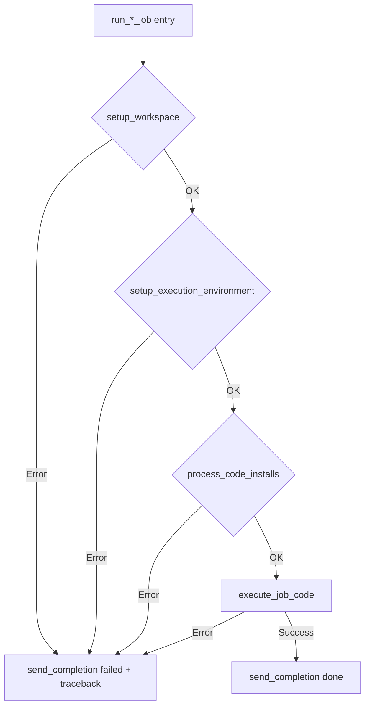
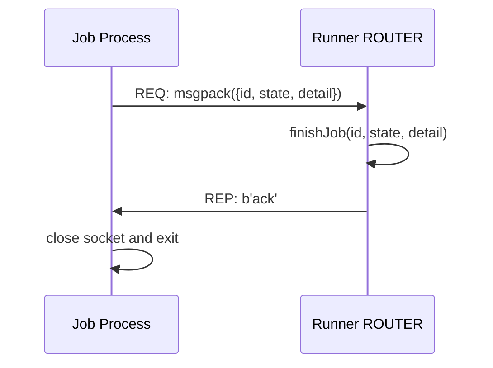
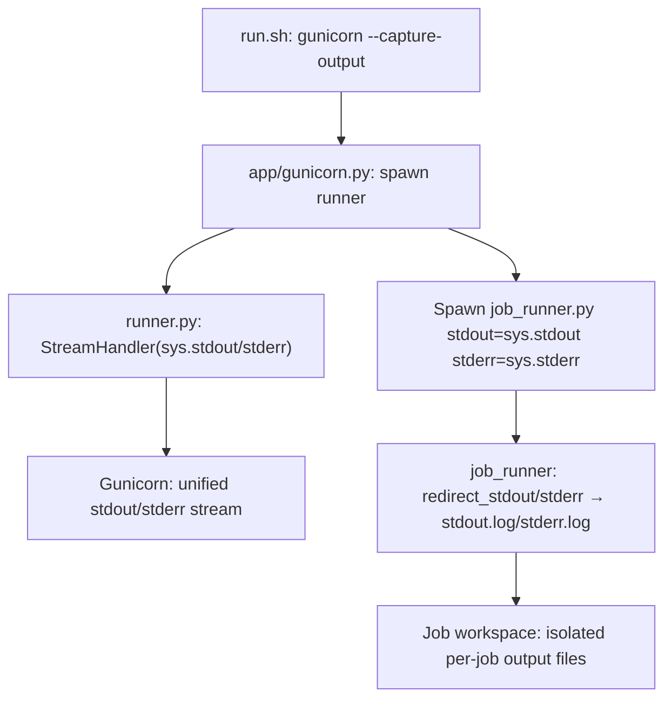

# PyOps App — Technical Reference

## Overview

PyOps is an "Execution Platform" for "Python Operations Scriptlets". Licensed under GNU AGPLv3, organized as a monorepo: core app in `app/`, VSCode extension in `vsix/`, tests in `tests/`, documentation in `doc/`.

### Monorepo Layout



### System Architecture



### Architecture Layers



### Technology Stack

- **Backend**: Python 3.12, FastAPI, SQLAlchemy 2.x, ZMQ, msgpack
- **Database**: SQLite (thread-safe WAL mode)
- **Frontend**: Bootstrap 5, jQuery 3.6, Ace Editor, Material Icons

### Key Module Map

| File | Role |
|------|------|
| `app/web.py` | FastAPI app, routes, controller proxy |
| `app/runner.py` | Background daemon: polls DB, spawns jobs, handles ZMQ |
| `app/job_runner.py` | Subprocess entry point: executes inside per-set venv |
| `app/gunicorn.py` | WSGI config; also spawns the runner process |
| `app/lib/files.py` | Config access (`etc/pyops.json`) |
| `app/lib/git.py` | Scriptlet storage in Git repos |
| `app/lib/runner.py` | DB-level job utilities: `enqueue`, `query`, `find`, `cancel`, `remove`, `drop` |
| `app/lib/job.py` | Execution utilities: `send_completion`, `terminate_debugpy_adapter`, `process_imports`, `process_install_lines`, `process_code_installs`, `kill_proc_tree`, `get_process_tree`, `get_debug_port`, `get_debugpy_adapter_pid`, `has_debugpy_adapter`, `validate_debug_prerequisites`, `loadLib`, `install_git_repo` |
| `app/lib/pyops.py` | `Control` (API proxy), `ServiceListener`, `ServiceClient` |
| `app/lib/sets.py` | Git set management (clone, remove, switch branch) |
| `app/lib/sites.py` | Site rendering utilities |
| `app/lib/async_utils.py` | Async helper utilities |
| `app/lib/auth.py` | `sanitize_owner()` for `X-User` header normalization |
| `app/orm/` | SQLAlchemy models: `Job`, `Schedule` |
| `app/routers/scriptlet/` | REST API routers |
| `app/sites/` | Static HTML templates: `root/root.html`, `scriptlet/` views |

---

## Configuration (`app/lib/files.py`)

`Config` class manages `etc/pyops.json`; loaded once at startup via `Config.init()`. Both `app/gunicorn.py` and `app/runner.py` read the `PYOPS_CONFIG` environment variable to override the default config path (`etc/pyops.json`). This enables isolated E2E test instances with separate data directories and ports. No built-in auth; proxy recommended.

### JSON Structure

- `web`: `{"bind": "127.0.0.1:8000", "worker": 4, "timeout": 300}`
- `data`: `{"jobs": "data/jobs", "git": "data/git", "db": "data/app.db"}`
- `runner`: `{"venv": "data/venv", "pkg": "data/pkg", "git_pull_interval": 60, "drop_done_delay_seconds": 60}`
- `log`: `{"loglevel": "debug"}`
- `users`: `{"anonymous": {"debug_port": 15678}}`

### Access Methods

- `conf_data()`: data section (jobs, git, db)
- `conf_runner()`: runner section (venv, pkg, git_pull_interval, drop_done_delay_seconds)
- `conf_web()`: web section (bind)
- `conf_log()`: log section (loglevel)
- `conf_users()`: users section (per-user debug_port)
- `get(path)`: serves static files from `app/files/`

---

## Data Models (`app/orm/`)

SQLite file-based DB in `data/app.db`, thread-safe WAL mode.

`app/orm/database.py`: `get_db_path()`, `init_db()` (creates tables on startup), `get_db_engine()`, `destroy_db()`.

### Job

| Column | Type | Notes |
|--------|------|-------|
| id | String PK | `{owner}_{set}_{name}_{timestamp}` |
| owner, set, name, kind | String | indexed |
| state | String | indexed; see state machine below |
| drop_done | Boolean | auto-remove on completion |
| max_retries | Integer | default=0 |
| param | String | job parameter/code snippet |
| pid | Integer | set when running |
| debugpy_pid | Integer | debug jobs only |
| detail | String | error message or traceback |
| overrides | String | JSON dict for debug/VSIX local code |
| start, end | DateTime | timestamps |

**State machine**: `todo → dequeued → loading → running → done/failed/cancel/cancelling/cancelled/remove/removed`

- `cancel`: requested by API
- `cancelling`: runner is actively terminating the process
- `cancelled`: termination complete
- `remove`: marked for workspace deletion
- `removed`: workspace deleted, pending DB cleanup

### Schedule

| Column | Type | Notes |
|--------|------|-------|
| id | Integer PK | autoincrement |
| schedule | String | cron expression for tasks; empty string for persistent services |
| set, name, owner | String | indexed |
| active | Boolean | indexed |
| drop_done | Boolean | default=True |
| max_retries | Integer | default=0 |
| param | String | |
| last | DateTime | last trigger time; indexed |

---

## Git Operations (`app/lib/git.py`)

Manages scriptlet files as Git repos in `data/git/{set}/`. All mutating operations are serialized via `repo_lock(git_base, set_name)` (fcntl advisory lock per set).

### Scriptlet File Conventions

- Tasks/libraries/controllers: `{name}.{type}.py`
- Views: `{name}.html`
- JS libraries: `{name}.js`
- Markdown: `README.md`
- Types inferred by `infer_type_from_filename()`

### Operations

- `get_repo_path(set)`: resolves `data/git/{set}/`; initializes `.git`, `.gitignore`, `README.md` if missing
- `read_content(repo, name, type_, committed, strict)`: reads working tree (default) or `git show HEAD:` for committed; `strict=True` raises if no committed version
- `write_content(repo, name, type_, content)`: writes file under `repo_lock`
- `perform_git_add_commit_push(repo, file_path, msg)`: add + commit + push (skips push if no remote; raises `GitConflictError` on tag)
- `batch_commit(repo, msg, rel_files)`: add all or specific files + commit + push
- `delete_file_and_commit(repo, file_path, msg)`: `git rm` + commit + push
- `list_scriptlets()`: scans all sets, returns `[{"set", "name", "type"}, ...]` sorted
- `get_repo_status(set)`: returns `{"branch", "is_tag", "flag"}`
- `rollback_staged(set, name, type_)`: backs up to `.bck`, then `git checkout HEAD`
- `rollback_committed(set, name, type_)`: `git checkout HEAD` (discards unstaged)
- `check_name_unique(repo, name)`: prevents duplicate scriptlet names
- `pull(repo)`: soft-reset to `origin/{branch}` if clean; skips if dirty or on tag; adds new `.py/.html/.js/README` files from HEAD if missing in working directory; retries fetch on `CalledProcessError`

### Sets Management (`app/lib/sets.py`)

Groups scriptlets in Git repos. Managed via `/scriptlet/sets` UI/API or VSIX trees.

- `list_sets()`: lists available sets (`data/git/` subdirectories)
- `clone_set(name, remote)`: clones remote to `data/git/{name}/`; creates `.gitignore` and `README.md`
- `remove_set(name)`: deletes `data/git/{name}/` directory
- `switch_branch(name, branch)`: checks out branch in set repo; uses `repo_lock`

### Status Detection

`has_unstaged_changes(repo, name, type_) -> bool`: lock-free `git status --porcelain --untracked-files=all -- {rel_path}`; 3 attempts with 2s sleep on `CalledProcessError`.



---

## Job Execution

The execution pipeline spans three components: `app/runner.py` (daemon), `app/job_runner.py` (subprocess entry), and `app/lib/job.py` (shared utilities).

### Runner Daemon (`app/runner.py`)

Background daemon spawned by `app/gunicorn.py`. Polls DB, spawns subprocesses, handles ZMQ completion signals.

#### Startup Sequence

1. `handleOddJobs()`: dequeued→todo, running→failed (crash recovery)
2. `purgeLeftoverServiceJobs()`: deletes stale service jobs (dequeued/running/failed/done)
3. `cleanup_drop_done_jobs()`: marks expired `drop_done` done-jobs as `remove`

#### Main Loop



#### Job Spawn Flow



- `loadJob(job_id)`: fetches from DB, sets state `loading`, returns owner, set, name, kind, param, code, overrides, max_retries
- `assignJob(job_id, pid)`: sets state `running`, start timestamp, pid; for debug also resolves and stores `debugpy_pid`
- `finishJob(job_id, state, detail)`: sets state/end/detail/pid=None; service jobs with drop_done and state "done" → immediately sets "remove"; spawns daemon thread to call `terminate_job_processes`
- `postTerm(job_id)`: if state "remove" → delete job + workspace; else → set state "cancelled"
- `terminate_job_processes(job_id, pid, is_debug, owner)`: SIGTERM to full process tree; waits up to 15s; SIGKILL if still alive; calls `postTerm`

#### Scheduling

`schedule()` is called each main loop iteration when no job is queued:
- **Cron tasks** (non-empty `schedule` string): enqueues `task` job when `next_run ≤ now`; skips if one already running
- **Persistent services** (empty `schedule` string): enqueues `service` job if none active and failed count < 3

#### Debug Spawn

1. `validate_debug_prerequisites(owner)` — resolves port from `conf_users`
2. Spawn subprocess
3. Poll `has_debugpy_adapter(port)` up to 50×0.1s (5s); if adapter absent and process alive → `finishJob("failed", ...)`
4. `assignJob` only called after adapter confirmed up

### Job Runner (`app/job_runner.py`)

Subprocess entry point; runs inside per-set venv. Receives all config as JSON kwargs on command line (no file reads). Dispatches to `run_task_job`, `run_service_job`, `run_debug_job`, `run_draft_job`.

#### Config Isolation

Config dicts (`conf_data`, `conf_runner`, `conf_users`, `conf_web`) are passed as kwargs from the runner at spawn time and stored as module-level globals (`_conf_data`, etc.). Relative paths resolved using locally computed `_project_root`.



#### Job Globals

`setup_job_globals()` injects into the scriptlet execution namespace:

| Name | Value |
|------|-------|
| `user` | job owner (DB column is still `owner`) |
| `set`, `name` | scriptlet identity |
| `workspace` | `data/jobs/{set}/{id}/` |
| `setspace` | `data/jobs/{set}/` (shared across all users) |
| `gitspace` | `data/git/` |
| `pkgspace` | `data/pkg/` |
| `jobsspace` | `data/jobs/` |
| `control` | `pyops.Control(owner, web_bind)` |
| `listener` | `pyops.ServiceListener(owner, job_id)` (service/debug only) |

#### Output Isolation

All job output is redirected to per-job files in the workspace:

- `setup_execution_environment()` opens `stdout.log` and `stderr.log`
- `run_*_job()` wraps execution in `with redirect_stdout(stdout_file): with redirect_stderr(stderr_file):`
- `setup_logging()` adds handlers pointing to `sys.stdout`/`sys.stderr` (which are redirected)
- `process_install_lines()` subprocesses use `stdout=stdout_file, stderr=stderr_file`
- `finally:` block flushes and closes files

#### Error Handling

All `run_*_job()` functions follow the same pattern: every setup phase is wrapped in try-except; any exception calls `send_completion` with `state="failed"` and full traceback as detail. No silent failures.



Top-level `__main__` block catches any uncaught exception, prints to stderr, and exits with code 1.

### Directives (`app/lib/job.py`)

Directives in scriptlet code control installs and library imports.

#### Library Imports: `process_imports()`

Pattern: `#!{[set::]name}` at line start. Recursively loads library code (committed unless debug/draft), appends to `libs` list in topological order. Cycle-safe via `seen_libs` set and `depth` limit (10).

Directive type detection:
- **git**: arg contains `://` or starts with `git@`
- **library**: starts with `{` or contains `::`
- **pip**: anything else

#### Install Processing: `process_install_lines()` / `process_code_installs()`

`process_code_installs()` applies `process_install_lines()` to param, libs, and code in order. `process_install_lines()` bootstraps pip/setuptools/wheel first, then for each `#!` line:
- **pip**: `pip install --no-cache-dir --upgrade --upgrade-strategy eager {args}`
- **git**: clones to `data/pkg/{set}/{repo}/` or pulls if exists; then `pip install -e`
- **library**: skipped (handled by `process_imports`)

### Debug Mode

Debug jobs are launched by the runner with `kind="debug"`.

#### Runner-Side (before spawn)

1. `validate_debug_prerequisites(owner)` resolves port from `conf_users()[owner]["debug_port"]` (must be int 1025–65535)
2. `enqueue()` (in `lib/runner.py`): marks any existing dequeued/running debug job for the owner as `state="cancel"` before creating the new todo job
3. After spawn: polls `has_debugpy_adapter(port)` for up to 5s; fails job if adapter doesn't appear

#### job_runner-Side (inside subprocess)

1. `terminate_debugpy_adapter(owner, port)`: kills any existing debugpy adapter process on the port
2. `pip install debugpy` in the set venv
3. Execs: `debugpy.log_to('.debug/adapter'); debugpy.listen(('0.0.0.0', port))`
   - If `#>AWAIT_DEBUG` in param: also execs `debugpy.wait_for_client(); debugpy.breakpoint()`
4. Creates `.debug/src/{set}/task/{name}.py` and `.debug/src/{set}/library/{lib}.py` from code; compiles objects from these files for accurate breakpoint line mapping
5. Applies overrides: VSIX `buildOverrides()` walks local `pyops/{set}/*.py`; runner applies override code if `{set}::{name}` matches

**`debugpy.listen` binds `('0.0.0.0', port)` intentionally** — required for Docker remote debugging (VSCode on host connects to container via port-forward). Never change this binding without explicit instruction.

#### Retry Behavior

`execute_job_code()` in `app/job_runner.py`:
- **task**: loops `max_retries + 1` times; on exception sleeps 60s and retries; final failure → `send_completion failed`
- **service/debug/draft**: no retry; single failure → `send_completion failed`

---

## IPC & Services (`app/lib/pyops.py`)

Two distinct ZMQ channels in the system:

| Channel | Socket | Purpose |
|---------|--------|---------|
| Runner completion | ROUTER/REQ at `/tmp/pyops/runner.sock` | Job → Runner: signal done/failed |
| Service requests | ROUTER/REQ at `/tmp/pyops/{job_id}.sock` | FastAPI → Service: proxy HTTP |

### Runner Completion IPC

`send_completion(runner_sock_path, msg)` in `app/lib/job.py`: connects REQ, sends `{"id", "state", "detail"}` (msgpack-packed), blocks for ACK. No retries — IPC in same container is reliable.

Runner receives multipart `(identity + empty + packed)`, calls `finishJob`, replies `(identity + empty + b'ack')`.



### Service IPC

`ServiceListener` (in service/debug scriptlets) binds a ROUTER socket at `/tmp/pyops/{job_id}.sock`. `ServiceClient` (in `controller_proxy`) connects REQ and calls `request(params)`.

**Message format** (scriptlet → FastAPI): `{"type": "GET/POST/...", "path": str, "user": str, "data": body, "data_type": "json/text/binary/none"}`

**Response format**: `[status: int, data]` (msgpack-packed `[status, msg]`)

`ServiceListener` API (all use `zmq.Poller` with `timeout=0` for non-blocking polls):
- `listen()`: blocks until message received or SIGTERM (returns `"TERM"`); polls with 1000ms timeout
- `poll()`: non-blocking (timeout=0); returns message dict, `None`, or `"TERM"`
- `response(msg, status=200)`: sends reply to last received identity
- `async_poll()`: returns list of all pending `(identity, message)` tuples
- `async_response(identity, msg, status=200)`: sends reply to specific client identity

### Control API (scriptlet-side)

`Control(owner, web_bind)` is injected into every scriptlet's global namespace. Proxies to FastAPI via HTTP:

- `control.job`: `list()`, `create()`, `get()`, `delete()`, `cancel()`, `download()`
- `control.schedule`: `list()`, `create()`, `get()`, `delete()`, `activate()`, `deactivate()`
- `control.get/post/put/delete(set, name, ...)`: proxy to `/controller/{set}/{name}` using matching HTTP method

---

## Web Layer (`app/web.py`)

FastAPI application; mounts all routers; serves static files.

### Routes

- `GET /` → `root.html`
- `GET /favicon.ico`
- `GET /files/{path}` → static files
- `GET /version` → `{"version": str}` from `app/lib/files.py::version()` which reads the project-root `VERSION` file (single source of truth shared with the VSIX build)
- `GET /debug/port` → `{"port": int}` from `conf_users()[owner]["debug_port"]`; 400 if missing; owner from `X-User` header (default `anonymous`)
- `GET /controller/{set}/{name}` → executes controller.py draft, renders head/menu/body views with `{{SET}}`/`{{NAME}}` injection; wraps the menu fragment in a `navbar-expand-md` collapse with a toggler so user menus fold behind a hamburger below 768px without any author effort
- `ANY /controller/{set}/{name}/{rest:path}` → `controller_proxy`: executes controller to find running service/debug job, forwards via `ServiceClient.request()`
- `GET /menu` → `{"menu": [...], "failures": [...]}` — hardcoded Scriptlet group (Manager, Scheduler, Monitor, Sets) + dynamic per-set controller groups from Git; exec failures collected rather than raised

### Controller Proxy Detail

`controller_proxy` determines kind (`debug` if `glob.get("debug")` else `service`); for debug kind filters by requesting user (`X-User`). Finds running job via `runner.find()`, creates `ServiceClient(job_id)`, forwards request with `data_type` inferred from `Content-Type`.

### Scriptlet Routers (`app/routers/scriptlet/`)

All routers mount under `/scriptlet/`. Owner resolved from `X-User` header (default `anonymous`).

| Router | Path | Purpose |
|--------|------|---------|
| `job.py` | `/scriptlet/job/` | Job lifecycle: enqueue (task/service/debug/draft), cancel, delete, download |
| `inventory.py` | `/scriptlet/inventory/` | Scriptlet CRUD: list, create, save, delete |
| `editor.py` | `/scriptlet/editor/` | Code editing, Jedi completion, preview |
| `schedule.py` | `/scriptlet/schedule/` | Schedule CRUD |
| `scheduler.py` | `/scriptlet/scheduler/` | Activate cron triggers; UI |
| `manager.py` | `/scriptlet/manager/` | Bulk ops UI |
| `monitor.py` | `/scriptlet/monitor/` | Job/schedule state listing UI |
| `sets.py` | `/scriptlet/sets/` | Git set management (clone, switch branch, remove) |
| `jslib.py` | `/scriptlet/jslib/{set}/{name}` | Serve JS libraries |

---

## Testing

`tests/` uses pytest with >90% coverage target.

### Structure

- `conftest.py`: shared fixtures
- `tests/unit/lib/`: lib_files, lib_git, lib_pyops, lib_runner_utils, lib_sets, lib_sites
- `tests/unit/orm/`: job, schedule
- `tests/integration/`: git, orm, routers, runner execution, zmq_integration, error_logging
- `tests/api/`: api_editor, api_endpoints, api_job, api_schedule, api_sets
- `tests/e2e/`: Playwright E2E tests against a real server instance

### Key Fixtures

- `mock_db`: temp SQLite DB
- `mock_git_dir`: mock set/scriptlet directory tree
- `mock_git_ops(mock_git_dir)`: temp FS ops; covers `write_content`, `read_content`, `get_controller_code`, `get_view_content`, `delete_file_and_commit`
  - **Pitfall**: `Path(repo)` creates real `./data/git/{set}/` files; can pollute test output and conflict with pytest collection despite `norecursedirs=data`
- `mock_popen`: `subprocess.Popen` mock with pid, `poll()`, `terminate()`, `wait()`
- `mock_zmq`: ZMQ Context/Socket mock; `send_completion` sends once and blocks for ACK (no retries)
- `mock_croniter`, `mock_jedi`, `mock_datetime`

Rules: no `autouse` fixtures; runtime files in `.cache/`; test-body-only imports from `app`.

### E2E Tests (`tests/e2e/`)

Playwright-based workflow tests that run against a real PyOps server. Each test function gets a fresh, isolated server instance.

#### Execution Model

Each test starts a real gunicorn server with isolated config (via `PYOPS_CONFIG` env var) pointing to a `tmp_path`-based data directory. The server runs in its own process group (`os.setsid`) so all children (gunicorn workers, runner daemon) can be terminated together on teardown.

```
pytest fixture: e2e_env → creates tmp dirs + config
                pyops_server → starts gunicorn, waits for ready, yields ServerLog, kills on teardown
                api → requests.Session with base URL + X-User header
                e2e_page → Playwright page pre-navigated to server root
```

#### Skip Guard

E2E tests are marked with `@pytest.mark.e2e` and auto-skipped unless:
- The test path targets `tests/e2e/` directly: `pytest tests/e2e/`
- The `--e2e` flag is passed: `pytest tests/ --e2e`

This prevents `test.sh` (which runs `pytest tests/`) from triggering E2E tests.

#### ServerLog Assertions

`ServerLog.assert_no_unexpected_errors(allow=[...])` scans the captured server output for `Traceback`, `FATAL`, `CRITICAL` patterns. Expected patterns (shutdown signals, intentional test failures) are filtered via allowlists. Each match includes 5 lines of context in the failure message.

#### CI Integration

The `test:e2e` stage in `.gitlab-ci.yml` installs Playwright with system deps (`playwright install --with-deps chromium`) and sets `E2E_STARTUP_TIMEOUT=60` for slower CI runners (default 30s locally).

---

## Deployment

### Development

`run_dev.sh` starts server with hot reload via Gunicorn + Uvicorn workers.

### Production

`run.sh` invokes gunicorn with `--access-logfile - --error-logfile - --capture-output`, unifying all stdout/stderr. `app/gunicorn.py` also spawns the runner process as a subprocess.

### Stdout/Stderr Flow



Docker deployment uses Nginx as reverse proxy.
