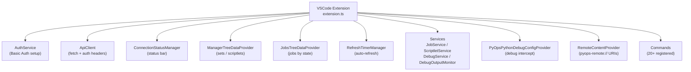
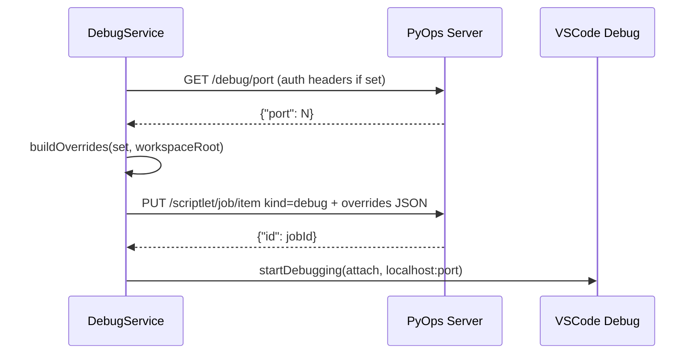

## PyOps VSIX Extension — Technical Reference

### Overview

The `vsix/` directory contains the VSCode extension for PyOps. It provides a graphical interface for managing scriptlets and jobs, supporting create/sync/diff/debug workflows against a running PyOps server.

### Architecture



**Activation events**: `onView:pyops-manager`, `onView:pyops-monitor`.

### Key Module Map

| File | Role |
|------|------|
| `src/extension.ts` | Main activation: initializes all services, registers providers/commands, handles deactivation |
| `src/apiClient.ts` | Shared HTTP client: `fetch(path, init?)`, `fetchJson<T>(path, init?)`, `getServerUrl()`, `getHeaders()`, `hasValidConfig()` |
| `src/utils.ts` | `inferExt(type)`: maps scriptlet type → file extension |
| `src/ConnectionStatusManager.ts` | Status bar item showing server connectivity |
| `src/managerTreeProvider.ts` | `ManagerTreeDataProvider`: sets → scriptlets hierarchy, sync status, local-only discovery |
| `src/jobsTreeProvider.ts` | `JobsTreeDataProvider`: jobs grouped by state, sorted by start time |
| `src/providers/RemoteContentProvider.ts` | `TextDocumentContentProvider` for `pyops-remote://` scheme |
| `src/commands/CreateScriptletCommand.ts` | Create new scriptlet: prompts type/set/name, writes template, opens editor |
| `src/services/AuthService.ts` | Static: prompts and stores Basic Auth password |
| `src/services/JobService.ts` | Job lifecycle: cancel, delete, download, view, bulk ops, polling |
| `src/services/ScriptletService.ts` | Scriptlet sync: local↔remote draft, diff, delete, open |
| `src/services/DebugService.ts` | Debug enqueue: build overrides, fetch port, attach config |
| `src/services/DebugOutputMonitor.ts` | Polls job stdout/stderr; streams to output channel |
| `src/services/RefreshTimerManager.ts` | Starts/stops auto-refresh timers for tree providers |
| `src/services/PyOpsPythonDebugConfigProvider.ts` | `DebugConfigurationProvider` intercept for Python task launches |

---

## Configuration (`pyops.*` workspace settings)

| Key | Type | Default | Purpose |
|-----|------|---------|---------|
| `serverUrl` | string | `http://localhost:8000` | PyOps server base URL |
| `username` | string | — | Basic Auth username (optional) |
| `timeout` | number | 30 | HTTP request timeout in seconds |
| `useRemoteLinter` | boolean | true | Enable Jedi completion via server |
| `localPyopsDir` | string | `pyops` | Workspace-relative path to local scriptlet directory |
| `autoRefreshInterval` | number | 10 | Tree auto-refresh interval in seconds |
| `excludedSets` | string[] | `[]` | Sets excluded from Manager tree |
| `debugPort` | number | 5678 | Debug port used for Python debugpy attach |

`hasValidConfig()` (in `apiClient.ts`) returns false if `serverUrl` is empty/undefined — it does **not** check any other config keys. Auth is optional: `getHeaders()` returns Basic Auth header only if both `username` and a stored password exist.

`ApiClient.fetch(path, init?)` is the primary HTTP method: prepends `getServerUrl()` to the path, merges auth headers from `getHeaders()` with any headers in `init`, and delegates to `global.fetch()`. `fetchJson<T>()` adds response-ok validation and JSON parsing. All services (`DebugService`, `JobService`, `ScriptletService`, `DebugOutputMonitor`, `ConnectionStatusManager`, `CreateScriptletCommand`) and tree providers use `apiClient.fetch()` — no service builds its own URL/header combination.

---

## Tree Providers

### ManagerTreeDataProvider

Displays scriptlet sets with their scriptlets. Each refresh:

1. `fetchScriptlets()` — `GET /scriptlet/inventory/list` → `ScriptletInfo[]`
2. `scanLocalScriptlets()` — walks `{localPyopsDir}/pyops/{set}/{type}/` for files matching `inferExt(type)`; marks `isLocalOnly: true`
3. Merges remote and local lists; applies `excludedSets` filter
4. Downloads remote-only scriptlets to `{localPyopsDir}/pyops/{set}/{type}/{name}{ext}`
5. Checks `has_unstaged_changes` per scriptlet to set sync status icon

**ScriptletInfo interface:**

```typescript
interface ScriptletInfo {
    set: string;
    name: string;
    type: string;            // 'task' | 'service' | 'library' | 'controller' | 'view' | 'markdown' | 'jslibrary'
    isLocalOnly?: boolean;
}
```

**Tree item display:**

| Condition | Icon | `contextValue` | Description |
|-----------|------|---------------|-------------|
| Local-only | diff-added | `pyopsItem-{type}-local` | `{ext} (local)` |
| Remote, synced | check | `pyopsItem-{type}` | sync status |
| Remote, dirty | warning | `pyopsItem-{type}` | sync status |

**Context menu visibility** (from `package.json` `when` clauses):
- `resetLocalFromRemote`, `saveRemoteDraft`, `diffLocalRemote` — excluded from `-local` items
- `writeLocalToRemoteDraft`, `deleteScriptlet` — available on all `pyopsItem-*` including `-local`
- `startDebugJob`, `stopDebugJob` — available on `/^pyopsItem-task(-local)?$/`

### JobsTreeDataProvider

Lists jobs grouped by state, sorted by `start` timestamp descending. Fetches `GET /scriptlet/job/list`.

**Job interface:**

```typescript
interface Job {
    id: string;
    kind: string;            // 'task' | 'service' | 'debug' | 'draft'
    name: string;
    set: string;
    owner?: string;
    start: string;           // ISO datetime
    state: string;           // 'todo' | 'dequeued' | 'running' | 'done' | 'failed' | 'cancelled' | 'killed'
    detail?: string;
    end: string;
    param?: string;
}
```

---

## File Type Mapping (`src/utils.ts`)

`inferExt(type: string): string`:

| Type | Extension |
|------|-----------|
| `task`, `service`, `library`, `controller` | `.py` |
| `view` | `.html` |
| `markdown` | `.md` |
| `jslibrary` | `.js` |
| unknown | `.py` (fallback) |

---

## Remote Content Provider (`src/providers/RemoteContentProvider.ts`)

Serves `pyops-remote://{set}/{name}?type={type}` URIs. Content is decoded from the URI fragment (base64). Language mode is set via `registerRemoteLanguageModeSetter()`:

| Type | Language ID |
|------|-------------|
| `task`, `service`, `library`, `controller` | `python` |
| `view` | `html` |
| `markdown` | `markdown` |
| `jslibrary` | `javascript` |

Used by `diffLocalRemote` to show the remote version read-only in the VSCode diff editor.

---

## Services

### AuthService (`src/services/AuthService.ts`)

`static setupAuth(context, outputChannel)`:
- Skips if `username` not configured
- Prompts for password if none stored in workspace state
- Stores password via `context.workspaceState.update()`

### JobService (`src/services/JobService.ts`)

Manages job lifecycle operations used by Monitor view commands.

**Key public methods:**

| Method | Description |
|--------|-------------|
| `listJobs()` | Fetches all jobs; used by `attachDebugJob` command |
| `cancelJob(item)` | `PUT /scriptlet/job/item` state=cancel |
| `deleteJob(item)` | `DELETE /scriptlet/job/item` (confirmation required) |
| `downloadJob(item)` | Downloads job workspace as ZIP |
| `viewJob(item)` | Opens output channel; polls stdout/stderr until terminal state |
| `copyJobParam(item)` | Copies job `param` to clipboard |
| `cancelAllJobs()` | Cancels all non-terminal jobs |
| `deleteAllDone()` | Deletes all `done`/`cancelled` jobs |
| `deleteAllFailed()` | Deletes all `failed`/`killed` jobs |
| `dispose()` | Clears active polling intervals |

`viewJob` polls at 1s intervals; stops on terminal states: `done`, `failed`, `cancelled`, `killed`, `remove`, or HTTP 404.

### ScriptletService (`src/services/ScriptletService.ts`)

Manages local↔remote synchronization for scriptlets.

| Method | Description |
|--------|-------------|
| `resetLocalFromRemote(item)` | `GET /scriptlet/inventory/item` → writes local file |
| `writeLocalToRemoteDraft(item)` | Reads local file → `PUT /scriptlet/inventory/item` (creates if 404) → `POST /scriptlet/editor/draft` |
| `saveRemoteDraft(item)` | `POST /scriptlet/inventory/item` (commit draft) |
| `diffLocalRemote(item)` | Opens VSCode diff: `pyops-remote://` URI vs local file |
| `deleteScriptlet(item)` | `DELETE /scriptlet/inventory/item` + removes local file |
| `openLocalFile(item)` | Opens local file in editor |

`writeLocalToRemoteDraft` auto-creates the remote scriptlet via `PUT` if it doesn't exist (HTTP 404), then posts the draft. Network errors on check/create are caught with specific `showErrorMessage` calls.

### DebugService (`src/services/DebugService.ts`)

Handles PyOps debug job enqueueing and Python debugpy attach config.



**Public methods:**

| Method | Description |
|--------|-------------|
| `static buildOverrides(set, workspaceRoot)` | Walks `{localPyopsDir}/pyops/{set}/*.py`; returns `{set}::{name}: code}` overrides dict + debugpy path mappings |
| `enqueueDebugJob(set, name, overrides)` | Fetches port, enqueues debug job with overrides, returns `{jobId, port}` |
| `getDebugPort()` | `GET /debug/port`; validates int in range 1–65535 |
| `getDebugHost()` | Parses hostname from `pyops.serverUrl`; falls back to `'localhost'` |

### DebugOutputMonitor (`src/services/DebugOutputMonitor.ts`)

Polls job output (stdout/stderr) and streams it to a named output channel.

| Method | Description |
|--------|-------------|
| `startMonitoring(key, jobId)` | Begins 1s polling cycle; appends new output incrementally |
| `stopMonitoring(key)` | Stops polling; cancels the job |
| `isMonitoring(key)` | Returns true if actively polling |
| `dispose()` | Clears all active timeouts |

Auto-stops when job reaches a terminal state: `done`, `failed`, `cancelled`, `killed`, `remove`, or HTTP 404. On stop it also fetches any available `stderr` error log.

### RefreshTimerManager (`src/services/RefreshTimerManager.ts`)

Manages setInterval-based auto-refresh for both tree providers.

- `ensureRunning()` — starts timers using `pyops.autoRefreshInterval` (default 10s); skips if already running
- `stopIfRunning()` — clears both manager and monitor timers
- `dispose()` → calls `stopIfRunning()`

---

## PyOpsPythonDebugConfigProvider (`src/services/PyOpsPythonDebugConfigProvider.ts`)

Implements VSCode `DebugConfigurationProvider` for Python debug launches from task scriptlet files.

On `resolveDebugConfiguration`:
1. Validates that the active file is inside `pyops/{set}/task/`
2. Calls `DebugService.buildOverrides(set, workspaceRoot)`
3. Calls `DebugService.enqueueDebugJob(set, name, overrides)`
4. Returns an attach-mode debug configuration targeting `localhost:{port}` with `justMyCode: false`
5. Injects `jobId` into the config to prevent re-triggering on the same session

Used by `pyops.startDebugJob` command and the attach-on-launch flow.

---

## Debug Integration

Full debug lifecycle connects VSIX, PyOps server, and the runner:

### Enqueue with Overrides

`PUT /scriptlet/job/item` with `kind="debug"` skips `git.read_content` existence check if `overrides["{set}::{name}"]` is present — enables local-only debug jobs without a committed remote scriptlet.

### Runner Override Injection

`app/runner.py loadJob()` skips the `os.listdir` file check for `kind="debug"` when `job.overrides` contains a valid JSON dict with `"{set}::{name}"` key. Sets `code = override_dict[main_key]`. Falls back to `git.read_content` on missing override or invalid JSON (logs warning). `committed=False` for debug fallback.

### `#>AWAIT_DEBUG` Directive

`app/job_runner.py run_debug_job()` always injects `debugpy.listen(('0.0.0.0', port))`. Appends `debugpy.wait_for_client()` only if `'#>AWAIT_DEBUG' in job.param`. VSIX `DebugService.enqueueDebugJob` sets `param='#>AWAIT_DEBUG'` to enable client-wait on the attach workflow.

### Attach Debug Command (`pyops.attachDebugJob`)

Title bar button in `pyops-manager` panel:
1. `JobService.listJobs()` — filters `kind="debug"` and `state` in `["running", "dequeued"]`
2. Requires exactly one matching job; warns on zero or multiple
3. `DebugService.getDebugPort()` — fetches port for the job's owner
4. `vscode.debug.startDebugging()` — debugpy attach to `localhost:{port}`, `justMyCode: false`
5. Session name: `Attach to PyOps Debug ({set}::{name})`

Enables re-attach to a detached debug session without reenqueue.

### Debug Port Endpoint

`GET /debug/port` uses `sanitize_owner(X-User, default "anonymous")` and reads `conf_users()[owner]["debug_port"]`. Returns `{"port": int}`. Returns 400 if `debug_port` not configured for the user.

---

## Commands

All commands registered in `extension.ts`. 20 total:

| Command | Description |
|---------|-------------|
| `pyops.refreshManager` | Refresh Manager tree |
| `pyops.createScriptlet` | Create new scriptlet (type/set/name prompt) |
| `pyops.resetLocalFromRemote` | Download remote version to local file |
| `pyops.writeLocalToRemoteDraft` | Upload local file to remote draft (auto-create if missing) |
| `pyops.saveRemoteDraft` | Commit remote draft to main version |
| `pyops.diffLocalRemote` | Open VSCode diff: remote vs local |
| `pyops.deleteScriptlet` | Delete remote + local scriptlet |
| `pyops.openLocalFile` | Open local scriptlet file in editor |
| `pyops.startDebugJob` | Enqueue debug job with local overrides, launch debugger |
| `pyops.stopDebugJob` | Stop active debug job |
| `pyops.attachDebugJob` | Attach debugger to existing running debug job |
| `pyops.refreshMonitor` | Refresh Monitor tree |
| `pyops.copyJobParam` | Copy job param to clipboard |
| `pyops.cancelJob` | Cancel a single job |
| `pyops.downloadJob` | Download job workspace as ZIP |
| `pyops.deleteJob` | Delete a job (confirmation required) |
| `pyops.viewJob` | Open job stdout/stderr in output channel with polling |
| `pyops.cancelAllJobs` | Cancel all non-terminal jobs |
| `pyops.deleteAllDone` | Delete all done/cancelled jobs |
| `pyops.deleteAllFailed` | Delete all failed/killed jobs |

---

## Testing

### Unit Tests (`vsix/tests/`, Jest)

Coverage targets: branches 80%, functions 80%, lines 90%, statements 80%.

| Test file | Covers |
|-----------|--------|
| `apiClient.test.ts` | `getServerUrl`, `getAuthHeaders`, auth/noauth paths |
| `ConnectionStatusManager.test.ts` | Status bar updates, auth retry logic |
| `extension.test.ts` | Activation, command registration |
| `utils.test.ts` | `inferExt` all cases including unknown type |
| `managerTreeProvider.test.ts` | `getTreeItem`/`getChildren`, fetch/download, error handling, refresh graceful failure |
| `jobsTreeProvider.test.ts` | Job state display, bulk operations |
| `providers/RemoteContentProvider.test.ts` | `provideTextDocumentContent`, `registerRemoteLanguageModeSetter` conditional logic, missing language mappings, event emitter |
| `commands/createScriptletCommand.test.ts` | Dialog flow, type/set/name validation, template write |
| `services/AuthService.test.ts` | `setupAuth` prompts and storage |
| `services/JobService.test.ts` | CRUD operations, bulk cancel/delete, `viewJob` polling with stdout/stderr updates, terminal state transitions, error handling, undefined provider handling, timer cleanup |
| `services/ScriptletService.test.ts` | Local/remote sync, network error handling, `existsSync` filesystem branches, multi-step error scenarios |
| `services/DebugService.test.ts` | `buildOverrides`, `enqueueDebugJob`, `getDebugPort` success/auth/noauth/fail/invalid-port/throw |
| `services/DebugOutputMonitor.test.ts` | Start/stop monitoring, incremental stdout/stderr append, channel display, stop on terminal states, error log fetch |
| `services/RefreshTimerManager.test.ts` | `ensureRunning`, `stopIfRunning` |
| `services/PyOpsPythonDebugConfigProvider.test.ts` | Config provision for task files |

**Mock patterns:**
- Hoisted `jest.mock('../src/services/*')` with `mockImplementation` for instances/methods
- `mockApiClient.fetch` for all API calls (via `createMockApiClient` helper which provides `fetch`, `fetchJson`, `getHeaders`, `getServerUrl`, `hasValidConfig` mocks)
- `fs`/`path` mocks for filesystem operations
- VSCode API mocks: `window.createOutputChannel`, `workspace.getConfiguration`, etc.
- `beforeEach(jest.clearAllMocks())` for isolation; `beforeAll` for shared activation

### Integration Tests (`vsix/tests/integration/`, VSCode electron)

Run with `npm run test:integration --prefix vsix/`. Requires a running PyOps server on `localhost:8000` without authentication. Excluded from CI/CD (no VSCode available in CI).

Uses `@vscode/test-electron` and a simple console-based test runner. Test suites:

| Suite file | Covers |
|------------|--------|
| `suite/core.test.ts` | Extension activation, view presence, command registration |
| `suite/command_integration.test.ts` | Command execution end-to-end |
| `suite/manager.test.ts` | Manager tree interactions |
| `suite/monitor.test.ts` | Job monitoring |
| `suite/debug.test.ts` | Debug job lifecycle |
| `suite/content.test.ts` | Content provider functionality |
| `suite/helpers.test.ts` | Helper utility verification |

Extension services accessed via `(global as any).serviceName` — not direct TypeScript imports. Static methods accessed via `serviceInstance.constructor.methodName` or class name.

### Integration Test TypeScript Config

Integration tests use a **separate** `tests/integration/tsconfig.json` from the main extension `tsconfig.json`:
- Different `rootDir` and `include` patterns (must list both suite files and utility files explicitly)
- Separate `outDir` (`tests/integration/out/`)
- `rootDir` must exactly match the directory containing all compiled source files

---

## Build and Compilation

| Script | Purpose |
|--------|---------|
| `npm run compile` | `tsc -p ./` — compiles `src/` → `out/` |
| `npm run watch` | `tsc -watch -p ./` |
| `npm run test` | Jest unit tests |
| `npm run test:coverage` | Jest with coverage report |
| `npm run test:integration` | Compile + compile integration tests + run electron |
| `npm run lint` | ESLint on `src/` |
| `vscode:prepublish` | `compile` |

**TypeScript config**: `target: ES2020`, `module: CommonJS`, `strict: true`, `outDir: out/`, `rootDir: src/`. Compiled JS files must only exist in `out/` — any `.js` in `src/` indicates misconfiguration.
