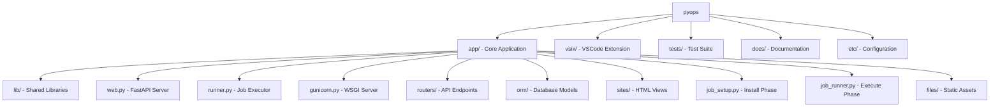
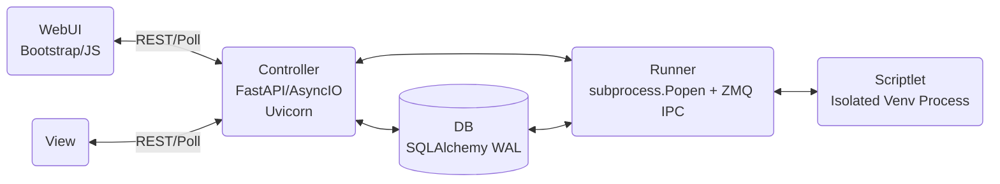
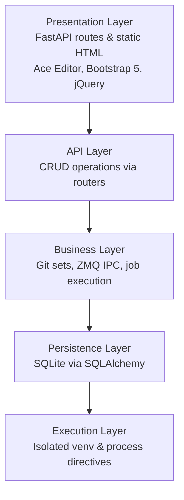
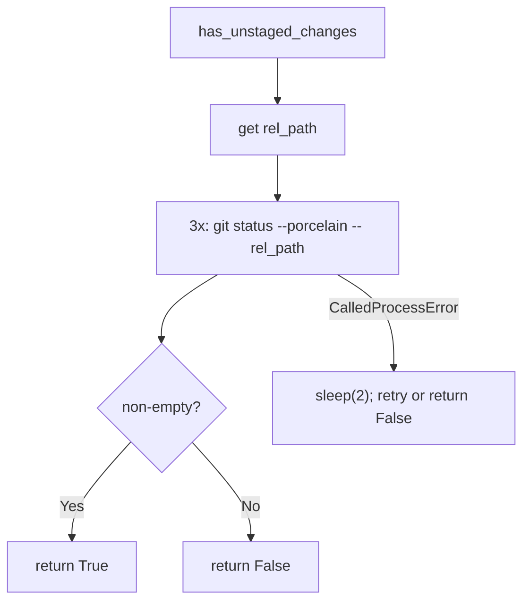
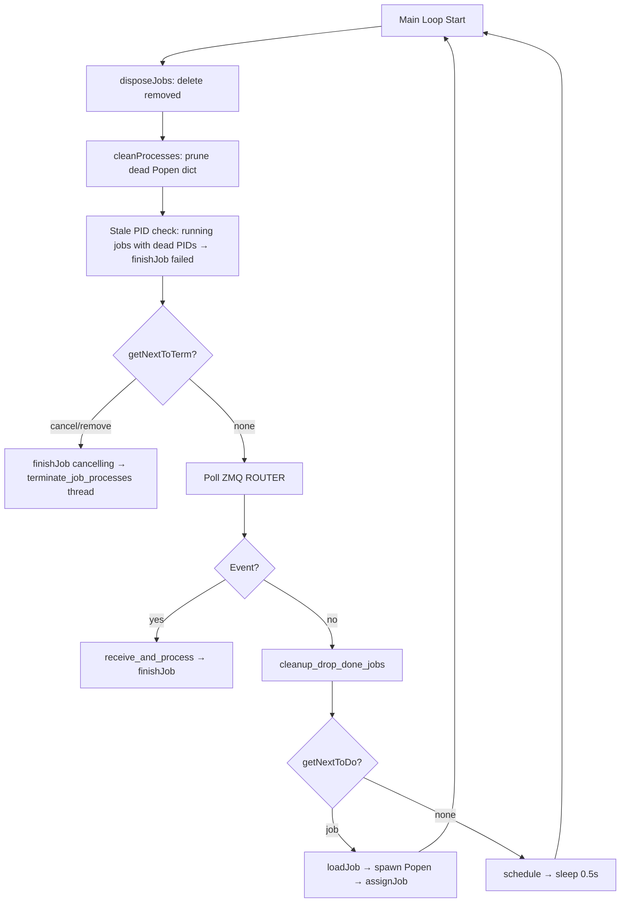
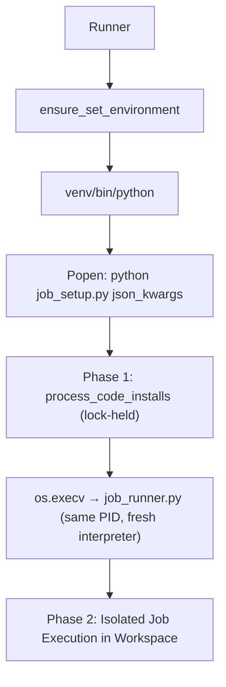
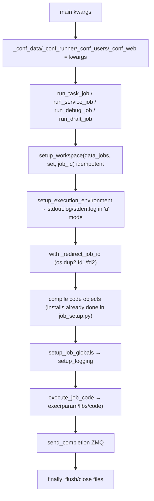
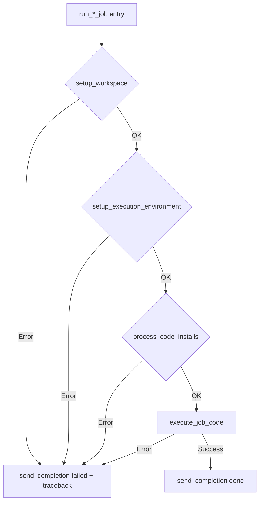
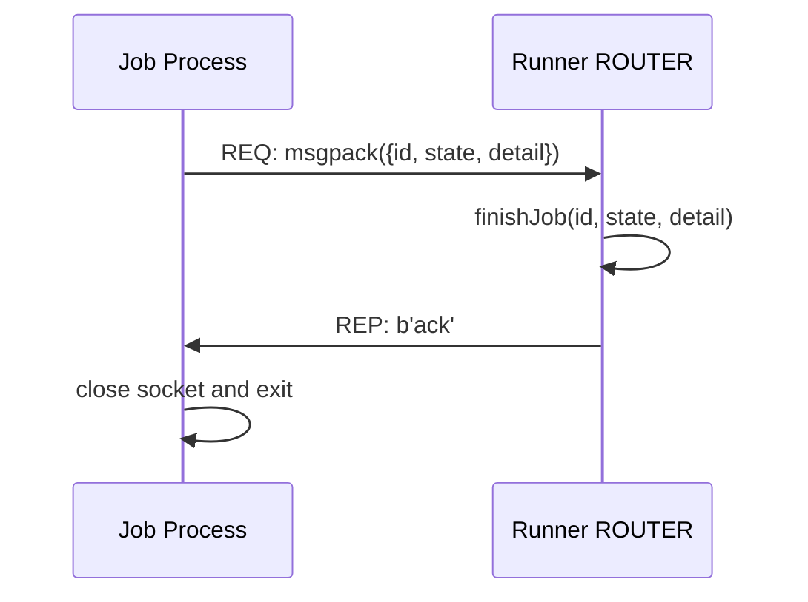
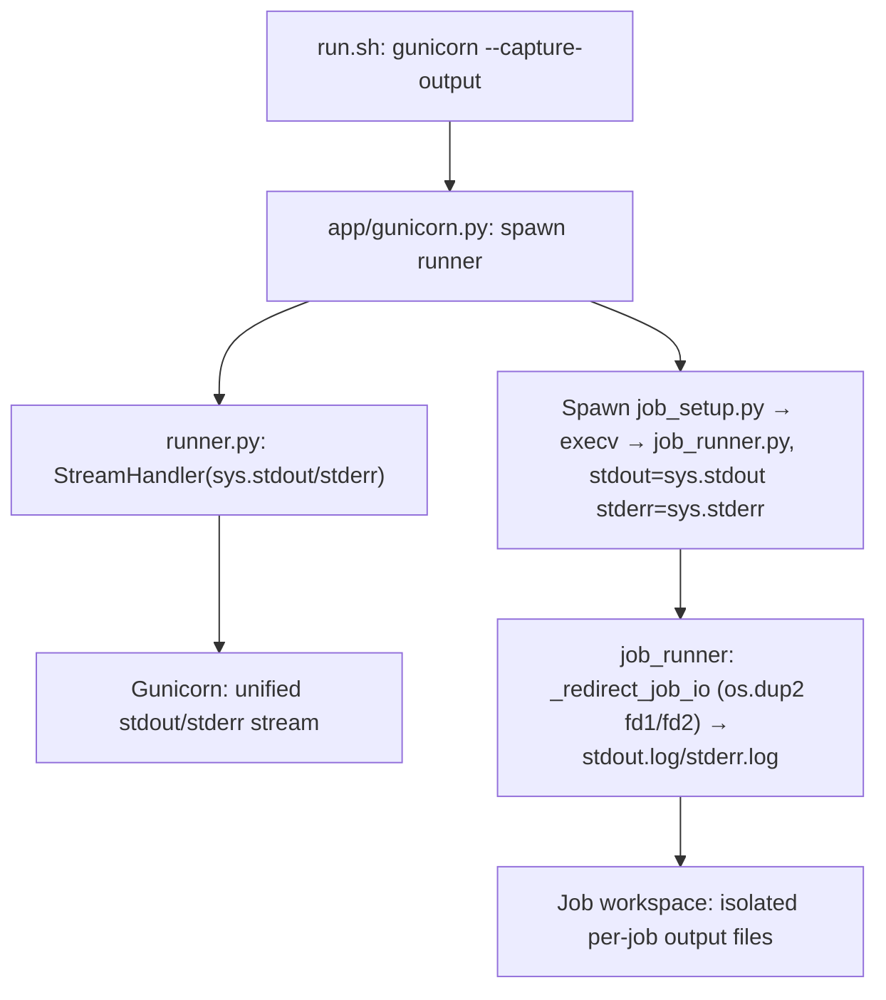

# PyOps App — Technical Reference

## Overview

PyOps is an "Execution Platform" for "Python Operations Scriptlets". Licensed under GNU AGPLv3, organized as a monorepo: core app in `app/`, VSCode extension in `vsix/`, tests in `tests/`, documentation in `docs/`.

### Monorepo Layout



### System Architecture



### Architecture Layers



### Technology Stack

- **Backend**: Python 3.12, FastAPI, SQLAlchemy 2.x, ZMQ, msgpack
- **Database**: SQLite (thread-safe WAL mode)
- **Frontend**: Bootstrap 5, jQuery 3.6, Ace Editor, Material Icons

### Key Module Map

| File | Role |
|------|------|
| `app/web.py` | FastAPI app, routes, controller proxy |
| `app/runner.py` | Background daemon: polls DB, spawns jobs, handles ZMQ |
| `app/job_setup.py` | First-phase subprocess: per-set venv, runs directive installs under bootstrap lock, then `os.execv`s into job_runner.py |
| `app/job_runner.py` | Second-phase subprocess (post-execv): same PID, fresh interpreter; executes user code |
| `app/gunicorn.py` | WSGI config; also spawns the runner process |
| `app/lib/files.py` | Config access (`etc/pyops.json`) |
| `app/lib/git.py` | Scriptlet storage in Git repos |
| `app/lib/runner.py` | DB-level job utilities: `enqueue`, `query`, `find`, `cancel`, `remove`, `drop` |
| `app/lib/job.py` | Execution utilities: `send_completion`, `process_imports`, `process_install_lines`, `process_code_installs` (acquires `sets.set_install_lock`), `kill_proc_tree`, `get_process_tree`, `loadLib`, `install_git_repo` |
| `app/lib/pyops.py` | `Control` (API proxy), `ServiceListener`, `ServiceClient` |
| `app/lib/sets.py` | Runner-side per-set venv primitives only: `ensure_set_environment`, `set_install_lock`, bootstrap-lock helpers, `CORE_DEPS`. The user-facing clone/create/pull/switch/remove/list/update-deps operations live as scriptlets under `app/pyops/` and are reached via `/controller/pyops/sets`. |
| `app/pyops/` | Pyops-managed scriptlet bundle: sets controller, data service, `set_*` sub-tasks, shared library, jslibrary modal, reusable libraries (e.g. `pyops::pytest`). Self-hosted admin operations plus the public library namespace user scriptlets import from via `#!{pyops::name}`. |
| `app/lib/sites.py` | Site rendering utilities |
| `app/lib/async_utils.py` | Async helper utilities |
| `app/lib/auth.py` | `sanitize_owner()` for `X-User` header normalization |
| `app/orm/` | SQLAlchemy models: `Job`, `Schedule` |
| `app/routers/scriptlet/` | REST API routers |
| `app/sites/` | Static HTML templates: `root/root.html`, `scriptlet/` views |

---

## Configuration (`app/lib/files.py`)

`Config` class manages `etc/pyops.json`; loaded once at startup via `Config.init()`. Both `app/gunicorn.py` and `app/runner.py` read the `PYOPS_CONFIG` environment variable to override the default config path (`etc/pyops.json`). This enables isolated E2E test instances with separate data directories and ports. No built-in auth; proxy recommended.

### JSON Structure

- `web`: `{"bind": "127.0.0.1:8000", "worker": 8, "timeout": 300, "expanded_sets": []}`
- `brand` *(optional)*: `{"title": "PyOps", "icon": "miscellaneous_services", "favicon": null}` — operator-facing chrome. `title` → `<title>` + sidebar/topbar header; `icon` → material-icons-round glyph name OR image path served via `/brand/icon`; `favicon` → optional image served at `/favicon.ico`. Paths can be absolute or project-root-relative. Defaults reproduce the bundled look so existing deployments don't need to opt in.
- `data`: `{"jobs": "data/jobs", "git": "data/git", "db": "data/app.db"}`
- `runner`: `{"venv": "data/venv", "pkg": "data/pkg", "git_pull_interval": 60, "drop_done_delay_seconds": 60}`
- `log`: `{"loglevel": "debug"}`
- `users`: per-owner table; pyops itself reads nothing more than the keys to identify owners. Any client-side debug-port pool, credentials, etc. live in client configs (VSIX workspace settings, pyopsctl profile TOML), not here.

### Access Methods

- `conf_data()`: data section (jobs, git, db)
- `conf_runner()`: runner section (venv, pkg, git_pull_interval, drop_done_delay_seconds)
- `conf_web()`: web section (bind)
- `conf_log()`: log section (loglevel)
- `conf_users()`: users section (per-owner table; pyops reads owners only)
- `get(path)`: serves static files from `app/files/`

---

## Data Models (`app/orm/`)

SQLite file-based DB in `data/app.db`, thread-safe WAL mode.

`app/orm/database.py`: `get_db_path()`, `init_db()` (creates tables on startup), `get_db_engine()`, `destroy_db()`.

### Job

| Column | Type | Notes |
|--------|------|-------|
| id | String PK | `{owner}_{set}_{name}_{timestamp}` |
| owner, set, name, kind | String | indexed |
| state | String | indexed; see state machine below |
| drop_done | Boolean | auto-remove on completion |
| max_retries | Integer | default=0 |
| param | String | job parameter/code snippet |
| pid | Integer | set on spawn; stays set across `loading`→`running`→terminal |
| detail | String | error message or traceback |
| overrides | String | JSON dict for debug/VSIX local code |
| start, end | DateTime | timestamps |

**State machine**: `todo → dequeued → loading → running → done/failed/cancel/cancelling/cancelled/remove/removed`

- `cancel`: requested by API
- `cancelling`: runner is actively terminating the process
- `cancelled`: termination complete
- `remove`: marked for workspace deletion
- `removed`: workspace deleted, pending DB cleanup

### Schedule

| Column | Type | Notes |
|--------|------|-------|
| id | Integer PK | autoincrement |
| schedule | String | cron expression for tasks; empty string for persistent services |
| set, name, owner | String | indexed |
| active | Boolean | indexed |
| drop_done | Boolean | default=True |
| max_retries | Integer | default=0 |
| param | String | |
| last | DateTime | last trigger time; indexed |

---

## Git Operations (`app/lib/git.py`)

Manages scriptlet files as Git repos in `data/git/{set}/`. All mutating operations are serialized via `repo_lock(git_base, set_name)` — an `fcntl.flock` exclusive lock on a persistent `data/git/{set}.lock` file. The lockfile is never unlinked: removing it after release would let a late caller open a new inode while another caller still holds flock on the unlinked one, breaking mutual exclusion.

### Scriptlet File Conventions

- Tasks/libraries/controllers: `{name}.{type}.py`
- Views: `{name}.html`
- JS libraries: `{name}.js`
- Markdown: top-level `README.md` for the set's primary doc; any number of additional markdown pages under `docs/{name}.md`. All resolve to type `markdown`. The split keeps free-named markdown out of the scriptlet-name namespace (the `name` of a `docs/notes.md` entry is `notes`, not subject to collision with a `notes.task.py`).
- Data: `data/{name}.{yaml,yml,json}` for set-scoped YAML/JSON. Resolve to type `data`. `list_scriptlets` reports an `ext` field for these entries so clients can mirror the actual format locally. See "Set Data" below.
- Types inferred by `infer_type_from_filename()`; `get_file_path(repo, name, "markdown")` returns `README.md` for `name == "README"`, otherwise `docs/{name}.md`. `get_file_path(repo, name, "data")` returns the existing `data/{name}.{yaml,yml,json}` or, for a brand-new file, defaults to `data/{name}.yaml`.
- Name uniqueness: `check_name_unique(repo, name)` covers top-level scriptlets, `docs/*.md` pages, and `data/*` files — all live in one namespace per set. Inventory creates and `data.write` use the same check so a `notes.task.py` and a `docs/notes.md` cannot both exist, and `config.yaml` excludes `config.json` (and vice versa).

### Operations

- `get_repo_path(set)`: resolves `data/git/{set}/`; initializes `.git`, `.gitignore`, `README.md` if missing
- `read_content(repo, name, type_, committed, strict)`: reads working tree (default) or `git show HEAD:` for committed; `strict=True` raises if no committed version
- `write_content(repo, name, type_, content)`: writes file under `repo_lock`
- `create_scriptlet(set_name, name, type_, content)`: atomic unique-name check + working-tree write under one `repo_lock` span (closes the race where two concurrent same-name creates pass `check_name_unique` before either writes); raises `FileExistsError` on duplicate. No commit — the new file shows up as untracked and is folded into the next `set_commit_drafts` batch.
- `delete_file_unstaged(repo, file_path)`: working-tree-only deletion under `repo_lock`; no `git rm`, no commit, no push. Idempotent on a missing path.
- `list_scriptlets()`: scans all sets (top-level files plus `docs/*.md`), returns `[{"set", "name", "type"}, ...]` sorted
- `get_repo_status(set)`: returns `{"branch", "is_tag", "flag"}`
- `rollback_staged(set, name, type_)`: backs up to `.bck`, then `git checkout HEAD`
- `rollback_committed(set, name, type_)`: `git checkout HEAD` (discards unstaged)
- `check_name_unique(repo, name)`: prevents duplicate scriptlet names
- `pull(repo)`: soft-reset to `origin/{branch}` if clean; skips if dirty or on tag; adds new `.py/.html/.js/README.md/docs/*.md` files from HEAD if missing in working directory; retries fetch on `CalledProcessError`

### Sets Management and the `pyops` set (`app/pyops/`)

Groups of scriptlets each live in their own Git repo under `data/git/{name}/`. The user-facing list/clone/create/pull/switch/remove/update-deps operations are not hardcoded routers — they are pyops scriptlets in the bundled `pyops` set, reached at `/controller/pyops/sets`. The same set is also the **public library namespace** user scriptlets import from via `#!{pyops::name}` (e.g. `#!{pyops::pytest}`).

Structure of the bundle:

| File | Role |
|------|------|
| `sets.controller.py` | Controller; binds the proxy to `service="data"`, sets the head/menu/body views |
| `sets_head.html`, `sets_menu.html`, `sets_body.html` | The Sets UI fragments |
| `data.task.py` | Service (`kind=service`); `ServiceListener` loop that routes incoming `controller/pyops/sets/{...}` requests |
| `set.library.py` | Shared helpers used by the `set_*` tasks (lock paths, run_cmd, status) |
| `set_clone.task.py`, `set_create.task.py`, `set_pull.task.py`, `set_switch.task.py`, `set_remove.task.py`, `set_update_deps.task.py`, `set_commit_drafts.task.py`, `set_discard_drafts.task.py` | One task per mutating operation, each held against the same `set_install_lock` the runner-side spawn path uses |
| `sets_job.js` | Jslibrary modal (loaded as `pyops::sets_job`): fires the sets-management controller POST, polls `/scriptlet/job/item` until terminal, tails stdout/stderr live |
| `pytest.library.py` | Reusable library imported from test-kind tasks via `#!{pyops::pytest}` — programmatic pytest invocation against named test classes, conditional coverage (see "Test Jobs") |

Request flow for a mutating action (e.g. clone):

1. UI calls `POST /controller/pyops/sets/clone` (jslib modal opens).
2. FastAPI's `controller_proxy` finds the running `data` service and forwards the request via ZMQ.
3. `data.task.py` enqueues a `set_clone` task with `drop_done=True` via `control.job.create(...)`, returns the job id.
4. The modal polls `/scriptlet/job/item?id=<id>` and tails the job's stdout/stderr.
5. The `set_clone.task.py` task runs in the runner, acquires `set_install_lock(name)`, performs the git operation, exits — runner finishes the job, drop_done auto-removes the row.

HTTPS credentials never live in the origin URL. `set_clone.task.py` does a `git remote set-url` after clone to strip any `user:token@host` prefix the operator passed in, leaving the `.git/credentials` helper as the single source of truth — token rotation by editing that file actually takes effect. Legacy sets cloned by pre-3.3.0 pyops have the credentials baked into the URL; `set.library.normalize_origin_url(repo_path)` runs from `set_commit_drafts` (before push) and `set_pull` (before fetch) to rewrite those origins on the next mutating operation. Idempotent for already-clean URLs and a no-op for SSH / file:// schemes.

The `pyops` set is a fixed bundle: the git lib resolves the set name `"pyops"` to `<project_root>/app/pyops/` with direct filesystem reads, no `.git` initialised in there. `list_sets()` (filesystem walk done by `data.task.py`) hides `pyops`; the inventory router and the `set_remove` task refuse to touch it. The `pyops::*` library namespace is reachable from any user scriptlet via the `#!{pyops::name}` directive — the library code is exec'd into the importing job's globals exactly like a same-set library, but the source lives with the pyops application.

Runner-side primitives in `app/lib/sets.py` (still used directly by the runner and by `set_install_lock` callers):

- `ensure_set_environment(name)`: idempotent — creates `data/venv/{name}` and pip-installs `CORE_DEPS` (pyzmq, msgpack, psutil, requests, pyyaml) under `_bootstrap_lock`. Skipped entirely for `name == "pyops"` — those scriptlets run in pyops's own host venv via `sys.executable`. Debug-kind jobs whose client bootstrap needs an extra package (e.g. `debugpy`, `gdbserver` companion libs) pull it via a `#!<pkg>` directive in `param`, not from CORE_DEPS. `pyyaml` is in CORE_DEPS because the `data` global injected into every scriptlet needs it for YAML reads/writes — making it part of the floor avoids per-scriptlet `#!pyyaml` boilerplate.
- `set_install_lock(name)`: `fcntl.flock` context manager on `data/git/{name}/.install.lock`, used both by `process_code_installs` and by the `set_*` tasks.

### Status Detection

`has_unstaged_changes(repo, name, type_) -> bool`: lock-free `git status --porcelain --untracked-files=all -- {rel_path}`; 3 attempts with 2s sleep on `CalledProcessError`.



### Set Data (`app/lib/data.py`)

Tasks and libraries in the same set can read/write small structured files under `data/git/{set}/data/`. The `data` global is injected into every scriptlet's namespace by `job_runner.setup_job_globals`; it is bound to the calling job's set and has no surface for cross-set access.

```python
# read (shared lock — concurrent reads in different jobs proceed in parallel)
with data.read("config") as cfg:
    threshold = cfg["threshold"]

# write (exclusive lock — blocks readers and other writers for this file)
with data.write("state") as st:
    st["last_run"] = time.time()

data.list()                     # ['config', 'state']
```

Format is auto-detected by extension: `.yaml`/`.yml` use `yaml.safe_load`/`safe_dump`, `.json` uses `json.loads`/`dumps`. On a brand-new file the caller passes `format="yaml"` or `format="json"`; existing files keep their format.

Concurrency:

- One `fcntl.flock` per file at `data/git/{set}/data/.{name}.lock` (persistent sidecar, never unlinked — same lockfile lifetime pattern as `repo_lock` and `set_install_lock`).
- `LOCK_SH` for `read`, `LOCK_EX` for `write`. Different files in the same set don't serialise; different sets always run in parallel by construction.
- Writes are atomic: serialise to `{name}.{ext}.tmp` then `os.replace` under the exclusive lock. Readers see either the previous file or the new one — never a torn write.
- Read-modify-write inside one `with data.write(...) as obj:` block is the unit of atomicity; multi-step orchestration that needs to span a "decide then change" cycle should keep both the decision and the change inside the same `with` block.

Name uniqueness:

- A name is unique within a set's `data/` regardless of format. `config.yaml` and `config.json` cannot coexist — the second create raises `FileExistsError`.
- `check_data_name_unique(repo, name)` is the cross-format check used by inventory writes; `SetData.write` calls the same check internally before allocating the new file.
- The set-wide `check_name_unique` (used by scriptlet creates) also returns False if any `data/{name}.{yaml,yml,json}` exists, so scriptlet names and data names share one namespace per set.

Gitignore:

- The set's `.gitignore` (initialised by `get_repo_path` and committed) gets a `data/.*.lock` entry appended on first `SetData` use (idempotent — appended only if missing). The lock sidecars therefore don't appear as unstaged changes.

Inventory integration:

- `list_scriptlets()` walks `data/git/{set}/data/*.{yaml,yml,json}` and emits entries with `type="data"` plus an `ext` field. Clients (VSIX) use the `ext` to mirror the actual format locally — yaml vs json affects both filename and editor language mode.
- `get_file_path(repo, name, "data")` returns the on-disk file if it exists, otherwise defaults to `data/{name}.yaml` for new creates from the inventory router.
- `pull(repo)`'s working-tree restore picks up `data/*.{yaml,yml,json}` alongside `.py/.html/.js/README.md/docs/*.md`.

---

## Job Execution

The execution pipeline spans four components: `app/runner.py` (daemon, host venv), `app/job_setup.py` (first phase in per-set venv), `app/job_runner.py` (second phase in per-set venv, fresh interpreter), and `app/lib/job.py` (shared utilities).

The two-phase split (`job_setup.py` → `os.execv` → `job_runner.py`) exists so editable installs (`pip install -e`) take effect before user code runs. `pip install -e` writes a `.pth` file that Python only reads at interpreter startup via `site.py`. Running installs inside the *same* interpreter that then tries to `import` the new package fails with `ModuleNotFoundError` (the running `sys.path` is frozen). Separating install from execution into two interpreters — the second one launched via `os.execv` so the PID stays the same and runner-side process tracking is unaffected — lets `site.py` ingest every `.pth` on the runner's fresh startup. From the runner's perspective there is still exactly one Popen per job.

### Runner Daemon (`app/runner.py`)

Background daemon spawned by `app/gunicorn.py`. Polls DB, spawns subprocesses, handles ZMQ completion signals.

#### Startup Sequence

1. Remove a stale `/tmp/pyops/shutdown.flag` from a previous unclean exit (so `lib_runner.enqueue` won't refuse from the first iteration).
2. `handleOddJobs()`: `dequeued`→`todo`, `running`→`failed`, `cancel`/`cancelling`→`cancelled` (crash + interrupted-cancel recovery).
3. `purgeLeftoverServiceJobs()`: deletes stale service jobs (dequeued/running/failed/done).
4. `cleanup_drop_done_jobs()`: marks expired `drop_done` done-jobs as `remove`.

#### Main Loop



#### Job Spawn Flow



- `loadJob(job_id)`: fetches from DB, sets state `loading`, returns owner, set, name, kind, param, code, overrides, max_retries
- `assignJob(job_id, pid)`: sets pid + start timestamp on the row. **Does not** change state — the job process flips `loading` → `running` itself, via a `state=running` ZMQ completion message at the kind-specific boundary (task: after `exec(param)` on the first retry attempt; service / draft / debug / test: after `exec(libs)` + `exec(param)` both return). See `markRunning` and the `state=running` subsection below.
- `markRunning(job_id)`: flips `loading` → `running` on the param-done signal from the job process. Honours the same terminal-state CASE protection as `finishJob`, so a cancel that committed before the signal arrived survives.
- `finishJob(job_id, state, detail)`: atomic UPDATE with CAS — preserves any committed `cancel`/`cancelling` state, otherwise applies the supplied state; service jobs with drop_done and state "done" immediately get re-targeted to "remove"; if `old_pid` is set, spawns a daemon `terminate_job_processes` thread to clean up the process tree
- `postTerm(job_id, killed=False)`: if state "remove" → delete job + workspace; else → set state "cancelled" with end/pid cleared
- `terminate_job_processes(job_id, pid, ...)`: HTTP-cancel path — SIGTERM the process tree, poll up to 15s, SIGKILL if still alive, then `postTerm`. Not used in the shutdown path (see Shutdown section below); the daemon-thread escalation is fine while the runner is otherwise idle, but it gets killed when `main()` returns, which is why shutdown needs its own synchronous variant.

#### Scheduling

`schedule()` is called each main loop iteration when no job is queued:
- **Cron tasks** (non-empty `schedule` string): enqueues `task` job when `next_run ≤ now`; skips if one already running.
- **Persistent services** (empty `schedule` string): enqueues `service` job if none active and failed count < 3.
- **Essential services** (`PYOPS_ESSENTIAL_SERVICES`, currently `[{"set":"pyops","name":"data","owner":"system"}]`): same `<3-failed` gating as services-with-empty-schedule, but no `Schedule` row required — the runner keeps the listed services up unconditionally. The `pyops::data` service is what backs `/controller/pyops/sets`.

Every `lib_runner.enqueue` inside `schedule()` is wrapped in `try/except ShutdownPending → return` so a SIGTERM landing mid-iteration terminates the call cleanly rather than escaping as an exception.

#### Shutdown

When SIGTERM/SIGINT lands, `GracefulKiller.exit_gracefully`:

1. Writes `/tmp/pyops/shutdown.flag` (cross-process gate, see below).
2. Flips `kill_now = True`.

The main loop's `while not killer.kill_now` exits at the next iteration boundary; before reaching `getNextToDo`/`schedule()` the loop also checks `if killer.kill_now: continue` so no new jobs are claimed mid-iteration. Then `_shutdown_job_processes(processes, timeout=15.0, runner_socket=…, runner_poller=…)` runs *synchronously* in the main thread:

1. Snapshot live targets — `pid → job_id` for every Popen in `processes` whose `poll()` is still `None`.
2. SIGTERM each process tree (`job_lib.get_process_tree(pid)` + `kill_proc_tree(tree, SIGTERM)`).
3. Wait loop until `timeout` or all exited. Each pass:
   - **Drain the runner ZMQ socket** — services that handle SIGTERM via their `ServiceListener` loop out of `listen()`, run through `job_runner`'s wrap-up, call `job_lib.send_completion(...)` and block on the REQ recv() for the ACK. Without this drain they sit there until the timeout and always get SIGKILL'd. With it, the runner ACKs, `finishJob` updates state to whatever the completion said (typically `done`), and the service exits within milliseconds.
   - Reap exited subprocesses via `subprocess.Popen.poll()`, **not** `psutil.Process.is_running()` — psutil reports zombies as still alive, which made the prior implementation always wait out the full timeout.
4. SIGKILL any survivors (`kill_proc_tree(tree, SIGKILL)`), wait briefly for them to die.
5. Final sweep: for each target whose state is still not terminal (no completion arrived — typical for tasks under default Python SIGTERM, and for SIGKILL'd survivors), mark `cancelled` with `detail="killed during shutdown"` (if SIGKILL'd) or `"terminated during shutdown"` (clean exit, no completion sent).

After `_shutdown_job_processes` returns, the runner drains any final ZMQ events, runs `disposeJobs()` for `remove`-state rows, removes the shutdown flag on its way out.

**Cross-process shutdown flag.** `lib_runner.SHUTDOWN_FLAG_PATH = "/tmp/pyops/shutdown.flag"`. Every `lib_runner.enqueue(...)` call checks `is_shutdown_pending()` first and raises `ShutdownPending` if the flag is present. The flag is also visible to other processes — gunicorn workers handling in-flight `PUT /scriptlet/job/item` or `/scriptlet/schedule/run/{id}` requests refuse new enqueues the moment the runner has been signalled, and so does the `pyops::data` service when its HTTP-back-channel `control.job.create(...)` runs during the shutdown window.

#### Debug Spawn

Debug jobs spawn exactly like every other kind — no special readiness probe, no port allocation, no debugger-specific cleanup. The runner doesn't import or know about any debugger. The only debug-specific behaviour lives in `run_debug_job` (file materialisation under `.debug/src/`, `kind in ("debug", "testdebug")` overrides) and in the job lifecycle (no retry, no execution timeout). The client's `param` block is what brings a debugger up (`debugpy.listen()`, `gdbserver --attach $$ :<port>`, ...); the `state=running` ZMQ completion that flips `loading` → `running` fires after that param block returns. For debug-kind specifically that's after the client has attached AND issued the first `continue` past `debugpy.breakpoint()`, so consumers polling job state observe ready := "debugger bootstrap finished and stepped past first stop". Library imports complete during `loading` (before `exec(param)` runs) so the debugger attaches to a fully-initialised library namespace rather than racing the import stack. `kind=testdebug` reuses `run_debug_job` with `__name__='__test__'` overlaid — see "Testdebug Jobs (Hybrid)" below.

### Job Setup (`app/job_setup.py`)

First-phase subprocess; the runner Popens this entry point with the venv's Python and the JSON kwargs. Single responsibility:

1. Read kwargs from `sys.argv[1]`.
2. Create the workspace at `data/jobs/{set}/{job_id}/`, `chdir` into it.
3. Open `stdout.log` and `stderr.log` in `'w'` mode (truncate; this is the first interpreter to touch the workspace).
4. Call `job_lib.process_code_installs(...)` — which acquires `sets.set_install_lock(set)` and runs every `#!pip` / `#!<git-url>` directive in param, libs, and code under one lock for *job-level atomicity*.
5. Close the log files.
6. `os.execv(venv_python, [venv_python, "job_runner.py", json_kwargs])` — replaces this process image. PID stays the same; the new interpreter runs `site.py` at startup and ingests any `.pth` files written by the editable installs in step 4.

On install failure: writes the error trace to `stderr.log`, calls `job_lib.send_completion(...)` with `state="failed"`, exits 1, never reaches `os.execv`. The runner sees the same ZMQ completion message it would from `job_runner.py`, so the job is marked failed without waiting for stale-PID detection.

### Job Runner (`app/job_runner.py`)

Second-phase subprocess (post-execv); runs inside per-set venv with `site.py` already having loaded every editable install's `.pth`. Receives all config as JSON kwargs on command line (no file reads). Dispatches to `run_task_job`, `run_service_job`, `run_debug_job` (also services `kind=testdebug` via a `kind=` parameter), `run_test_job`, `run_draft_job`.

Opens `stdout.log` and `stderr.log` in `'a'` mode so the install logs written by `job_setup.py` are preserved above the user-code output.

#### Config Isolation

Config dicts (`conf_data`, `conf_runner`, `conf_users`, `conf_web`) are passed as kwargs from the runner at spawn time and stored as module-level globals (`_conf_data`, etc.). Relative paths resolved using locally computed `_project_root`.



#### Job Globals

`setup_job_globals()` injects into the scriptlet execution namespace:

| Name | Value |
|------|-------|
| `user` | job owner (DB column is still `owner`) |
| `setname`, `name` | scriptlet identity |
| `kind` | this job's execution kind (`task`/`service`/`draft`/`debug`/`test`/`testdebug`); threaded into `Control` to drive child-kind inheritance in `control.job.create` |
| `workspace` | `data/jobs/{setname}/{id}/` |
| `setspace` | `data/jobs/{setname}/` (shared across all users) |
| `gitspace` | `data/git/` |
| `pkgspace` | `data/pkg/` |
| `jobsspace` | `data/jobs/` |
| `control` | `pyops.Control(owner, web_bind, kind)` |
| `listener` | `pyops.ServiceListener(owner, job_id)` (service/debug/draft/testdebug) |
| `data` | `SetData(setname, repo_path)` — set-scoped YAML/JSON I/O with shared/exclusive locks; see "Set Data" |

`__name__` is overlaid by `run_test_job` (`'__test__'`) and by `run_debug_job` (`'__test__'` when `kind=testdebug`, `'__main__'` otherwise) before exec; every other kind keeps the default `'__main__'`. The classes a scriptlet's libraries define inherit `__module__` from that value at exec time.

To keep `importlib`-based deserialisers (`Vortex.from_dict` and any other library that round-trips class identity by `(__module__, __name__)`) working when those classes need to be reloaded inside the same job, `execute_job_code` calls `_register_user_module(glob)` after libraries are exec'd and before the main code runs. Two registration paths:

- When `glob['__name__']` is unique to the job (today: `'__test__'`, set by `kind=test` / `kind=testdebug`), the helper wraps `glob` in a fresh `types.ModuleType(name)` and registers it in `sys.modules`.
- When the name is already there (kind=task / service / debug / draft all keep `'__main__'`, which the running interpreter owns as `job_runner.py`), the helper stamps the user's non-dunder, non-conflicting globals onto the existing `__main__.__dict__`. Runner-owned bindings (`logger`, `job_lib`, stdlib imports) stay intact; user names that collide drop on the floor — practical collisions are stdlib re-imports like `os`/`time` that point to the same object either way.

Either path makes `importlib.import_module(glob['__name__']) + getattr(mod, ClassName)` resolve every directive-merged class, regardless of kind.

#### Output Isolation

All job output is redirected to per-job files in the workspace via a
file-descriptor-level redirect, not just a Python-object swap:

- `setup_execution_environment()` opens `stdout.log` and `stderr.log` in `'a'` mode.
- `run_*_job()` wraps execution in `with _redirect_job_io(stdout_file, stderr_file):`. The helper (defined in `job_runner.py`) uses `os.dup2` to rewire fd1 / fd2 to the log files, and additionally swaps `sys.stdout` / `sys.stderr` so Python-level callers see the file objects too. Saved fds plus the original `sys.stdout` / `sys.stderr` are restored in `finally` — including after an exception inside the block.
- This catches *every* writer, not just Python's `print` / `sys.stdout.write`. Child processes inherit fd1 / fd2 by default and write into the job log files automatically; C-extension / native code (HF tqdm download bars, transformers, torch native code) writing to fd1 / fd2 directly is captured the same way. The earlier `contextlib.redirect_stdout` / `redirect_stderr` only swapped the Python objects and lost everything that went through the fds — those bytes ended up in the gunicorn worker's real stdout/stderr instead.
- Streaming behaviour is preserved: `setup_execution_environment` opens both log files with `buffering=1` (line-buffered), so `print(...)` flushes per newline, and `os.write(1, ...)` / `os.write(2, ...)` / subprocess writes go straight through the kernel fd with no Python-level buffer in between. Operators can `tail -f stdout.log` on long-running jobs and see output as it happens; the redirect helper does not change this.
- `setup_logging()` adds handlers pointing to `sys.stdout` / `sys.stderr` (which are also redirected, so logging.* still works as expected).
- `process_install_lines()` subprocesses use `stdout=stdout_file, stderr=stderr_file` explicitly — install logs run before the redirect helper is in scope.
- The outer `finally:` block flushes and closes the log files.

#### Error Handling

All `run_*_job()` functions follow the same pattern: every setup phase is wrapped in try-except; any exception calls `send_completion` with `state="failed"` and full traceback as detail. No silent failures.



Top-level `__main__` block catches any uncaught exception, prints to stderr, and exits with code 1.

### Directives (`app/lib/job.py`)

Directives in scriptlet code control installs and library imports.

#### Library Imports: `process_imports()`

Pattern: `#!{set::name}` at line start. The `::` is **mandatory**; an empty `set` means "current set", so `#!{::lib}` imports library `lib` from the same set as the calling scriptlet, and `#!{otherset::lib}` imports from a different set. Cross-set imports include the `pyops::*` namespace shipped with the application (e.g. `#!{pyops::pytest}`). Recursively loads library code (committed unless debug/draft), appends to `libs` list in topological order. Cycle-safe via `seen_libs` set and `depth` limit (10).

Directive type detection:
- **git**: arg contains `://` or starts with `git@`
- **library**: starts with `{` and contains `::`
- **pip**: anything else (`#!pytest` → `pip install pytest`)

#### Install Processing: `process_install_lines()` / `process_code_installs()`

`process_code_installs()` short-circuits to a no-op when no input contains a real install directive (the common case), otherwise acquires `sets.set_install_lock(set)` and holds it across all three sub-calls (param, libs, code) — *job-level atomicity*: another job in the same set cannot slip between this job's param-install and libs-install and swap a package version. Jobs in *different* sets each have their own lock file and remain parallel. The same lock is held by `ensure_set_environment` / `remove_set_environment` / `update_set_environment`, so an HTTP `remove_set` or "Update Dependencies" click lands after — never during — a directive install.

Both `process_code_installs()` and `process_install_lines()` take an `upgrade: bool = False` parameter. **Per-job (`upgrade=False`)**: plain `pip install <pkg>` and no `git pull` on existing repos. Already-installed packages and existing checkouts are reused as-is — no index lookups, no network round-trips, milliseconds per directive. **Update Dependencies (`upgrade=True`)**: `pip install --upgrade --upgrade-strategy eager` and `git pull` on existing repos.

For each `#!` line:
- **pip**: `pip install --no-cache-dir [--upgrade --upgrade-strategy eager] {args}`
- **git**: clones to `data/pkg/{set}/{repo}/` or `checkout`s the requested branch on existing; `git pull` only on the upgrade path; then `pip install -e` (with optional `--upgrade`)
- **library**: skipped (handled by `process_imports`)

Note: the per-job path here is strictly offline — no `git fetch`, no `git pull`, no pip index lookups. The Update Dependencies path lives in a separate code path (`app/pyops/set_update_deps.task._install_git`); see the "Update Dependencies" section below for the network-touching logic, including the `git fetch --prune --tags origin` step that runs before checkout so directive branch flips resolve cleanly.

Installs run inside `job_setup.py` — before `os.execv` into `job_runner.py`. By the time user code attempts an `import`, the second interpreter has already loaded every `.pth` file via `site.py`.

#### "Update Dependencies" — set-level operator action

UI button → `POST /controller/pyops/sets/update_deps` (via the jslib modal) → `pyops::data` service routes to → `set_update_deps.task.py` enqueued with `drop_done=True`. The modal polls `/scriptlet/job/item?id=<id>` and tails the live stdout/stderr while the task runs.

1. Acquires `set_install_lock(name)` for the full duration; running jobs in the same set queue behind, other sets are unaffected.
2. Upgrades pyops core deps: `pip install --upgrade pip setuptools wheel` then `pip install --upgrade pyzmq msgpack psutil requests`. Two calls because pip cannot upgrade itself in the same invocation that installs other packages (certifi vendor path issue).
3. Walks `data/git/{name}/*.py` for `#!`-prefixed install directives and follows `#!{set::name}` library-include directives transitively (cycle-safe via a `set::name` seen-set), the same way the per-job directive processor (`process_imports`) builds a job's effective install graph. A cami task that only declares `#!{system::causal}` therefore lands `causal.py`'s git directive (which textually lives in `system/causal.library.py`) in cami's effective directive list — Update Dependencies for cami clones / fetches / checkouts `causal.py` into `data/pkg/cami/causal.py/` the same way the per-job processor would. Each directive is annotated with `source` (basename of the file the directive textually appears in — the included library, not the top-level scriptlet) and `mtime` (filesystem mtime, so unstaged edits count — git commit time would miss them).
4. **Conflict resolution**: aggregate by canonical pip package name (PEP 503 normalized) and git URL.
   - All scriptlets agree on the spec/branch → use the unified spec.
   - Any disagreement → **newest-mtime-wins**. Logged via `logger.warning(...)` and recorded in the conflict list.
   - This pre-empts pip resolve failures from impossible-constraint situations like `>=2.0` AND `<1.5` — pip only ever sees the survivor spec.
5. Installs the survivors via two helpers local to the task — `_install_pip` (plain `pip install --upgrade --upgrade-strategy eager <spec>`) and `_install_git`. The git helper, on an existing local clone, runs `git fetch --prune --tags origin` *before* `git checkout {branch}` / `git pull`. The fetch is what makes a directive change that introduces a remote branch added after the original clone (e.g. flipping from `main` to a new feature branch) resolve cleanly — without it, the checkout would fail with `pathspec '{branch}' did not match` because the local clone has no ref for it, and the operator's only recourse used to be a manual `git fetch` in `data/pkg/{name}/{repo}`. Per-job installs (`process_install_lines`) stay strictly offline; only this path touches the network.
6. Writes `data/venv/{name}/.update_warnings.json` with the conflict summary (always; empty conflicts overwrite a previous warning state). Kept under `<venv_base>` rather than inside the set's git tree on purpose — the git tree is user content, the warnings file is pyops runtime state, and operators were getting untracked-file noise in their set repos otherwise.
7. Returns the summary as the HTTP response.

`/health` (`_collect_dependency_conflicts`) iterates `<git_base>` for the list of sets and reads each one's `<venv_base>/{set}/.update_warnings.json`; any non-empty conflicts flip status to `degraded` and surface under `dependency_conflicts: [...]` so a monitoring system polling `/health` can alert on them.

### Debug Mode

Debug jobs are launched by the runner with `kind="debug"`. **pyops does not import, install, or start any debugger** — the client (VSIX, pyopsctl, or any other operator surface) writes the debugger bootstrap into `param`. The server-side contribution is the lifecycle shape and the file materialisation that makes source-path-mapping debuggers work.

#### Runner-side (before spawn)

1. `enqueue()` (in `lib/runner.py`): marks any existing dequeued/running debug job for the same `{owner, set, name}` as `state="cancel"` before creating the new todo job, so a re-issued debug session supersedes the prior one.
2. Spawn `job_setup.py` → `os.execv` → `job_runner.py` — same path as every other kind. No readiness probe, no port allocation, no debugger-specific cleanup. If the param's bootstrap fails to bind, the job process raises and `state=failed` propagates back the normal way.

#### job_runner-side (inside subprocess)

1. Apply overrides: if `{set}::{name}` is present in the `overrides` dict, swap its body; same for any library entry that matches. Overrides are the "operator is iterating on local code that may not be committed yet" mechanism and stay with `kind=debug`.
2. Materialise `.debug/src/{set}/task/{name}.py`, `.debug/src/{set}/task/param.py` (if param present), and `.debug/src/{set}/library/{lib}.py` for each lib. Standards-compliant directory layout, no `__init__.py` required — debugpy/gdb-python/lldb do path lookup, not import. The layout is also the audit trail for "which source produced this output".
3. Compile from the on-disk files (not from in-memory strings) so frame `source.path` reports `.debug/src/...` and debuggers can map line numbers cleanly.
4. `execute_job_code(...)` runs `exec(libs)` → `exec(param, glob)` → sends `state=running` (the `loading → running` flip) → `exec(code)` → `state=done` / `failed`. Library imports finish during `loading`, so for debug-kind the debugger bootstrap in `param` attaches to a fully-initialised library namespace, and for service / draft / test the controller-proxy only sees `state=running` once `exec(libs)` has actually returned. (Task-kind keeps the inverted order — `exec(param)` then `state=running` then `exec(libs)` then `exec(code)`, inside a retry loop — because task authors use param as config-prelude that libs read.)

The param block is where debug-kind diverges from the other kinds in behaviour: for `kind=debug`, clients put their debugger bootstrap there. Typical shapes:

```python
# debugpy
#!pip debugpy
import debugpy
debugpy.listen(("0.0.0.0", 45679))
debugpy.wait_for_client()
debugpy.breakpoint()
```

```python
# gdbserver / cuda-gdbserver — out-of-process; PR_SET_PDEATHSIG
# ensures the kernel kills it when the job process exits
import os, subprocess, ctypes
libc = ctypes.CDLL("libc.so.6")
def _preexec():
    libc.prctl(1, 15)  # PR_SET_PDEATHSIG, SIGTERM
subprocess.Popen(["gdbserver", "--attach", ":2345", str(os.getpid())],
                 preexec_fn=_preexec)
```

The param author is responsible for picking a port (client-side per-user pool) and for ensuring any spawned debugger-server process dies with the job process. pyops's only invariant is: when `exec(param)` returns, the job is "running" — whatever that means for the chosen debugger. For non-task kinds `exec(libs)` has already completed by that point, so the debugger attaches to a populated namespace; for task `exec(libs)` happens after the flip, since task-kind retries re-run param-then-libs together.

#### Retry behaviour

`execute_job_code()` in `app/job_runner.py`:
- **task**: loops `max_retries + 1` times; on exception sleeps 60s and retries; final failure → `send_completion failed`
- **service/debug/draft/test**: no retry; single failure → `send_completion failed`

#### `state=running` for all kinds

The `state=running` ZMQ completion fires the first time `exec(param)` returns successfully. `assignJob` no longer flips the row to running on spawn; the job process owns that transition. The *sequence position* of the flip is kind-aware so library-import time lands on the right side of the readiness line:

- **task**: `exec(param)` → `state=running` → `exec(libs)` → `exec(code)`, inside the retry loop. Task authors use param as config-prelude that libs read, so param must execute first; the `running_sent` guard makes the flip a one-shot across retries.
- **service / draft / debug / test**: `exec(libs)` → `exec(param)` → `state=running` → `exec(code)`. Libraries (`#!{set::lib}` directives) do the heavy I/O — for cami-shaped services that's torch + transformers, 5-10 s — so running them during `loading` keeps the controller-proxy honest. For debug, `exec(param)` is the debugger bootstrap (`debugpy.listen + wait_for_client + breakpoint`), which blocks until the client attaches and continues past the first stop; the flip to `running` fires right after that point so consumers polling job state still observe `running` := "debugger bootstrap finished".

Either way `running` means "real work about to start" — for task that's `exec(libs)` and `exec(code)` next; for service it's `exec(code)` (which is typically `service.run(listener)` — the ticker loop starts within microseconds of the flip); for debug it's user code stepped under the debugger.

### Test Jobs

`kind="test"` is a peer of `task | service | debug | draft`. The point: the same `*.task.py` file can serve as both a production task and its own test suite, gated by the standard `if __name__ == "__main__":` / `if __name__ == "__test__":` idiom. When enqueued with `kind=test` pyops sets `__name__` to `"__test__"`; for every other kind it stays `"__main__"`.

**Pyops is pytest-agnostic.** The runner does not import, install, or invoke pytest, has no concept of test discovery, and does not parse `test_sets`. The runtime cost of the kind is exactly:

1. Apply overrides (same mechanism as `kind=debug` — VSIX / pyopsctl can run uncommitted local code via the `overrides` dict).
2. Materialise scriptlet sources under `workspace/.test/src/{set}/(task|library)/<name>.py` so coverage / debuggers / log paths refer to canonical file paths. Verbatim copy of the source; line numbers match the editor view.
3. Compile from the materialised files (so `frame.f_code.co_filename` points at `.test/src/...`).
4. Exec the task body in globals with `__name__ = "__test__"`. `state=running` ZMQ flip fires after `exec(libs)` and `exec(param)` both return (matches every other non-task kind; task-kind keeps the inverted param-then-libs order because of its retry loop).
5. Exit derived from the body's outcome: clean return → `done`, exception → `failed` with traceback in `detail`.
6. No retry, no execution timeout — same lifecycle policy as `kind=debug`.

Authors who want pytest invoke it themselves — typically via the bundled helper `pyops::pytest` (see "Sets Management and the `pyops` set"). The helper resolves `test_sets` strings (`'TestX'` or `'TestX::method'`) by AST-scanning the materialised library tree, invokes `pytest.main()` programmatically with the resolved node IDs, and auto-attaches `pytest-cov` flags + a `[paths]`-mapped `.coveragerc` whenever `import pytest_cov` succeeds (i.e. the author has `#!pytest-cov` somewhere in the import graph). Authors who want a different test framework, plain `assert` statements, or a custom coverage flow skip the import and write whatever they need in the `__test__` block — pyops never inspects the body.

**Namespace bridge — pyops symbols in test bodies.** Because pyops's directive merge does its work in the task's exec globals (`#!{set::name}` libraries' top-level symbols + pyops-injected `setname` / `workspace` / `data` / `listener` / `control` / `gitspace` / ...), and pytest's import machinery would otherwise create a fresh empty namespace for each materialised test file, `pyops::pytest.pytest_run` captures `sys._getframe(1).f_globals` and pre-registers each file referenced by the resolved test-set node IDs as a `sys.modules` entry whose `__dict__` is seeded with that namespace. The test file then exec's into the seeded dict, so module-level code (decorators, class bodies, fixture factories, helpers) and test methods alike resolve pyops-side symbols by bare name. **Test files never write `from X import Y` for symbols carried by the directive merge** — classical imports are valid only for stdlib / venv-installed packages, which are reached through `sys.modules` independent of the bridge. Only files referenced by the resolved test-set IDs are pre-registered, so production-library files in the same materialised dir (e.g. a set whose `os` library materialises as `os.py`) cannot shadow stdlib modules.

The convention is that `pytest_run` is called directly from the `if __name__ == "__test__":` block. Wrapping the call in a helper function would shift the captured frame to the helper's locals and break the bridge.

Typical shape:

```python
# my_task.task.py
#!pytest-cov                  # optional — turns on coverage automatically
#!{::shared_lib}              # production helpers used by both task body + tests
#!{::unit_tests}              # test library in same set
#!{pyops::pytest}             # the helper described above (transitively installs pytest)

def do_work(x):
    return multiply(x, 2)     # `multiply` directive-merged from shared_lib

if __name__ == "__main__":
    do_work(input_value)

if __name__ == "__test__":
    pytest_run(
        test_sets=[
            "TestWork",                  # whole class
            "TestEdge::test_zero",       # single method
            "TestE2E",
        ],
        args=["-v"],
    )
```

```python
# unit_tests.library.py — no `from shared_lib import multiply` line;
# `multiply` lands in this file's exec namespace via the bridge.
import pytest                  # stdlib / venv → classical import is fine

class TestWork:
    def test_doubles(self):
        assert multiply(3, 2) == 6

    def test_workspace_visible(self):
        # pyops-injected globals are seeded the same way
        import os
        assert os.path.isdir(workspace)
```

The router accepts `kind=test` via `PUT /scriptlet/job/item`; `loadJob` reads unstaged content for `kind in ("debug", "draft", "test", "testdebug")`, matching the "operator iterating on local code" use case for all four preview/diagnostic kinds.

### Testdebug Jobs (Hybrid)

`kind="testdebug"` is the hybrid of `debug` and `test`: it runs the scriptlet's `__test__` block (test trait) under a debugger that the client attached via the `param` block (debug trait). The runner dispatches it through `run_debug_job` with `kind="testdebug"`, so:

- **Sources materialise under `.debug/src/`** (not `.test/src/`). The path-mapping that VSIX and pyopsctl already use for `kind=debug` (`./.debug/src ↔ <localPyopsDir>`) keeps working unchanged.
- **A `.test → .debug` symlink is added in the workspace.** Tooling that walks the canonical "test sources" path (`workspace/.test/src/...`) resolves to the same files. `zipstream` follows symlinks when packaging the download, so the workspace zip ends up with both roots populated — slightly larger but no separate code path to maintain.
- **`__name__ = "__test__"`** is set in the exec globals before `exec(param)` runs. Same flip as `kind=test` — the scriptlet's `if __name__ == "__test__":` block runs while pdb/debugpy holds the program at the bootstrap's `set_trace()`/`wait_for_client()`.
- **No retry, no timeout** — inherited from the debug-family lifecycle.
- **One-active-debug-per-owner** gate (`app/lib/runner.py:enqueue`) is shared between `debug` and `testdebug`: starting either kind cancels a running session of the other for the same owner. Both block on a debugger attach, so the operator can only have one active interactive session.
- **Overrides + unstaged read** behave like the other preview kinds — `kind in ("debug", "test", "testdebug")` is the overrides-accepted set on the router, `kind in ("debug", "draft", "test", "testdebug")` is the unstaged-read set in `loadJob`.

Client surface:
- **pyopsctl**: `pyopsctl debug start --kind testdebug <set> <name>` — same flow as `--kind debug` (port lease, attach, session daemon) with the kind tag changed.
- **VSIX**: `pyops.startTestDebugJob` command on a task tree item, alongside `pyops.startDebugJob`. Both delegate to the same `startDebugFamilyJob` helper in `extension.ts`; the only diff is the kind passed to `DebugService.enqueueDebugJob`.

The router accepts `kind=testdebug` via `PUT /scriptlet/job/item`, same Literal entry as the other kinds.

---

## IPC & Services (`app/lib/pyops.py`)

Two distinct ZMQ channels in the system:

| Channel | Socket | Purpose |
|---------|--------|---------|
| Runner completion | ROUTER/REQ at `/tmp/pyops/runner.sock` | Job → Runner: signal done/failed |
| Service requests | ROUTER/REQ at `/tmp/pyops/{job_id}.sock` | FastAPI → Service: proxy HTTP |

### Runner Completion IPC

`send_completion(runner_sock_path, msg)` in `app/lib/job.py`: connects REQ, sends `{"id", "state", "detail"}` (msgpack-packed), blocks for ACK. No retries — IPC in same container is reliable.

Runner receives multipart `(identity + empty + packed)`, calls `finishJob`, replies `(identity + empty + b'ack')`.



### Service IPC

`ServiceListener` (in service/debug scriptlets) binds a ROUTER socket at `/tmp/pyops/{job_id}.sock`. `ServiceClient` (in `controller_proxy`) connects REQ and calls `request(params)`.

**Message format** (scriptlet → FastAPI): `{"type": "GET/POST/...", "path": str, "user": str, "data": body, "data_type": "json/text/binary/none"}`

**Response format**: `[status: int, data]` (msgpack-packed `[status, msg]`)

`ServiceListener` API (all use `zmq.Poller` with `timeout=0` for non-blocking polls):
- `listen()`: blocks until message received or SIGTERM (returns `"TERM"`); polls with 1000ms timeout
- `poll()`: non-blocking (timeout=0); returns message dict, `None`, or `"TERM"`
- `response(msg, status=200)`: sends reply to last received identity
- `async_poll()`: returns list of all pending `(identity, message)` tuples; when `kill_now` is set, returns the single sentinel `[(b"", "TERM")]` instead — same shutdown contract as `listen()`'s `"TERM"` return, so non-blocking callers (causal tick loops) honour SIGTERM within one poll cycle instead of falling through to the runner's 15s SIGKILL escalation
- `async_response(identity, msg, status=200)`: sends reply to specific client identity

### Control API (scriptlet-side)

`Control(owner, web_bind, kind)` is injected into every scriptlet's global namespace. Proxies to FastAPI via HTTP:

- `control.job`: `list()`, `create()`, `get()`, `delete()`, `cancel()`, `download()`
- `control.schedule`: `list()`, `create()`, `get()`, `delete()`, `activate()`, `deactivate()`
- `control.get/post/put/delete(set, name, ...)`: proxy to `/controller/{set}/{name}` using matching HTTP method

`control.job.create(set, name, ..., kind=None)` defaults the spawned job's kind from the *calling* job's kind (the `kind` passed to `Control`): a working-tree parent — `draft`/`debug`/`test`/`testdebug` — yields a `draft` child so the child runs the same uncommitted code the parent is iterating on; `task`/`service` (and no-context `None`) yield a `task`. An explicit `kind=` argument overrides the inheritance. This must be client-side: the `PUT /scriptlet/job/item` handler only sees `X-User`, never which job issued the request. The legacy `debug: bool` argument is a deprecated no-op (`RunArgument` has no `debug` field) — pass `kind="debug"` to debug a child.

---

## Web Layer (`app/web.py`)

FastAPI application; mounts all routers; serves static files.

### Routes

- `GET /` → `root.html`
- `GET /favicon.ico`
- `GET /files/{path}` → static files
- `GET /version` → `{"version": str}` from `app/lib/files.py::version()` which reads the project-root `VERSION` file (single source of truth shared with the VSIX build)
- `GET /controller/{set}/{name}` → executes controller.py draft, renders head/menu/body views with `{{SET}}`/`{{NAME}}` injection; wraps the menu fragment in a `navbar-expand-md` collapse with a toggler so user menus fold behind a hamburger below 768px without any author effort
- `ANY /controller/{set}/{name}/{rest:path}` → `controller_proxy`: executes controller to find running service/debug job, forwards via `ServiceClient.request()`
- `GET /menu` → `{"menu": [...], "failures": [...]}` — hardcoded Scriptlet group (Manager, Scheduler, Monitor, Sets — the Sets entry now points at `/controller/pyops/sets`) + dynamic per-set controller groups from Git; exec failures collected rather than raised

### Controller Proxy Detail

`controller_proxy` resolves the kind it forwards to from `glob["debug"]`:

- `debug=True` (preview mode) — tries `debug` kind first (debugger-attached, started from VSIX), then falls back to `draft` kind (a Manager-started preview without debugger). The first kind that has a running job for this `{set, name}` and the requesting user (`X-User`) wins. If neither is running, the proxy returns 503.
- `debug=False` (the default, production mode) — forwards to the `service` kind only.

The proxy finds the running job via `runner.find()`, creates `ServiceClient(job_id)`, and forwards the request with `data_type` inferred from `Content-Type`. When no matching job is running (warmup window or after a cancel) it returns a structured `503 JSONResponse` with `{"error": "No running {kind}: {set}::{name}"}` rather than raising — clients polling for service readiness no longer dump a traceback into the server log on every miss. The `kind` reported in the error is `"preview"` in `debug=True` mode (so the message is informative regardless of which preview kind the client expected) and `"service"` otherwise.

### Scriptlet Routers (`app/routers/scriptlet/`)

All routers mount under `/scriptlet/`. Owner resolved from `X-User` header (default `anonymous`).

| Router | Path | Purpose |
|--------|------|---------|
| `job.py` | `/scriptlet/job/` | Job lifecycle: enqueue (task/service/debug/draft/test), cancel, delete, download |
| `inventory.py` | `/scriptlet/inventory/` | Scriptlet CRUD: list, create, save, delete. `code_get` returns `type` and (for data files) `ext` so the editor picks the right Ace mode. |
| `editor.py` | `/scriptlet/editor/` | Per-type editor templates: `editor_task` / `editor_library` / `editor_view` / `editor_md` / `editor_jslibrary` / `editor_data` (Ace yaml/json mode by extension). Plus Jedi completion. |
| `schedule.py` | `/scriptlet/schedule/` | Schedule CRUD |
| `scheduler.py` | `/scriptlet/scheduler/` | Activate cron triggers; UI |
| `manager.py` | `/scriptlet/manager/` | Bulk ops UI |
| `monitor.py` | `/scriptlet/monitor/` | Job/schedule state listing UI |
| `jslib.py` | `/scriptlet/jslib/{set}/{name}` | Serve JS libraries |

There is no `sets` router under `/scriptlet/`. Sets management (list/clone/create/pull/switch/remove/update_deps) lives at `/controller/pyops/sets/*` — see "Sets Management and the `pyops` set (`app/pyops/`)" above.

### Monitoring Router (`app/routers/monitoring.py`)

Mounted at root (no `/scriptlet/` prefix). Unauthenticated — designed to be scraped from `localhost` and behind reverse-proxy ACLs.

| Endpoint | Format | Purpose |
|----------|--------|---------|
| `GET /health` | JSON | Aggregated status (`ok` / `degraded` / `fail`); checks DB, runner socket, data dirs, ulimits, GPU, **dependency_conflicts**; returns 503 only when DB unreachable. `degraded` if any failed jobs exist, a subsystem is unhealthy, or any set's `<venv_base>/{set}/.update_warnings.json` from the last "Update Dependencies" run contains a non-empty conflict list. |
| `GET /health/failed` | JSON | All failed jobs (no pagination), full detail (`set`, `name`, `kind`, `owner`, `detail`, `start`, `end`); newest first. Lets the monitoring side filter by set or scriptlet name. |
| `GET /metrics` | Prometheus exposition (`text/plain; version=0.0.4`) | All gauges; per-state job counts, per-(set,name,state) breakdown, separate `pyops_service_jobs`, ulimit gauges (`pyops_open_fds`, `pyops_max_fds_soft`, `pyops_threads`, `pyops_max_nproc_soft`), `pyops_gpu_ok{status}` plus dedicated `pyops_gpu_reboot_required` flag, `pyops_oldest_todo_age_seconds`, `pyops_last_completed_seconds`. |

GPU check distinguishes `ok`, `no_gpu_expected` (no `nvidia-smi` and no `/dev/nvidia*`), `reboot_required` (nvidia-smi reports "Driver/library version mismatch"), `fail`, `missing_smi`, `timeout`, `unknown`. The reboot-required path was added because driver/runtime mismatches after a kernel update otherwise present as silent CUDA-init failures inside jobs.

Ulimit check tracks RLIMIT_NOFILE and RLIMIT_NPROC against current usage from `/proc/self/fd` and `psutil`; flips to `degraded` once usage crosses 80% of the soft limit, so an FD/thread leak is caught before the process actually hits the wall.

---

## Testing

`tests/` uses pytest with >90% coverage target.

### Structure

- `conftest.py`: shared fixtures
- `tests/unit/lib/`: lib_files, lib_git, lib_pyops, lib_runner_utils, lib_sites
- `tests/unit/runner/`: test_daemon (covers `_shutdown_job_processes`, `TestShutdownFlag`, `TestHandleOddJobsCancelStates`, essential-services, pyops-set host-venv contract)
- `tests/unit/orm/`: job, schedule
- `tests/integration/`: git, orm, routers, runner execution, zmq_integration, error_logging, `test_pyops_set` (rendering + scriptlet parse + controller-proxy reach)
- `tests/api/`: api_editor, api_endpoints, api_job, api_schedule
- `tests/e2e/`: Playwright E2E tests against a real server instance — includes `test_sets_via_controller.py` covering the controller-mediated sets-management path end-to-end (REST and UI modal)

### Key Fixtures

- `mock_db`: temp SQLite DB
- `mock_git_dir`: mock set/scriptlet directory tree
- `mock_git_ops(mock_git_dir)`: temp FS ops; covers `write_content`, `read_content`, `get_controller_code`, `get_view_content`, `delete_file_unstaged`
  - **Pitfall**: `Path(repo)` creates real `./data/git/{set}/` files; can pollute test output and conflict with pytest collection despite `norecursedirs=data`
- `mock_popen`: `subprocess.Popen` mock with pid, `poll()`, `terminate()`, `wait()`
- `mock_zmq`: ZMQ Context/Socket mock; `send_completion` sends once and blocks for ACK (no retries)
- `mock_croniter`, `mock_jedi`, `mock_datetime`

Rules: no `autouse` fixtures; runtime files in `.cache/`; test-body-only imports from `app`.

### E2E Tests (`tests/e2e/`)

Playwright-based workflow tests that run against a real PyOps server. Each test function gets a fresh, isolated server instance.

#### Execution Model

Each test starts a real gunicorn server with isolated config (via `PYOPS_CONFIG` env var) pointing to a `tmp_path`-based data directory. The server runs in its own process group (`os.setsid`) so all children (gunicorn workers, runner daemon) can be terminated together on teardown.

```
pytest fixture: e2e_env → creates tmp dirs + config
                pyops_server → starts gunicorn, waits for ready, yields ServerLog, kills on teardown
                api → requests.Session with base URL + X-User header
                e2e_page → Playwright page pre-navigated to server root
```

#### Skip Guard

E2E tests are marked with `@pytest.mark.e2e` and auto-skipped unless:
- The test path targets `tests/e2e/` directly: `pytest tests/e2e/`
- The `--e2e` flag is passed: `pytest tests/ --e2e`

This prevents `test.sh` (which runs `pytest tests/`) from triggering E2E tests.

#### ServerLog Assertions

`ServerLog.assert_no_unexpected_errors(allow=[...])` scans the captured server output for `Traceback`, `FATAL`, `CRITICAL` patterns. Expected patterns (shutdown signals, intentional test failures) are filtered via allowlists. Each match includes 5 lines of context in the failure message.

#### CI Integration

The `test:e2e` stage in `.gitlab-ci.yml` installs Playwright with system deps (`playwright install --with-deps chromium`) and sets `E2E_STARTUP_TIMEOUT=60` for slower CI runners (default 30s locally).

---

## Deployment

### Development

`run_dev.sh` starts server with hot reload via Gunicorn + Uvicorn workers.

### Production

`run.sh` invokes gunicorn with `--access-logfile - --error-logfile - --capture-output`, unifying all stdout/stderr. `app/gunicorn.py` also spawns the runner process as a subprocess.

### Stdout/Stderr Flow



Docker deployment uses Nginx as reverse proxy.

### Shutdown timing chain

`docker compose down` (and any other SIGTERM to the container) propagates through three layers, each with its own timeout:

```
docker  ── SIGTERM ──▶  gunicorn master (PID 1)
                       │   handles SIGTERM, asks each worker to drain in-flight HTTP
                       │   requests; waits at most `graceful_timeout` (120s in app/
                       │   gunicorn.py — sized for the rare cold-cache pip install
                       │   that lands inside a request)
                       │
                       ▼   workers exit
                  on_exit(server) fires
                       │   p.terminate() → SIGTERM the runner subprocess (started
                       │   from multiprocessing.Process in gunicorn.py:on_starting)
                       │
                       ▼
                  runner subprocess
                       │   GracefulKiller flips kill_now; main loop exits; runs
                       │   _shutdown_job_processes (timeout=15.0 — SIGTERM all
                       │   live job trees, drain ZMQ completions, Popen.poll reap,
                       │   SIGKILL stragglers, final-sweep non-terminal rows to
                       │   'cancelled')
                       │
                       ▼
                  gunicorn master exits
```

Worst-case clock: 120s (workers) + 15s (runner) ≈ **135s**. Docker's default `stop_grace_period` is **10s** — that's nowhere near enough; docker SIGKILLs the container before the runner ever gets its SIGTERM, leaving any then-running service rows in state `running`. The next start's `handleOddJobs` marks those as `failed` with the sentinel detail `"incomplete execution detected on startup"` (deduplicated per identity so the per-service `<3 failed` gate never accumulates across repeated unclean restarts).

**Compose deployments must set `stop_grace_period: 180s`** (or higher) on the pyops service so the chain has room to finish. See the example in the project README.

**Compose deployments must also raise `nofile` to 65535** (`ulimits.nofile.soft`/`hard`) on the pyops service. Default Docker `nofile` (1024 soft historically) is the first wall pyops hits — between gunicorn workers, the runner subprocess, per-job log streams, and ZMQ sockets, the FD count climbs fast and `/health` flips to `degraded` once the `pyops_open_fds / pyops_max_fds_soft` ratio crosses the warning threshold. The README example deploys with `nofile: 65535`.
