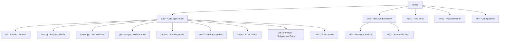
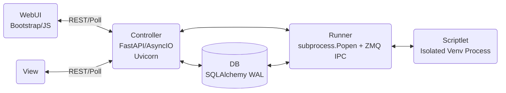
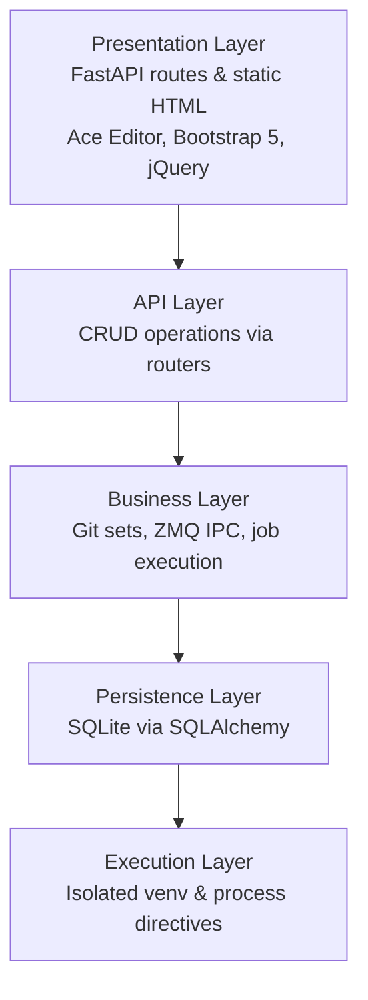
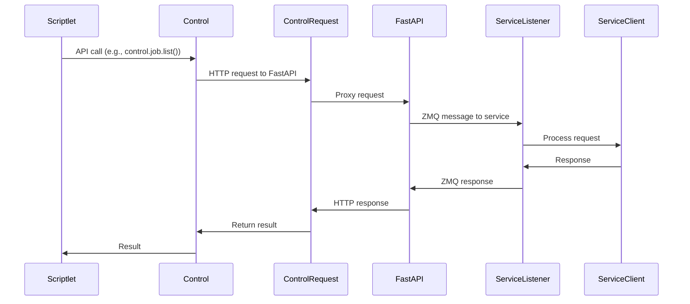
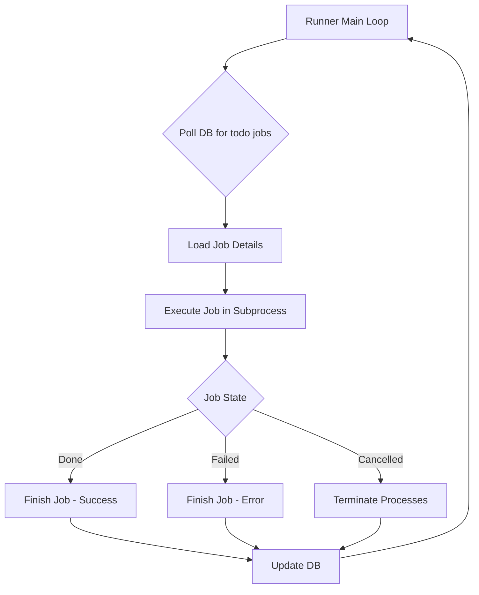
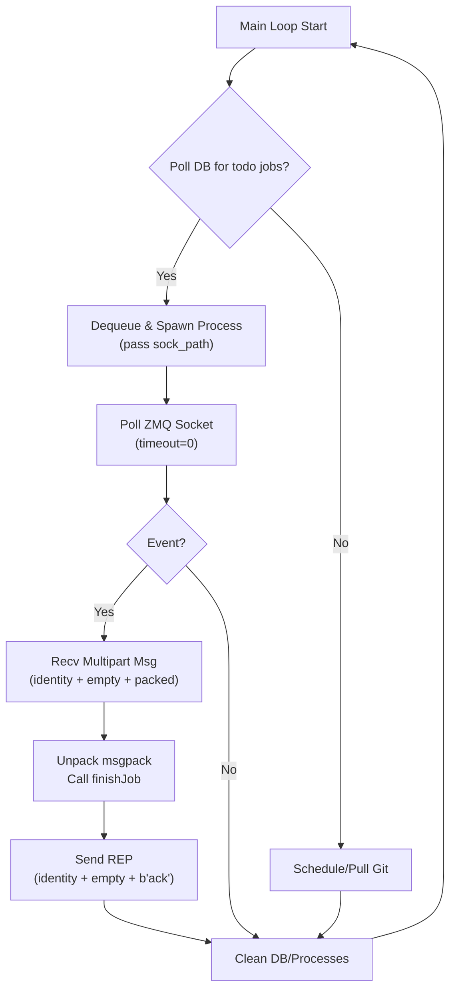
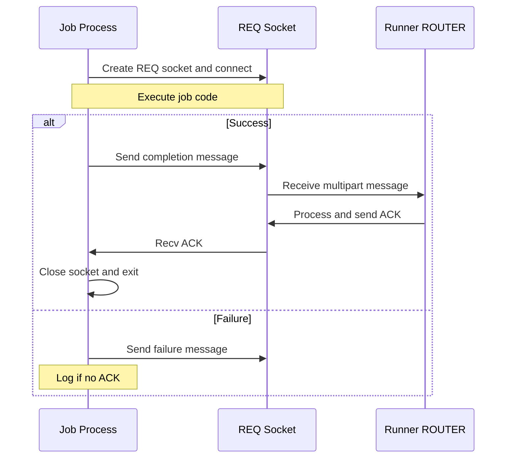
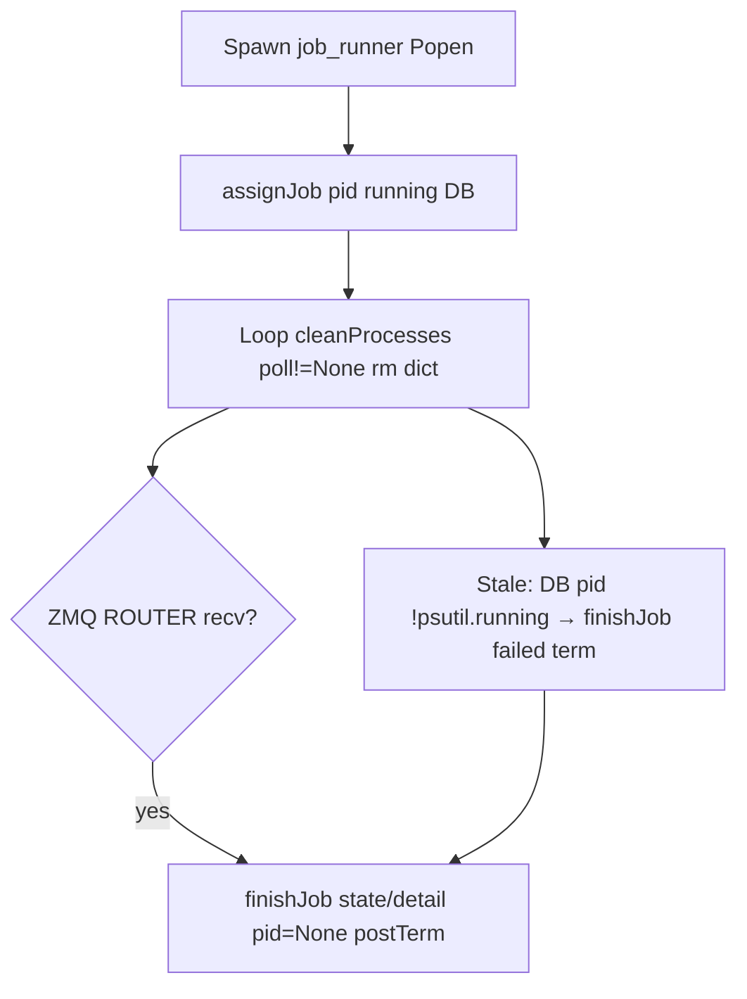
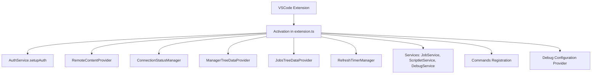

# PyOps Overview

PyOps is an "Execution Platform" for "Python Operations Scriptlets". It is licensed under GNU AGPLv3 and organized as a monorepo with core functionality in `app/`, a VSCode extension in `vsix/`, tests in `tests/`, and documentation in `docs/`.

## Monorepo Structure

The project is structured as follows:

## Architecture

### High-Level System Architecture

### Layers

The architecture is layered as follows:

### Layer Details

- **Presentation Layer**: FastAPI routes and static HTML with Ace Editor, Bootstrap 5, jQuery
- **API Layer**: CRUD operations via scriptlet routers
- **Business Layer**: Git sets, ZMQ IPC, job execution
- **Persistence Layer**: SQLite via SQLAlchemy
- **Execution Layer**: Isolated venv and process directives

### Technology Stack

- **Backend**: Python 3.12, FastAPI, SQLAlchemy 2.x, ZMQ, msgpack
- **Database**: SQLite (thread-safe)
- **Frontend**: Bootstrap 5, jQuery 3.6, Ace Editor, Material Icons

## Core Components

### Runner (`app/runner.py`)
- Daemon that polls DB for todo jobs using subprocess.Popen for isolated execution in per-set venvs.
- ZMQ IPC (ROUTER/REQ over /tmp/pyops/runner.sock) signals completion; json-serialized kwargs ensure config isolation.
- Process checks: p.poll() for liveness; psutil for tree-kill (SIGTERM → SIGKILL after 15s).
- Stale PID handling: After cleanProcesses, sync DB running jobs to 'failed' if !psutil.Process(pid).is_running().
- Job states: todo, dequeued, loading, running, done, failed, cancel, cancelling, cancelled, remove, removed.
- Debug mode: pyops doesn't inject a debugger. The client's `param` carries the bootstrap (debugpy / gdbserver / cuda-gdbserver / lldb-server / anything that speaks the wire its consumer understands). The runner only flips `running` after `exec(param)` returns. `kind=debug` keeps no timeout, no retry, and materialises sources under `.debug/src/<set>/{task,library}/<name>.py`.
- Test mode: peer of debug. `kind=test` materialises sources under `.test/src/<set>/{task,library}/<name>.py`, sets `__name__='__test__'` (so the same `*.task.py` can act as both production task and its own test suite), and exec's. Pyops is pytest-agnostic — invocation/coverage live in the `pyops::pytest` library or whatever the author imports.

### Web (`app/web.py`)
- Serves /controller/{set}/{name}, /menu, and static /files/

### PyOps (`app/lib/pyops.py`)
- Provides `Control` for API calls
- Provides `ServiceListener` for ZMQ service IPC

## Configuration

`app/lib/files.py` defines the Config class for managing `etc/pyops.json`. Both `app/gunicorn.py` and `app/runner.py` read the `PYOPS_CONFIG` environment variable to override the default config path, enabling isolated E2E test instances.

### JSON Structure

- `web`: `{"bind": "127.0.0.1:8000", "worker": 8, "timeout": 300}`
- `data`: `{"jobs": "data/jobs", "git": "data/git", "db": "data/app.db"}`
- `runner`: `{"venv": "data/venv", "pkg": "data/pkg", "git_pull_interval": 60, "drop_done_delay_seconds": 60}`
- `log`: `{"loglevel": "debug"}`
- `users`: per-owner table; pyops itself does not read any keys inside the owner objects.

### Access Methods

- `conf_data()`: Returns data section (jobs, git, db) with defaults merged from etc/pyops.json
- `conf_runner()`: Returns runner-specific config
- `conf_web()`: Returns web section (bind) with defaults
- `get(path)`: Serves static files
- `conf_log()`: Provides log config with file handlers
- `conf_users()`: Provides users section

### Features

- Supports dynamic reload on change
- Defaults: web bind "127.0.0.1:8000", jobs "data/jobs", no SSL
- No built-in auth; proxy recommended
- Log levels: debug, info, etc.

### IPC

### Controls

- **JobControl**: `list()`, `create()`, `get()`, `delete()`, `cancel()`, `download()`
- **ScheduleControl**: `list()`, `create()`, `get()`, `delete()`, `activate()`, `deactivate()`

### Service Components

- **ServiceListener**: Listens for messages, handles TERM signals, supports both synchronous and asynchronous messaging
- **ServiceClient**: Connects to running services
- **Control Class**: Wraps controls, proxies to `/controller/{set}/{name}/q`

### Database

- `database.py`: `get_db_path()`, `init_db()`, `get_db_engine()`, `destroy_db()`
- SQLite file-based DB, thread-safe WAL mode

## Execution

### Runner Daemon

`app/runner.py` implements background job executor with `GracefulKiller` for graceful shutdown on SIGINT/SIGTERM.

#### Main Loop

#### Job Execution

- `loadJob()`: Fetches from DB, returns owner, set, name, kind, param, code, overrides
- `run()`: Dispatches to `run_task_job`, `run_service_job`, `run_debug_job`, or `run_draft_job`; processes param, libs, code in subprocess with venv activation
- Handles directives: pip packages, git repos, libraries
- For debug: uses unstaged code (preview) or overrides (VSIX)
- Compiles with custom filenames for accurate stacktraces
- `finishJob()`: Sets state, end, detail, pid=None

#### Directive Processing

- `process_imports()`: Handles pip, git, library directives
- Installs pip -q, clones git repos to pkg/, pip installs -e, exec libs
- Uses committed code for libs
- `process_install_lines()`: Executes installs

#### Directive Logic

Distinguishes types by argument:
- git: contains '://' or starts with 'git@'
- pip: plain string not starting with '{' and not containing '::'
- library: starts with '{' or contains '::'

#### Post-Termination

- `postTerm()`: Updates state to cancelled if not done/failed, deletes if remove
- `terminate_job_processes()`: HTTP-cancel path — SIGTERM the tree, wait up to 15s, SIGKILL if still alive (runs in a daemon thread spawned by `finishJob`)
- `_shutdown_job_processes()`: shutdown path — synchronous; SIGTERMs all live trees, drains ZMQ completion ACKs during the wait so services can finish cleanly, uses `Popen.poll()` (not psutil) to reap zombies, SIGKILLs survivors, then sweeps any non-terminal rows to `cancelled` with detail "killed during shutdown" / "terminated during shutdown"

#### Shutdown Gate

- `lib_runner.SHUTDOWN_FLAG_PATH` (`/tmp/pyops/shutdown.flag`): created by `GracefulKiller.exit_gracefully`, removed on clean startup and exit
- `lib_runner.enqueue()` raises `ShutdownPending` when the flag is present — gunicorn-worker HTTP enqueues and `pyops::data` service callbacks refuse new work as soon as the runner has been signalled

#### Scheduling

- `schedule()`: enqueues from cron Schedules via croniter; also re-enqueues `PYOPS_ESSENTIAL_SERVICES` (currently the `pyops::data` service that backs `/controller/pyops/sets`) under the same `<3-failed` gating as services without a Schedule row

#### Subprocess Execution Isolation

Jobs executed via subprocess.Popen with set-specific venv Python interpreter for per-set isolation.

- **Benefits**: Prevents package conflicts, ensures clean execution context.
- **CLI Invocation**: job_runner.py accepts JSON-serialized kwargs via command-line for complex arg passing.
- **Process Management**: Polling uses p.poll() is None (alive), termination via Popen.terminate() with psutil tree-kill.
- **ZMQ IPC**: Works across subprocess boundaries.
- **Debug Handling**: `kind=debug` materialises sources under `.debug/src/`; the client's `param` brings the debugger.
- **Test Handling**: `kind=test` materialises sources under `.test/src/`, sets `__name__='__test__'`. Pyops doesn't invoke pytest; `pyops::pytest` does (or the author's own framework).
- **Testing**: Mocks use subprocess.Popen; maintains >90% coverage.

#### Runner IPC

The runner uses ZMQ ROUTER/REQ over IPC sockets for reliable job completion signaling from child processes, replacing multiprocessing.Queue.

##### Pattern

- **Socket**: Runner binds ROUTER to `/tmp/pyops/runner.sock`; children connect REQ.
- **Message Format**: `{"id": str, "state": str, "detail": str|None}` (msgpack-packed).
- **Protocol**: Child sends REQ (single frame), runner receives multipart (identity + empty + packed), processes `finishJob`, replies empty REP (identity + empty + b'ack').
- **Guarantees**: REQ/REP ensures delivery; no message loss like Queue.
- **Polling**: Integrated in main loop with `zmq.Poller` timeout=0 for non-blocking.
- **Cleanup**: `setsockopt(zmq.LINGER, 0)`; close on shutdown.

#### Runner Main Loop with ZMQ Polling

#### Child Completion Signaling

#### Process Lifecycle

- `app/runner.py` main: spawn `job_runner.py` → `assignJob(pid, "running")` → loop `cleanProcesses` (poll!=None → remove `Popen` dict).
- Completion: ZMQ `ROUTER/REQ` → `receive_and_process` → `finishJob(state/detail, pid=None)` → `postTerm` (remove/cancelled).
- Startup: `handleOddJobs` dequeued/running → todo/failed.
- Debug: Post-spawn adapter poll (5s timeout → fail if no).
- Stale PID Monitoring: Post-`cleanProcesses`, query DB `Job.pid` in former dict → if `!psutil.Process(pid).is_running()` → `finishJob("failed", "process termination pid={pid}")`. Ensures DB sync for silent deaths (e.g., segv).

## Web Interface

### FastAPI App

`app/web.py` creates FastAPI application mounting routers and static files.

#### Root Routes

- `root()`: Serves root.html
- `favicon()`: Serves favicon.ico
- `file(path)`: Serves static /files/{path}

#### Controller Proxy

- `controller(set, name)`: Renders UI via `get_controller_code` & `get_view_content`
- Injects {{SET}} {{NAME}} in views
- `controller_proxy()`: Handles HTTP methods to /controller/{set}/{name}/{rest:path}
- Sends ZMQ msg to service with type, path, query, body, data_type
- `menu()`: Lists controllers from Git

#### View Rendering

- `get_controller_code()`: Reads controller.py
- `get_view_content()`: Reads html views (head, menu, body)
- Dynamic UI with Bootstrap, Ace, jQuery
- Supports light/dark theme

#### Monitoring (`app/routers/monitoring.py`)

Top-level (not under `/scriptlet/`), unauthenticated, read-only.

- `GET /health` — JSON aggregated status (`ok` / `degraded` / `fail`); subsystem checks (database, runner socket, data dirs, ulimits, GPU); job/schedule/set summary; stuck-job indicators. HTTP 503 only when DB unreachable.
- `GET /health/failed` — JSON list of every job in `failed` state, full detail, no pagination.
- `GET /metrics` — Prometheus exposition (`text/plain; version=0.0.4`); per-state job counts, per-(set, name, state) breakdown, ulimit gauges, GPU status with dedicated `pyops_gpu_reboot_required` flag for driver/runtime mismatch.

Designed for Zabbix/Prometheus polling; see `docs/insights_app.md` § "Monitoring Router" for the GPU status taxonomy and ulimit threshold semantics.

## Testing

`tests/` uses pytest with >90% coverage.

### Structure

- `conftest.py`: Fixtures mock_conf, mock_db, mock_client, mock_git_dir, mock_git_ops, etc.
- unit/lib/: Tests lib_files, lib_git, lib_pyops, lib_runner_utils, lib_sites
- unit/orm/: Tests job, schedule
- integration/: Tests git, orm, routers, runner execution
- api/: Tests api_editor, api_endpoints, api_job, api_schedule
- e2e/: Playwright E2E tests against real server instances

### Fixtures-Mocks

- `mock_db`: Temp SQLite
- `mock_git_dir`: Mock sets/scriptlets
- `mock_git_ops(mock_git_dir)`: Temp FS ops via `mock_git_dir.tmp_path / repo` (repo="data/git/{set}" → `tmp_path/data/git/{set}/{name}.{ext}`).
  - Covers `write_content`, `read_content`, `get_controller_code`, `get_view_content`, `delete_file_unstaged`.
  - **Pitfall**: `Path(repo)` creates **real** `./data/git/{set}/` files (e.g., "test_set" tests → pollution; conflicts `testset/test_task.py` pytest collection despite `norecursedirs=data`).
- `mock_popen`: Subprocess.Popen mock with pid, poll(), terminate(), wait()
- `mock_zmq`: ZMQ Context/Socket mock for REQ/REP simulation (msgpack-packed messages, 3 retries on ZMQError)
- `mock_croniter`, `mock_jedi`, `mock_datetime`
- Overrides for controller_code, view_content, file_path

### E2E Tests

Playwright-based workflow tests in `tests/e2e/` that start a real PyOps server per test function. Each test gets isolated data directories via `PYOPS_CONFIG` env var pointing to `tmp_path`. Server runs in its own process group for clean shutdown.

- Skipped by default in `pytest tests/`; run via `pytest tests/e2e/` or `pytest tests/ --e2e`
- `ServerLog.assert_no_unexpected_errors()` scans server output for tracebacks and fatal errors
- CI runs in `test:e2e` GitLab stage with Playwright system deps and `E2E_STARTUP_TIMEOUT=60`

## VSIX Extension

The `vsix/` directory contains the VSCode extension for PyOps, providing a graphical interface for managing scriptlets and jobs.

### Architecture

### Core Components

- **`src/extension.ts`**: Main activation file that sets up the extension context and registers all providers and services.
- **`src/jobsTreeProvider.ts`**: Provides the `JobsTreeDataProvider` for displaying job states in the tree view.
- **`src/managerTreeProvider.ts`**: Provides the `ManagerTreeDataProvider` for managing scriptlets.
- **`src/utils.ts`**: Contains shared utility functions like `inferExt` and `hasValidConfig`.
- **`src/commands/CreateScriptletCommand.ts`**: Handles the logic for creating new scriptlets.

### Configuration

VSCode workspace settings set serverUrl, username, password (state), localPyopsDir, and autoRefreshInterval. Auth is optional (Basic if username/password set).

### Functionality

#### Auth Service

`src/services/AuthService.ts` handles authentication setup for Basic Auth:

- Prompts for password if username is configured but no password is stored.
- Stores password securely in workspace state.
- Unit tests in `tests/services/AuthService.test.ts`.

#### Refresh Timer Manager

`src/services/RefreshTimerManager.ts` manages auto-refresh timers for manager/jobs tree providers:

- Starts/stops timers based on config validity.
- Prevents duplicate timers.
- Unit tests in `tests/services/RefreshTimerManager.test.ts`.

#### Tree Providers

- **ManagerTreeDataProvider** fetches scriptlets via API, downloads to local `.pyops/{set}/`, supports create/upload/save/diff/reset/delete/debug, has unit tests in `tests/managerTreeProvider.test.ts`.
- **JobsTreeDataProvider** lists jobs by state, supports bulk cancel/delete & refresh.

#### Content Provider

RemoteContentProvider serves remote files; onDidChange events.

#### Services

- JobService, ScriptletService, DebugService, etc.

#### Commands

- Registration and execution.

### Testing

#### VSIX Tests

- **Unit tests** in `tests/` use Jest with mocked vscode APIs & API client.
- **Integration tests** in `tests/integration/` use @vscode/test-electron for real VS Code environment with simple assert-based testing.
- Integration tests run against separately started localhost PyOps development server without authentication.
- PyOps server must be started externally before running integration tests (not managed by test framework).
- Run unit tests with `npm run test` or `npm run test:coverage`.
- Run integration tests with `npm run test:integration` (requires running local development PyOps server on localhost:8000).
- Integration tests excluded from CI/CD since VS Code not available.
- Infrastructure set up with simple console-based test runner that works in VS Code extension host.
- Tests verify extension activation, configuration (server URL only), views, and command registration.
- No authentication testing in integration tests (development server runs without auth).

## Key Features

- Scriptlets support types: task, service, schedule, controller, view, library, markdown, jslibrary, data
- Support directives for pip packages, git repos, libraries
- Scheduling via croniter
- Monitoring and bulk operations
- VSIX trees for manager and jobs

## Deployment

### Development Server

`run.sh` starts development server using Gunicorn and Uvicorn

### Docker Support

Containerized deployment with Nginx reverse proxy

For detailed insights into specific components, configurations, and implementations, refer to the insights documentation and LLM context.
